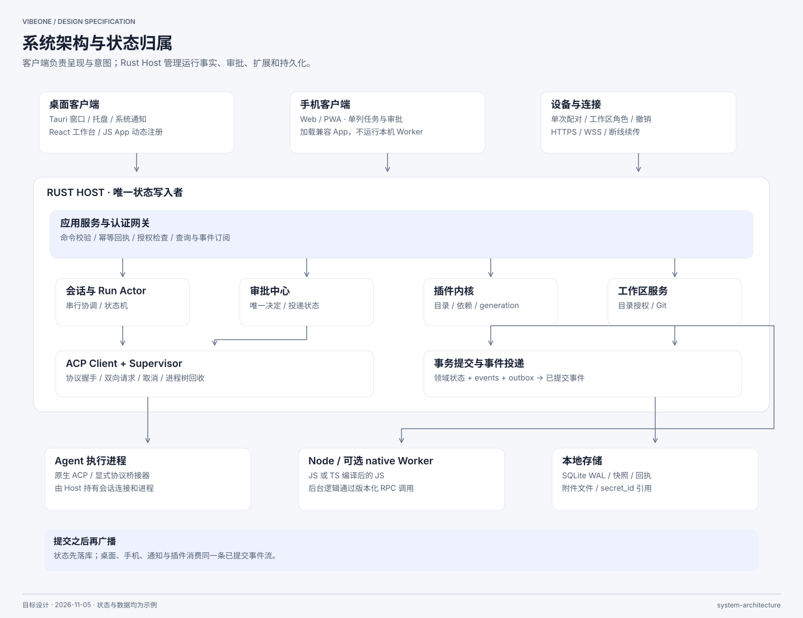

# VibeOne 架构设计

版本：0.3 · 2026-11-05。本文描述目标架构，功能尚未实现。插件运行后端与公共接口在原型验收后冻结。

## 1. 定位与范围

VibeOne 是本地优先、可远程控制、以 ACP 为主要接入协议的 Agent 工作台。用户在电脑上运行现有 Coding Agent，通过桌面或手机查看进展、发送指令、取消任务、审批工具请求和查看代码变更。

建议的第一版：Tauri 2 + React 桌面客户端、独立 Rust Host、手机 Web/PWA 客户端、JS 动态插件与可选原生 Worker。Agent 继续使用自身模型、认证与执行逻辑。

后端与插件管理内核采用 Rust；普通插件使用 JS，也允许 TS 开发后编译成 JS。App 插件通过版本化 SDK 动态注册 React 面板、命令、Hook 和服务，后台逻辑运行在 Host 管理的 Node.js Worker 中。声明式资源作为便捷入口保留；Rust 等原生 Worker 是可选扩展，运行时不直接执行 TS。

第一版聚焦单用户、多设备、单执行主机；允许多个 Agent 会话。预留多主机身份，不立即实现分布式调度。手机端先完成控制与审批，不在手机本地运行 Coding CLI。

## 2. 总体结构



图中连线表示主要调用或状态提交，事件在提交后异步广播。Agent 与插件进程由 Host 管理；桌面关闭窗口不会改变状态归属。

三套协议分别版本化：

| 边界 | 协议 | 负责内容 |
| --- | --- | --- |
| UI ↔ Host | VibeOne API v1，HTTP + WS；本地可桥接 IPC | 业务命令、查询、订阅、设备授权 |
| Host ↔ Agent | ACP，MVP 锁定稳定 v1 | 会话、消息、工具、审批、取消、能力协商 |
| Host ↔ 插件 | VibeOne Plugin RPC v1，stdio JSON-RPC | 激活、扩展注册、业务调用、订阅、卸载 |

不要把内部领域模型直接等同于 ACP 数据结构；保留映射层和可选原始诊断数据。ACP 新版本、新字段或厂商扩展不应迫使 UI 和数据库一起迁移。

## 3. Host 与桌面生命周期

- `vibeone-host` 是唯一运行时状态写入者，管理数据库、Agent、插件、审批与网络。
- Tauri 只负责窗口、托盘、系统通知、更新、选择目录、Host 发现与启动。
- 默认关闭窗口保留托盘与 Host；显式“退出并停止任务”走受控停止流程。
- “后台持续运行”作为单独运行模式，使用平台服务管理器托管 Host；不能假定普通 sidecar 在父进程退出后会自动存活。
- 同一用户的数据目录只允许一个 Host 写入：锁文件、实例 ID、认证后的健康检查；支持新桌面窗口重新连接。
- Headless 使用同一个 Host binary，不引入 Tauri/WebView/GTK 依赖。
- Host 更新先阻止新 Run、排空或终止现有 Run，再迁移与替换；首版不承诺无损热升级。

首版桌面与手机共用 HTTP 命令/查询与 WS 事件客户端：桌面访问仅监听 loopback 的 HTTP/WS，手机通过可信 HTTPS/WSS 入口访问同一逻辑网关。Tauri IPC 只承担目录选择、托盘、系统通知和 Host 生命周期等本机能力，不额外代理全部业务请求。未来如有需要，可为本地连接增加 UDS / Windows named pipe 适配。随机本地连接密钥经受限权限通道交付；即使 loopback 也认证和校验 Origin。

## 4. 领域对象与状态

| 对象 | 含义 |
| --- | --- |
| Host | 一台执行主机，包含 host_id 和本次启动 epoch |
| Workspace | 获准访问的仓库/目录及工作区策略 |
| Task | 用户目标，可有多个执行尝试；MVP 可先弱化 |
| Session | 某个 Agent 的会话，记录上游 session_id 和配置 |
| Run | 一次用户触发的执行，绑定 session、provider 与插件版本 |
| ToolCall | Agent 报告的工具调用及内容块 |
| ApprovalRequest | 绑定某次连接与调用的审批请求 |
| Device | 已配对设备及工作区级角色 |
| Artifact | diff、日志、附件等带访问范围的大对象 |
| PluginInstance | 已安装插件的某个作用域实例 |

Session、Run、连接状态分别建模：

```text
Session: available | archived | recovery_required
Run: queued → starting → running
     running → cancelling → cancelled
     running → completed | failed | interrupted
Connection: connecting | ready | disconnected | closed
```

Run 可有多个同时待批或待回答请求；执行阶段、待办计数和连接状态分别记录。`waiting_approval` 是活动 Run 存在待批请求时派生的展示状态，不另建一套互斥执行状态。UI 的取消是异步操作；若结束结果先到，保留实际终态，不把已完成执行改成 cancelled。

同一 Session 同时只允许一个活动 Run。忙碌时接受的新输入作为 QueuedMessage 保存，上一轮正常结束且授权、工作区资源可用后再提升为新 Run。失败、取消、中断或投递状态不确定时暂停后续队列，由用户显式恢复。Session 固定工作区与 Agent Profile；切换 Agent 创建新会话。具体行为见 [主要功能设计](core-functions.md)。

每个活动会话由 Actor 串行处理 prompt、cancel、审批和更新，避免并发修改状态；每个 Agent 的并发上限与多会话进程复用能力由 Provider 声明。首版默认一会话一进程，随后按实测优化。

## 5. ACP 接入

采用官方 Rust SDK，并将版本变化限制在 `acp-client` 模块。先支持 ACP v1；v2 在独立 feature 与一致性测试通过后加入。

标准流程：启动进程 → initialize/能力协商 → 必要认证 → new/load → prompt → 更新/权限请求 → prompt 结果。v1 以 prompt 响应表达该轮结束；不能套用 v2 的异步接受语义。

必须处理：

- stdin/stdout 专用于协议，stderr 单独收集、限额并脱敏。
- cwd、参数数组、最小环境继承、可执行文件来源与版本；不把用户输入拼成 shell 命令。
- JSON-RPC 双向调用：等待 prompt 时仍能处理权限、文件和终端请求。
- 协议帧大小、无效 JSON、流量上限、请求超时和背压。
- 区分无输出、等待人工、模型长任务及进程失联；不能仅因暂时没 token 就杀进程。
- 正常取消、宽限期、进程组/Job Object 清理、子孙进程回收。
- 可选 fs/terminal 能力只在 Host 真正实现并授权时发布。
- 上游 load/resume 不可用时，只恢复本地历史展示，不假装执行已恢复。
- 接入 MCP/Skills 等配置只在工具支持时做投射，不能承诺所有 Agent 等价支持。

每个 Provider 返回细粒度 `CapabilitySet`：结构化流、交互审批、取消、会话加载、模型选择、模式切换、用量、文件 diff、MCP 配置等，附来源和限制。未知用量显示未知，不填 0。

接入分级：原生 ACP → 原生结构化协议的 ACP 桥接器 → 只读历史导入 → 终端兼容。后两类不标为完整可远程审批；终端文字解析不作为可靠权限拦截。

新工具若只是启动命令不同，用声明式 Provider；确需协议翻译时才写插件或桥接器。首批验证两个真实工具，允许均通过 ACP 适配器连接，不以原生接入为硬性门槛；兼容性以锁定版本的实际验证结果为准。

## 6. 插件机制

插件包格式、作者示例和验收场景统一见 [插件机制设计](plugin-design.md)。以下定义架构归属，不维护第二套 Manifest 或 SDK 字段示例。

### 6.1 三个执行环境

| 环境 | 实现与执行 | 职责 |
| --- | --- | --- |
| Host 可信内核 | Rust | 包管理、目录、设备鉴权、会话调度、审批提交、事务 |
| 客户端插件 Host | 浏览器 JS / React | 动态加载 App ESM，注册面板、命令、Hook 与服务 |
| 后台 Worker | Node.js ESM，或可选 native 可执行程序 | 本地业务、通知、自定义探测与宿主 RPC |

作者可以直接写 JS，或将 TS/TSX/JSX 构建为 JS；发布产物不依赖用户机器上的 TS 编译器。SDK 提供 JS 运行时导出和类型声明。React、React DOM 与前端 SDK 通过宿主版本化模块映射共享，避免插件引入另一份 React。

Node 插件可按逻辑实例共享 Host 管理的 Node 进程，native Worker 使用独立进程。共享运行进程的崩溃会影响多个实例，不能声称每插件都有独立进程级故障隔离。

### 6.2 注册、消费与动态更新

Manifest 统一为 `plugin.json`，显式声明入口、依赖和贡献标识。贡献可绑定声明资源、App 注册或 Worker handler。Host 按 kind 调用，不识别具体插件 ID。未知 kind 或不匹配的必需 handler 拒绝激活。

App 模块导出 `activate(ctx)`，通过 Registry 注册界面、命令、Hook 与服务。Scope 追踪 disposer、订阅和后台任务，停用时删除注册并清理资源；异步激活的迟到注册不能复活已停止实例。

升级先准备后端候选，原子发布 Host 贡献目录；每个客户端再独立准备和替换 App 注册。两者不是一个跨设备原子事务，客户端激活失败要可见。候选失败保留原可用版本，任意外部副作用不承诺回滚。

已有会话以 Provider Lease 固定旧代，其后续 Run 沿用旧代，直到显式关闭或经过验证的迁移。新会话使用新版本。普通 App、短 RPC 和长会话分别制定排空策略。

### 6.3 扩展点与语言边界

首版支持 `agent.provider`、`notification.sink` 和 `app.panel / app.command / app.settings / app.slot`；前端 SDK 同时提供 Hook、服务和 Scope。上下文来源、历史导入、工作区供给、受限审批策略和工作流扩展后续加入。

声明式设置表单与代码型 React 面板并存。JS App 不是任意替换 Host 内部函数的入口；设备鉴权、审批最终提交和数据库事务仍由可信内核持有。未来审批策略扩展不能因异常或超时变成批准。

### 6.4 协议与可信边界

App SDK 注册、Plugin RPC 和 ACP 是不同通道。插件控制 stdout 不承载 Agent 流量；Worker 返回受校验的启动描述，Host 监督模块独立启动 Agent 或桥接程序。

Plugin RPC 传输序列化 DTO，不跨动态库传递 Rust trait object。原生 Worker 可实现同一协议；Rust dylib 不作为首版插件加载方式，WASM 留待单独验证。

App 与宿主前端同环境运行，Node/native 代码也属于用户信任的代码，不能把 SDK、Scope 或进程管理称为恶意代码沙箱。Host 仍校验真实设备、工作区范围和操作契约；前端自报 plugin ID 不构成安全身份。后台连接由 Host 与实际实例和代次绑定。

手机只加载兼容的浏览器 App 产物，不运行 Host 的 Node/native Worker。不兼容的插件表面明确降级；后台处理始终在拥有工作区的 Host 上执行。

## 7. 手机远程控制

### 7.1 连接与配对

首版：手机响应式 Web/PWA；桌面与手机共享 DTO、事件 reducer、部分 React 组件，分别做布局。手机默认页面为主机状态、会话列表、运行时间线、审批收件箱、diff 与输入框。

桌面创建短时单次配对码，二维码只带 Host 地址和 bootstrap code；手机通过已验证的 HTTPS 连接兑换设备凭证，桌面展示新设备并确认本次配对。bootstrap code 不是长期 API token；兑换后失效并清理 URL。不能只扫描未知证书链接就建立信任。

设备角色：viewer、operator、approver、owner；可按 workspace 授权。远程默认不授予任意目录读写或通用终端。刷新凭证、设备撤销、Origin 白名单、WebSocket 鉴权与速率限制由内核实现。Web 端优先 Secure/HttpOnly cookie 加 CSRF 防护，不在 URL/localStorage 长期保存 bearer token。

网络分阶段：

1. loopback 桌面闭环；测试用 LAN 可调试，但正式手机/PWA 使用 HTTPS/WSS。
2. 用户现有 VPN/私网连接或带有效证书的自托管入口；配对和设备授权仍然必须。
3. 再实现自托管 Relay：Host 主动出站连接，避免要求公网开放主机端口。

Relay 分发与端到端信任需独立评审：普通 TLS 中继可能读到内容；如承诺中继不可读，必须设计设备密钥、双向身份验证和应用层加密，不能将其当作 WSS 自动提供的功能。

### 7.2 审批闭环

审批由 Host 持有上游等待句柄，UI 只提交决定：

```text
Agent 请求权限
→ Host 生成 approval_id，绑定 host_epoch / connection_epoch / run / tool_call
→ 事务保存 Pending + 事件 + 通知 Outbox
→ 桌面/手机获取原始选项及动作上下文
→ 用户提交 option_id、expected_version、idempotency_key
→ Host 重新校验设备、权限、请求状态与上游连接
→ CAS 原子提交唯一决定，写审计与投递状态
→ 返回上游 permission response
→ 广播最终可观察状态
```

状态区分 `pending / decision_recorded / response_sent / expired / invalidated / delivery_unknown`。没有上游确认语义时，`response_sent` 只表示本地写入成功，不代表工具已执行。

- 同时手机批准与桌面拒绝：第一个成功的原子提交获胜，后一个返回冲突及当前状态。
- 使用 Agent 给出的 option_id 与语义；“始终允许”只有上游提供相应选项并且用户明确选择时才能传递，不由 UI 伪造。
- 展示已知的工具、命令、路径、diff、来源和范围；缺少内容明确标未知，不由模型编造摘要代替原始动作。
- 断网不自动批准；到期或取消按可用协议选项拒绝/取消，并让 Run 状态一致。Agent 已自行超时则将请求失效。
- Host 崩溃后旧 stdio 的等待句柄已不存在，旧 pending 请求不能跨 epoch 重放。历史决定可保留审计，但不能静默应用到新调用。
- 数据库决定提交后、响应写出前崩溃存在不确定窗口：记录 delivery_unknown，重新建立会话后要求新请求；不承诺跨崩溃 exactly-once 执行。

授权审批与用户补充信息是不同实体。Agent 的问答/选择需求可复用收件箱外观，但不要借用工具允许选项来提交普通回答。

### 7.3 同步、断线与后台

手机重连携带事件游标；Host 返回增量，游标过期则返回新快照及其 high-water mark，再衔接事件。客户端按 event_id 去重并检测缺口。

浏览器进后台后 WebSocket 可能暂停。PWA 推送作为增强能力，按系统/浏览器实际支持验证；不能将常驻 WS 作为锁屏通知方案。通知默认只含状态与不透明 ID，用户打开后在线读取审批详情，推送不直接执行批准。通知 outbox 重试按 event_id 去重。

主机休眠、断电或 Host 停止时，手机显示离线和最后同步时间；控制指令默认不离线排队执行，审批必须在线校验。

## 8. 持久化与事件

推荐 SQLite WAL 存领域记录与追加事件，附件放本地文件并记录授权元数据；避免维护两套平级事实源。

```text
workspaces / agent_profiles / sessions / queued_messages / runs / tool_calls
approvals / approval_decisions / devices / device_grants
plugins / plugin_instances / plugin_grants / plugin_operations
events / snapshots / outbox / command_receipts / artifacts
```

事件信封包含 `event_id, host_id, seq, aggregate_id, aggregate_version, type, schema_version, occurred_at, correlation_id, payload`。seq 为 Host 内部持久化递增游标，客户端只能查询自己获准的事件；多主机不假设全局顺序。

命令携带 request_id/idempotency_key、目标及 expected_version；身份来自已认证会话，不能信任客户端提交的 actor_id。Host 为关键命令保存结果回执，避免移动网络重试重复创建 Run。

领域状态、事件、通知 outbox 同事务提交。WS、插件和通知消费提交后的事件，不能因订阅者慢而阻塞审批。慢客户端超限断开后重新补流，不静默丢审批事件。

文本 delta 按短窗口合并持久化与传输，状态事件立即提交；明确窗口内尾部文本可能在崩溃时丢失，不能夸称逐 token 无损。日志与历史设置保留期、容量上限、分页和清理。快照需包含 reducer/schema 版本；原始协议日志默认关闭，可选记录时脱敏与限额。

密钥使用系统凭据存储；headless 使用显式配置的 secret backend。数据库仅引用 secret_id。Agent 原有登录由其现有认证机制管理，不复制令牌到手机。

## 9. Workspace 与并行任务

Workspace 根目录需显式授权；Host 文件 API 校验路径规范化、符号链接及越界访问，平台行为纳入测试。该约束只覆盖经 Host 的访问，Agent 直接执行 shell 时还需要 Agent 自身或 OS 沙箱。

同工作目录默认只允许一个具有写权限的 Run。并行写任务使用独立 Worktree/分支；共享 Git 索引/引用操作加仓库级锁。Worktree 隔离不包含数据库、网络服务和构建端口，任务仍需独立配置。

完成后显示 diff，由用户明确提交/合并。首版不自动 rebase、丢弃未提交变更或清理脏 Worktree；清理时检查 Agent 子进程和后台任务。

## 10. 技术与目录

技术建议：Rust + Tokio、Axum、Serde、SQLite/SQLx、tracing；React + Vite、路由、虚拟化时间线及小型客户端状态层。先用系统 Git 命令与参数数组实现 Worktree，后续按需求评估 libgit2。具体版本在 P0/P1 验证后锁定。

```text
apps/
  desktop/                 # Tauri 壳与桌面入口
  web/                     # 手机 Web/PWA 入口
crates/
  domain/                  # 领域类型、状态机，不依赖 Tauri
  application/             # 用例、鉴权、命令协调
  host/                    # binary、启动、实例锁、生命周期
  transport/               # 本地/HTTP/WS、配对、API
  storage/                 # SQLite、迁移、快照、outbox
  acp-client/              # ACP SDK 适配与进程监督
  plugin-api/              # DTO、Schema、协议版本
  plugin-host/             # 加载、依赖、scope、RPC
  plugin-native-sdk/       # 后续可选原生 Worker SDK
  workspace/               # Git、Worktree、文件边界
packages/
  client/                  # 生成契约、连接、事件 reducer
  plugin-sdk/              # JS App / Worker SDK 与 .d.ts
  plugin-tools/            # JS/TS 构建、校验与本地联调
  ui/                      # 共享 React 组件、插件插槽与声明式表单 renderer
plugins/
  generic-acp/              # 内置 Provider
  local-notification/       # 内置通知实现
  example-plugin/           # JS/TS 源码与构建后的 App / Worker
docs/
```

这是目标边界，初期可合并 crates 减少构建复杂度；必须保留 domain、Tauri 壳、ACP 和插件协议的依赖方向。共享客户端类型从 Rust/JSON Schema 生成，避免手工维护两套 DTO。

## 11. UI 与客户端状态边界

桌面采用项目导航、会话列表、主时间线、上下文检查区四个区域；手机采用主机、会话、审批、设置四个底部入口，详情页使用单列布局。两端共享业务 DTO、事件投影、兼容的 App 扩展与声明式组件语义，不共享桌面布局。

运行状态、连接状态、待审批数分别显示。未连接时保留最后可信快照，标记最后同步时间，禁用会改变主机状态的动作。按钮点击先进入提交中，收到 Host 回执后才更新为已提交；审批完成不代表工具执行成功。

UI 规范与页面草图见 [UI 与交互设计](ui-specification.md)，接口及异常处理见 [功能实现设计](functional-implementation.md)。

## 12. 关键决策

1. 独立 Host 优先，桌面不拥有 Agent 生命周期。
2. ACP 优先，能力差异可见；专有桥接是显式维护成本。
3. JS 动态插件优先，允许 TS 编译为 JS；代码型 UI 与声明资源并存，Node Worker 为默认后台，可选原生 Worker，WASM 后置。
4. 扩展契约、依赖与生命周期显式管理，保留最小可信内核。
5. 手机 Web/PWA 首发，先私网再中继，再考虑原生壳。
6. SQLite 事务和事件游标支撑审批、重连与审计。
7. 以会话控制与审批闭环验证架构，再扩展任务编排。

实施顺序与阶段验收见 [实施计划](implementation-plan.md)。
