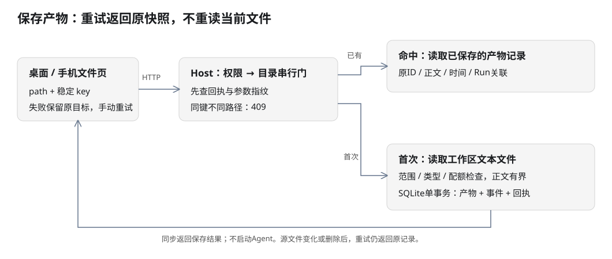

# 产物保存与原始快照对账

文本产物是用户主动保存的工作区文件快照，保留采集时的内容与执行关联，不代表文件一定由Agent生成。第一次成功保存后，同一次请求的重试始终返回原产物；文件后来修改、删除，或者会话出现新Run，都不会改变原快照。

首次保存关联最近一次有 `startedAt` 开始记录的Run（执行），跳过尚未开始或已撤回的排队项。没有可确认的开始记录时 `runId` 为null；重试保持原关联，不重新归属，也不改写旧产物的历史关联。

## 接口与首次保存

`POST /v1/sessions/{id}/artifacts` 接收 `path` 和可选幂等键 `key`，成功响应保持原字段：`id/sessionId/runId/path/content/createdAt/source`。请求与成功响应由实际Rust结构生成共享契约，客户端使用 `captureArtifact` 构造命令。

key按会话隔离，须为1至128字节。同key同路径返回第一次成功保存的产物身份、内容、时间和Run关联；同key不同路径返回409 `IDEMPOTENCY_CONFLICT`。路径使用请求的原始相对字符串比较，不把不同路径拼写自动合并。未提供key或为null时兼容旧行为，每次调用都保存新的快照；不同key也表示新的采集意图。

Host先验证设备的工作区操作权限，再进入目录串行门查回执。命中回执直接读取已保存的产物，不访问源文件、不重复检查新增配额，也不启动Agent。首次请求才检查总量上限、工作区范围和普通文本文件约束，从工作区读取至多256KiB正文。超过上限时在UTF-8边界截断，保留文件大小与 `truncated` 标记；二进制文件仍拒绝保存为文本产物。

## 原子保存与恢复

产物记录、变更事件和私有回执在一个SQLite事务内提交，成功后才发布到内存；失败不发布假产物或成功回执。第一次未成功提交时，没有可供重取的原快照。已成功回执仅保存参数指纹与产物ID，不复制一份正文，快照正文由产物记录持久保存。

Host重启后可以用原请求对账，即使源文件已不存在或当前产物数量达到256个上限，也能返回原记录。历史记录缺失或身份无效时明确报错，不以当前文件重新生成一个冒充原记录的快照。当前没有自动清理历史产物的行为。

查询列表仍通过原 `GET /v1/sessions/{id}/artifacts` 返回。保存与查询继续受Host的会话/工作区授权保护；持有key不增加权限。新能力标识为 `artifactCaptureIdempotency`，旧Host保持原调用兼容，不具备新回执保证。

## 正式界面

文件页显示保存中的状态、成功提示和独立的失败提示。未知结果保留原路径与key，用户点击「重试保存产物」才对账，不自动重放。切换文件、关闭预览、切到其他右侧面板再返回，都不会把重试目标改成当前预览文件。

请求身份由当前会话界面持有；切换会话或刷新页面后，不保证恢复本机未确认提示。未确认期间暂停新的保存入口，避免新路径覆盖待对账身份；可重试原请求，或关闭提示后发起新采集。「关闭提示」结束本次本机提示，不撤销服务端已接受的保存。一次成功后再次点击保存是新的采集意图。

成功提示明确显示实际保存的路径，截断时也明确提示。桌面保持紧凑亮暗样式，手机保存、重试和关闭提示按钮的触摸高度至少44px。

## 验证

- 真实Host：并发同key只有一个产物；源文件修改/删除、出现新Run及Host重启后仍返回原ID和原内容；无key兼容、不同内容冲突和变更事件不重复。
- 状态测试：配额满且源文件已删除时仍可重取原产物，新采集继续受配额限制。
- 实际SQLite：回执写入故障使产物与事件完整回滚，成功事务重新打开数据库后两类记录一起存在。
- 桌面：主动丢弃真实成功响应，修改源文件、切换文件和面板后同key重试；产物面板显示原正文。
- HTTPS手机：成功后删除源文件并丢弃响应，关闭预览后同key重取原快照；检查实际触摸高度和设备权限。
