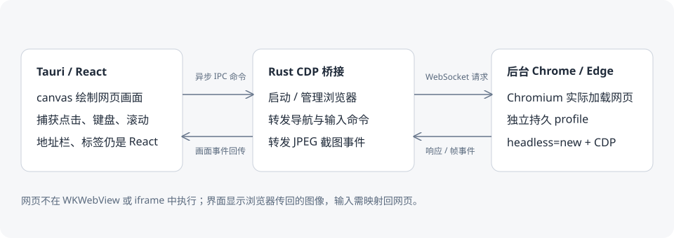

# Atrium 桌面网页浏览源码调查

调查日期：2026-11-07。只读检查上游 `main` 的固定提交 [`b5274a952a781ce545f4a4db59c493a8189a3797`](https://github.com/met0n/atrium/tree/b5274a952a781ce545f4a4db59c493a8189a3797)（提交时间 2026-11-06T19:43:53Z）。下载源码到临时目录，未运行 Atrium、安装依赖或访问个人浏览数据。VibeOne 对照基线为本地提交 `52c4b0a76f51cabd8817158e37fbcd436a67ff6b` 的 `apps/desktop/src-tauri/src/browser.rs`。

## 核心结论

Atrium 提供两条路径，不能将其统称为“在 Tauri 中原生嵌入 Chromium”：

- 默认 `native`：Tauri 原生子 Webview，配置 `incognito: true`。这条路径没有替换 Tauri 的系统网页内核。
- 可切换的 `cdp`：启动本机安装的 Chromium 系浏览器，无头运行；经 CDP（Chrome DevTools Protocol，Chrome 开发者工具协议）投送 JPEG 帧到 React `canvas`，鼠标键盘反向发送 CDP 命令。它是可交互画面流，不是 Chromium 原生子窗口，也不是把目标网页 DOM 放入 iframe。

模式选择和默认值直接见 [`WebPane/index.tsx:43–44,138–146,194–214`](https://github.com/met0n/atrium/blob/b5274a952a781ce545f4a4db59c493a8189a3797/src/components/WebPane/index.tsx#L43-L44)；原生创建配置见 [`PrivateBrowserSurface.tsx:146–169`](https://github.com/met0n/atrium/blob/b5274a952a781ce545f4a4db59c493a8189a3797/src/components/WebPane/PrivateBrowserSurface.tsx#L146-L169)；帧流生产见 [`browser_pane.rs:341–395`](https://github.com/met0n/atrium/blob/b5274a952a781ce545f4a4db59c493a8189a3797/src-tauri/src/browser_pane.rs#L341-L395)，消费见 [`CdpBrowserSurface.tsx:97–137`](https://github.com/met0n/atrium/blob/b5274a952a781ce545f4a4db59c493a8189a3797/src/components/WebPane/CdpBrowserSurface.tsx#L97-L137)。

## Chromium 从哪里来、如何启动

| 环节 | 当前源码行为 | 固定源码 |
| --- | --- | --- |
| 浏览器来源 | 查找已安装可执行文件；显式传路径则只检查存在。该启动路径不下载或捆绑 Chromium，也不使用 CEF | [`browser_session.rs:45–100`](https://github.com/met0n/atrium/blob/b5274a952a781ce545f4a4db59c493a8189a3797/src-tauri/src/browser_session.rs#L45-L100) |
| macOS 搜索 | `/Applications` 下 Google Chrome、Microsoft Edge、Chromium，依次取第一个存在者；不自动扫描 `~/Applications` 或 PATH | [同文件:63–70](https://github.com/met0n/atrium/blob/b5274a952a781ce545f4a4db59c493a8189a3797/src-tauri/src/browser_session.rs#L63-L70) |
| Windows 搜索 | `ProgramFiles`、`ProgramFiles(x86)`、`LOCALAPPDATA` 下的 Edge 与 Chrome，按源码顺序取存在者 | [同文件:45–61](https://github.com/met0n/atrium/blob/b5274a952a781ce545f4a4db59c493a8189a3797/src-tauri/src/browser_session.rs#L45-L61) |
| Unix 搜索 | `/usr/bin` 的 Chrome/Chromium/Edge 及 `/snap/bin/chromium` 固定候选 | [同文件:72–85](https://github.com/met0n/atrium/blob/b5274a952a781ce545f4a4db59c493a8189a3797/src-tauri/src/browser_session.rs#L72-L85) |
| 启动参数 | 随机空闲端口、`--remote-debugging-port`、独立 `--user-data-dir`、`--headless=new`、关闭首次启动/默认浏览器检查，初始 `about:blank`；没有在这组参数中伪装 UA | [同文件:103–133](https://github.com/met0n/atrium/blob/b5274a952a781ce545f4a4db59c493a8189a3797/src-tauri/src/browser_session.rs#L103-L133) |
| 进程管理 | 异步锁覆盖整个启动过程，复用存活进程；通过 `Command::spawn` 启动，标准输入输出错误置空；`/json/version` 最多等待 20 秒，就绪失败杀进程 | [同文件:135–241](https://github.com/met0n/atrium/blob/b5274a952a781ce545f4a4db59c493a8189a3797/src-tauri/src/browser_session.rs#L135-L241) |
| CDP 连接 | HTTP `/json/version` 读取 `webSocketDebuggerUrl`，Rust `tokio-tungstenite` 建立 WebSocket；以请求 ID 匹配响应，20 秒调用超时；`Target.attachToTarget(flatten: true)` 在一条连接复用多个页面 session | [`cdp.rs:18,128–263`](https://github.com/met0n/atrium/blob/b5274a952a781ce545f4a4db59c493a8189a3797/src-tauri/src/cdp.rs#L128-L263) |

这里的“Chromium”是架构类别；具体二进制可能是 Chrome 或 Edge，版本由用户安装的软件决定。独立的 Playwright MCP 模式另当别论：生成 `npx -y @playwright/mcp@latest` 配置，已有共享浏览器时添加 `--cdp-endpoint`，选择 dedicated 时由 Playwright 自行管理另一浏览器。这不是 Atrium 内置浏览器分发机制。[`browser_session.rs:313–373`](https://github.com/met0n/atrium/blob/b5274a952a781ce545f4a4db59c493a8189a3797/src-tauri/src/browser_session.rs#L313-L373)

## 显示、输入和导航

CDP 路径为：本机无头浏览器 → `Page.startScreencast` → Rust 接收 `Page.screencastFrame` → Tauri `browser-cdp://frame/{pane_id}` 事件 → 前端 base64 解码、`createImageBitmap`、`canvas.drawImage`。编码为 JPEG、质量 60、`everyNthFrame: 1`，最大画面尺寸跟随面板；Rust 回传 `Page.screencastFrameAck`。前端解码期间只保留最新待绘制帧，避免排队延迟。[`browser_pane.rs:113–158`](https://github.com/met0n/atrium/blob/b5274a952a781ce545f4a4db59c493a8189a3797/src-tauri/src/browser_pane.rs#L113-L158)、[同文件:262–329](https://github.com/met0n/atrium/blob/b5274a952a781ce545f4a4db59c493a8189a3797/src-tauri/src/browser_pane.rs#L262-L329)、[`CdpBrowserSurface.tsx:37–44,97–137`](https://github.com/met0n/atrium/blob/b5274a952a781ce545f4a4db59c493a8189a3797/src/components/WebPane/CdpBrowserSurface.tsx#L97-L137)

面板尺寸通过 `ResizeObserver` 防抖 180ms 同步，Rust 更新 `Emulation.setDeviceMetricsOverride` 并重启 screencast。隐藏时停止流、重新可见时启动流；打开或切换页面调用 `Page.bringToFront`。因此可以借用普通 DOM 的裁剪、叠层和拖动布局，但网页画面仍经历编码、IPC、解码，不能据此声称与原生视图有相同性能。[`CdpBrowserSurface.tsx:177–204`](https://github.com/met0n/atrium/blob/b5274a952a781ce545f4a4db59c493a8189a3797/src/components/WebPane/CdpBrowserSurface.tsx#L177-L204)、[`browser_pane.rs:332–339`](https://github.com/met0n/atrium/blob/b5274a952a781ce545f4a4db59c493a8189a3797/src-tauri/src/browser_pane.rs#L332-L339)、[同文件:608–665](https://github.com/met0n/atrium/blob/b5274a952a781ce545f4a4db59c493a8189a3797/src-tauri/src/browser_pane.rs#L608-L665)

鼠标点击、移动、滚轮映射为 `Input.dispatchMouseEvent`；坐标由 canvas 实际大小与帧 `deviceWidth/deviceHeight` 换算。键盘 `keydown/keyup` 映射 `Input.dispatchKeyEvent`，携带修饰键、虚拟键码及可打印文本；Escape 和部分应用快捷键留给宿主。它不是操作系统把完整原生输入直接交给 Chromium。[`CdpBrowserSurface.tsx:230–268,301–318`](https://github.com/met0n/atrium/blob/b5274a952a781ce545f4a4db59c493a8189a3797/src/components/WebPane/CdpBrowserSurface.tsx#L230-L268)、[`cdpInput.ts:32–114`](https://github.com/met0n/atrium/blob/b5274a952a781ce545f4a4db59c493a8189a3797/src/components/WebPane/cdpInput.ts#L32-L114)、[`browser_pane.rs:667–696`](https://github.com/met0n/atrium/blob/b5274a952a781ce545f4a4db59c493a8189a3797/src-tauri/src/browser_pane.rs#L667-L696)

后端具备 `Page.navigate`、忽略缓存的 `Page.reload`、`Page.getNavigationHistory` / `Page.navigateToHistoryEntry`；不能将“存在后端命令”直接写成“前端已提供完整地址栏、前进后退”。该组件实际展示配置 URL、刷新、引擎切换、外部打开和页面列表；`url` prop 变化触发 effect 清理和重新打开 target。[`browser_pane.rs:528–606`](https://github.com/met0n/atrium/blob/b5274a952a781ce545f4a4db59c493a8189a3797/src-tauri/src/browser_pane.rs#L528-L606)、[`WebPane/index.tsx:99–159`](https://github.com/met0n/atrium/blob/b5274a952a781ce545f4a4db59c493a8189a3797/src/components/WebPane/index.tsx#L99-L159)、[`CdpBrowserSurface.tsx:126–163`](https://github.com/met0n/atrium/blob/b5274a952a781ce545f4a4db59c493a8189a3797/src/components/WebPane/CdpBrowserSurface.tsx#L126-L163)

通过 `Target.setDiscoverTargets` 发现 Agent 创建/导航的页面，用户可观察已有 target；自己创建的 target 关闭面板时关闭，观察 Agent 的 target 时仅解绑。Playwright MCP 连接相同 endpoint，达到人与 Agent 操作同一个浏览器页面的效果。[`browser_pane.rs:234–329`](https://github.com/met0n/atrium/blob/b5274a952a781ce545f4a4db59c493a8189a3797/src-tauri/src/browser_pane.rs#L234-L329)、[同文件:398–429,473–525](https://github.com/met0n/atrium/blob/b5274a952a781ce545f4a4db59c493a8189a3797/src-tauri/src/browser_pane.rs#L398-L429)、[`browser_session.rs:339–365`](https://github.com/met0n/atrium/blob/b5274a952a781ce545f4a4db59c493a8189a3797/src-tauri/src/browser_session.rs#L339-L365)

## 持久会话与退出

CDP 浏览器 profile（浏览数据目录）为 `<app_local_data_dir>/profiles/<active_profile_id>/browser-session`，每次启动复用同一路径，而不是每页临时目录；粒度是当前 Atrium profile 下一个共享浏览器进程，所有面板 target 使用该浏览器目录，并非每个网页、项目或 Agent 单独隔离；启动参数没有 incognito。源码提供持久浏览数据的基础，隔离于日常 Chrome 的真实 profile。它不意味着自动继承用户 Chrome 登录，也没有在本次调查中实测 Cookie 跨重启、异常退出写盘或认证保持。[`paths.rs:6–17`](https://github.com/met0n/atrium/blob/b5274a952a781ce545f4a4db59c493a8189a3797/src-tauri/src/paths.rs#L6-L17)、[`browser_session.rs:115–128,200–229`](https://github.com/met0n/atrium/blob/b5274a952a781ce545f4a4db59c493a8189a3797/src-tauri/src/browser_session.rs#L200-L229)

默认 native 路径反而明确使用 `incognito: true`，因此不能把两种模式的会话语义混在一起，也不能仅根据 UI 的 private 提示认定 CDP 数据不会持久化。[`PrivateBrowserSurface.tsx:155–169`](https://github.com/met0n/atrium/blob/b5274a952a781ce545f4a4db59c493a8189a3797/src/components/WebPane/PrivateBrowserSurface.tsx#L155-L169)、[`WebPane/index.tsx:122–125,219`](https://github.com/met0n/atrium/blob/b5274a952a781ce545f4a4db59c493a8189a3797/src/components/WebPane/index.tsx#L122-L125)

正常退出在 `ExitRequested` 显式 kill 浏览器并等待；下次启动扫描进程，以浏览器名字加专用 profile 路径识别并杀掉遗留进程。实现不是保证所有异常退出自动清理；这一补救机制也说明不能只依赖普通子进程生命周期。[`lib.rs:659–663`](https://github.com/met0n/atrium/blob/b5274a952a781ce545f4a4db59c493a8189a3797/src-tauri/src/lib.rs#L659-L663)、[`browser_session.rs:155–160,244–285`](https://github.com/met0n/atrium/blob/b5274a952a781ce545f4a4db59c493a8189a3797/src-tauri/src/browser_session.rs#L244-L285)

## macOS、跨平台与适用边界

CDP 主链路没有使用 macOS 的 NSView 原生 Chromium 桥接。macOS 差异主要是浏览器搜索路径；同一 Rust WebSocket/CDP 和 React canvas 路径用于各桌面平台。因此它为 Tauri/macOS 提供的是“外部浏览引擎进程加应用内画面”的可借鉴方案。默认 native 路径仍走 Tauri 子 Webview；系统内核差异可参见 [Tauri 官方 Webview 文档](https://v2.tauri.app/reference/webview-versions/)（macOS WKWebView，Windows WebView2，Linux WebKitGTK）。[浏览器平台分支](https://github.com/met0n/atrium/blob/b5274a952a781ce545f4a4db59c493a8189a3797/src-tauri/src/browser_session.rs#L45-L100)、[CDP 客户端](https://github.com/met0n/atrium/blob/b5274a952a781ce545f4a4db59c493a8189a3797/src-tauri/src/cdp.rs#L128-L263)、[原生视图创建](https://github.com/met0n/atrium/blob/b5274a952a781ce545f4a4db59c493a8189a3797/src/components/WebPane/PrivateBrowserSurface.tsx#L146-L169)

限制应作为尚需验证的产品工作，而不是从“用 Chromium”推断已经解决：

- 需要用户安装兼容浏览器；固定位置查找与显式路径存在性检查不足以证明版本、权限或可执行格式兼容。[解析及启动](https://github.com/met0n/atrium/blob/b5274a952a781ce545f4a4db59c493a8189a3797/src-tauri/src/browser_session.rs#L87-L100)、[spawn](https://github.com/met0n/atrium/blob/b5274a952a781ce545f4a4db59c493a8189a3797/src-tauri/src/browser_session.rs#L200-L215)
- 画面只是 canvas；在所查输入链中没有看到 `onCompositionStart/Update/End` 或 `onPaste` 处理，也没有看到 IME composition（输入法组合文本）转发、剪贴板读写、文件上传选择器、下载 UI、拖放、浏览内容无障碍树或音频传输实现。不能仅靠 `keydown` 转发确认中文输入、复制粘贴、多媒体和浏览器原生交互完整可用；这不是对整个应用所有模块的否定。[完整 surface 事件绑定](https://github.com/met0n/atrium/blob/b5274a952a781ce545f4a4db59c493a8189a3797/src/components/WebPane/CdpBrowserSurface.tsx#L270-L330)、[键输入转换](https://github.com/met0n/atrium/blob/b5274a952a781ce545f4a4db59c493a8189a3797/src/components/WebPane/cdpInput.ts#L81-L114)
- 共享浏览器让人与 Agent 互相影响焦点、导航和页面；“能观察 target”不等于已具备协作仲裁。源码会主动 `Page.bringToFront`，因此多面板并行画面与交互仍需实测。[打开](https://github.com/met0n/atrium/blob/b5274a952a781ce545f4a4db59c493a8189a3797/src-tauri/src/browser_pane.rs#L332-L395)、[观察](https://github.com/met0n/atrium/blob/b5274a952a781ce545f4a4db59c493a8189a3797/src-tauri/src/browser_pane.rs#L473-L525)
- CDP 客户端缓存在 state 中；`ensure_client` 发现已有对象就复用，未在该函数中实现断线探活重连。帧事件泵的 `while let Ok(event) = events.recv()` 也会在错误时结束。浏览器崩溃、事件积压、断流恢复应专门验证。[缓存](https://github.com/met0n/atrium/blob/b5274a952a781ce545f4a4db59c493a8189a3797/src-tauri/src/browser_pane.rs#L234-L260)、[事件泵](https://github.com/met0n/atrium/blob/b5274a952a781ce545f4a4db59c493a8189a3797/src-tauri/src/browser_pane.rs#L262-L329)
- 本机 CDP HTTP endpoint 用于浏览器控制；独立 profile 和回环地址是现有机制，不代表完成了调试端口、权限边界与不可信网页的安全审计。[endpoint](https://github.com/met0n/atrium/blob/b5274a952a781ce545f4a4db59c493a8189a3797/src-tauri/src/browser_session.rs#L103-L133)

## 对 VibeOne 的具体启示

VibeOne 当前已通过 `WebviewBuilder::new(WebviewUrl::External(...))` 和 `main.add_child` 原生加载页面，`browser_layout` 同步尺寸和显隐；导航事件通过 Channel 回传，原生窗口系统接收网页输入。macOS 使用桌面 Safari 风格 UA，实际仍是 WKWebView，未启动 Chromium、建立 CDP 或绘制画面流。[本地 browser.rs](/Volumes/xiron/myself/rust_project/VibeOne/apps/desktop/src-tauri/src/browser.rs:101)

| 对比点 | VibeOne 当前 | Atrium CDP | 可借鉴内容 |
| --- | --- | --- | --- |
| 网页呈现 | 原生子 Webview，macOS WebKit | 外部 Chromium 系进程 → JPEG canvas | 保留 Tauri 主界面，单独增加 Chromium 画面模式；这是新增浏览实现，而非改 UA |
| 输入 | 原生网页视图接收 | DOM 事件 → CDP | 可复用坐标缩放与快捷键归属；输入法等须补齐验证 |
| 会话 | 本文件没有显式独立 profile 配置，不能推断与 Safari 共用登录 | 专用持久 user-data-dir | 明确用户配置、共享范围与清理策略 |
| Agent 同页操作 | 此文件无 CDP 共享接口 | Playwright MCP 和面板共用 endpoint/target | 浏览器进程管理与页面观察分开，区分 owned/watched 生命周期 |
| 安全导航 | `local` 调用者校验、HTTP/HTTPS及凭证过滤、最多16页、新窗转当前页、已知 HTTPS 主机升级 | 所查 CDP navigate 直接传 URL，页面作为 target 管理 | 保留 VibeOne 已有校验，不直接照搬对外命令 |

VibeOne 证据：[URL与调用入口校验](/Volumes/xiron/myself/rust_project/VibeOne/apps/desktop/src-tauri/src/browser.rs:24)、[创建与导航](/Volumes/xiron/myself/rust_project/VibeOne/apps/desktop/src-tauri/src/browser.rs:69)、[布局和动作](/Volumes/xiron/myself/rust_project/VibeOne/apps/desktop/src-tauri/src/browser.rs:153)；Atrium 证据见上文各链路源码。

建议把这次发现作为一个可验证的备选实现：先验证“本机 Chromium 无头进程＋独立持久目录＋CDP canvas”是否满足真实网页操作；重点检查中文输入、滚动和选择文本、登录、音视频、复制粘贴、下载上传、缩放及崩溃恢复。若目标是与 Cursor `WebContentsView` 相同的原生 Chromium 嵌入体验，Atrium 的 CDP 路径不能直接证明该目标已实现。

源码中没有能够证明“百度不会要求验证码”或“换 Chromium 必定消除网站验证”的证据；本次没有对照运行百度、登录或验证风控结果。无头模式、独立未登录 profile、网络与站点策略都需要真实运行证据，不能把兼容性方案写成免验证承诺。
