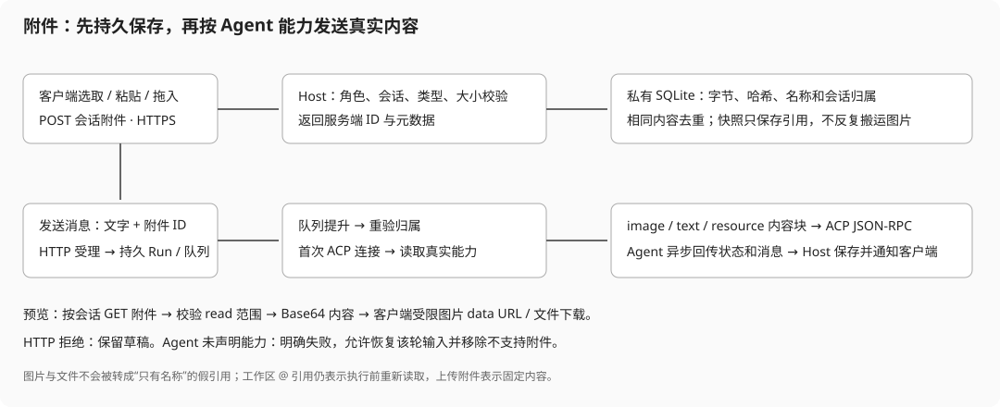

# 附件与图片实现方案

状态：已实现；真实Host、可控ACP、桌面与HTTPS手机验证记录见文末。

## 用户行为

输入区提供选择文件、粘贴图片及拖入文件；附件作为可移除卡片，图片显示缩略预览。`@` 工作区引用继续表示执行前重读工程文件；上传附件表示用户选取时的固定内容，不依赖任意主机路径。允许只发送附件，也可配合文字和现有文件引用。

## 数据与权限

附件由当前会话的上传接口接收，Host生成ID、校验内容类型与大小，在已有私有SQLite中持久保存字节及元数据。快照、队列和Run只携带ID/名称/类型/大小，不随每次WS快照重复传输图片Base64。下载/预览按会话读取，不在图片URL里放令牌。移动设备延用工作区read/operate校验。

单文件上限4MiB，每条消息最多5个上传附件、总量16MiB；纯文本作为文本上下文，PNG/JPEG/GIF/WebP作为图片，其他文件须经上游嵌入上下文能力发送。SVG不按可执行图片预览。上传路由单独限制编码后请求大小，其余API保留原有256KiB限制。会话附件有总量限制，草稿移除可清理未引用附件；已进入Run的内容为历史保留，不因移除草稿损坏旧会话。

## ACP 发送

本机Rust SDK `ActiveSession::send_prompt_blocks` 支持内容数组。图片使用 `ImageContent`，嵌入文件使用 `EmbeddedResource`（文本或Base64内容）。只有 `capabilities.session.prompt.image` / `embeddedContext` 对象存在才视为支持；不猜测媒体能力。能力已知时尽早拒绝不兼容附件；首次连接能力未知时，先连接再校验，失败保留执行记录并提供恢复输入的操作，绝不将只显示文件名伪装成内容已发送。

HTTP受理和Agent执行失败分别反馈：网络/校验失败保留当前草稿；已受理后上游拒绝会标记Run失败，用户可恢复该轮输入并移除不支持内容。幂等比较包含附件ID，队列提升前再次校验归属及可用性。

## 验证要求

以可控ACP Agent实际校验接收的内容块及字节，不仅检查UI卡片。覆盖图片/文本/二进制、未声明能力、超限、跨会话/跨工作区读取、角色拒绝、重复提交、队列与重启。桌面和HTTPS手机需验证真实上传及缩略图。最终图示与实际接口在实现完成后补齐。

## 已接入的接口与限制

- `POST /sessions/{id}/attachments`：名称、声明类型及Base64；独立6MiB请求上限，解码后4MiB，Host校验魔数/类型。图片不在Host内解码，损坏图片由预览或Agent明确报错；不将魔数检查宣称为完整图片解码验证。
- `GET /sessions/{id}/attachments/{attachment}`：同会话授权读取固定字节，用于缩略预览与下载，不在URL中携带认证令牌。
- `POST /sessions/{id}/attachments/{attachment}/remove`：仅清理未被Run引用的草稿附件，已引用者保留历史。离线移除先更新本机草稿，不保证立即清理主机缓存。
- 消息新增 `attachments: string[]`，幂等比较包含附件ID。上传元数据与字节在SQLite保存；每会话最多500项、总量256MiB，重复内容按会话/哈希/名称去重。

32KiB以内的UTF-8无NUL文本通过普通文本块发送；其他文件使用嵌入资源，需要 `capabilities.session.prompt.embeddedContext` 对象。PNG/JPEG/GIF/WebP需要 `capabilities.session.prompt.image` 对象。首次能力未知时的拒绝保留失败Run及原附件，输入区提供“恢复失败任务”操作；恢复不会自动发送。

## 验证记录

2026-11-06：可控ACP对图片和二进制内容的长度、SHA-256回执与上传原字节一致；纯文本附件可在没有媒体能力时正常发送。重复上传去重、相同幂等键不同附件拒绝、跨会话拒绝、单文件超限和伪图片拒绝、草稿移除与历史保留验证通过。

桌面验证实际文件选择、图片粘贴、拖入后移除、仅图片发送、历史缩略图、真实下载字节，以及上游无图片能力时恢复失败输入后移除附件继续。HTTPS手机验证实际图片上传及预览，非operator上传拒绝；崩溃恢复验证附件字节保留。workspace Clippy与Impeccable检查通过，已查看桌面和390px手机截图。物理手机相册/粘贴行为与原生WKWebView仍在最后实机检查中；本机锁屏期间不宣称原生核对通过。

## 入口错误与容量恢复

上传、读取和草稿移除按领域错误返回稳定身份，区分INVALID_ATTACHMENT、ATTACHMENT_TOO_LARGE、ATTACHMENT_NOT_FOUND、ATTACHMENT_LIMIT_REACHED及存储不可用。跨会话附件查询与不存在附件均为404。配额冲突不使主机进入数据库故障状态；删除未引用草稿可释放容量，已进入Run的附件保留历史。重复移除已删除草稿仍成功，不影响其他会话或历史。

上传与移除在独立命令任务中完成；数据库失败不回显SQLite路径。真实500项容量、清理后再上传及数据库关闭分别验证。详细状态码见[HTTP错误契约](http-errors.md)。
