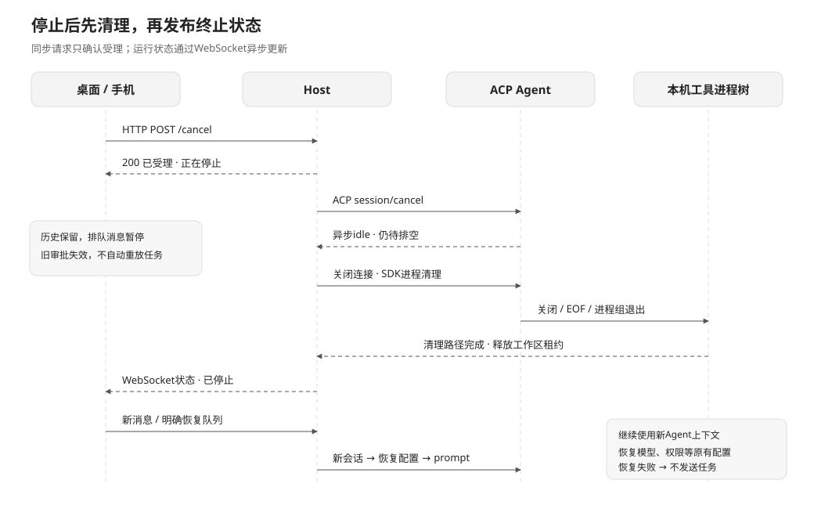

# 停止执行与进程排空

点击停止会通过HTTP提交取消请求，Host立即返回请求已受理。此时状态为 `cancelling`（正在停止），不等同于工具进程已经结束。

Host发送ACP `session/cancel`，随后关闭本次Agent连接，通过SDK的关闭、EOF和进程组退出路径清理该连接启动的进程树。上游提前报告 `idle/cancelled` 时，Host仍保持正在停止，不提前结束Run或释放工作区租约；清理路径完成后才发布本地取消状态，将尚未完成的工具记录标为已停止。排队消息继续暂停，旧审批和补充输入失效。

## 继续执行

关闭连接会结束上游上下文。本地对话、文件和执行历史保留，页面说明后续使用新Agent上下文，不把旧消息自动重新发送。用户新发消息或明确恢复队列后，Host新建ACP会话，并在发送任务前恢复停止前上游声明的配置项，包括模型与权限模式。配置恢复失败时，该Run失败并暂停队列，不在默认权限下继续执行。

这不是原生上游会话恢复，也不保证终止Agent自行提交到其他机器或外部系统的任务；当前清理范围是本机连接所属进程树。普通完成不关闭连接，后续轮次仍沿用该上下文。

## 已验证证据

- 确定性回归：测试Agent启动真实子进程，在收到取消时先报告idle却不退出子进程。修复前子进程仍存活；修复后终止状态出现时子进程已退出。继续发送时，非默认配置被恢复，本地历史仍在。
- 不响应取消/关闭的测试Agent，其进程和子进程仍通过SDK清理路径退出。
- 真实Codex在只读模式运行带唯一标识的长耗时Python进程；烟测核对进程确实存在，再取消并确认它从进程表消失。不能只依赖Run状态作为进程停止证据。

完整真实权限烟测入口为 `npm run agent:controls`；仅复验取消为 `npm run agent:controls -- --cancel-only`。它们显式调用已认证的真实Codex，使用独立Host与临时工作区，不加入默认测试套件，不修改用户全局配置。批准/拒绝阶段显示真实请求及一次性选项，由操作者审查动作后输入对应ID；其他输入或超时中止，最后清理临时Host和目录。
