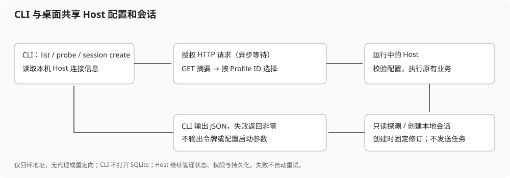

# 命令行选择 Agent 配置

CLI（命令行界面）使用正在运行的本地 Host，与桌面共享配置和会话。先启动桌面应用或 `vibeone-host serve`；CLI 不会自行启动第二个 Host，也不直接打开数据库。

## 使用方式

```sh
vibeone-host profiles list
vibeone-host profiles probe --profile <配置ID>
vibeone-host session create --profile <配置ID> --workspace /path/to/project
```

所有命令支持 `--data-dir /path/to/data` 指定 Host 数据目录。未指定时使用 `VIBEONE_DATA_DIR`，再回退到用户目录下的 `.vibeone`，与 `serve` 一致。开发仓库构建后可将命令名替换为 `./target/debug/vibeone-host`；桌面包内的 `Contents/Resources/bin/vibeone-host` 也提供相同入口。

- `profiles list` 输出 JSON 配置摘要：ID、名称、Provider（Agent 接入方式）和可用修订；异常记录仅输出身份和问题说明。输出不包含启动程序、参数、原始扩展、移除摘要或聊天记录。
- `profiles probe` 按 ID 选择配置，调用现有环境探测接口。结果包括实际桥接器版本、v2基础会话/媒体声明与认证状态；不创建会话或发送模型任务。动态插件的独立探测仍不支持，须在桌面通过会话连接验证。
- `session create` 按 ID 选择配置，由 Host 在受理时固定当前修订并返回会话 ID。随后可在桌面中找到该会话。名称不作为模糊选择条件，避免同名配置被意外选中。
- 省略 `--workspace` 时由 Host 创建托管项目；提供目录时支持相对路径、空格和中文，CLI 将它转换为绝对路径，Host 再执行工作区与配置校验。

创建会话不启动 Agent，也不发送第一条任务。模式选项以连接会话后 Agent 实际提供的 `configOptions` 为准；不在 CLI 中虚构可选模式。v2基础会话能力与旧版加载标志的区别见[环境探测](provider-probe.md)。

## 协议与限制



新增 `GET /v1/profiles` 返回类型化 `ProfileCatalogResponse`，仅含摘要和异常项；CLI 使用它查找配置。环境探测与创建分别调用既有 `POST /v1/providers/{id}/probe` 和 `POST /v1/sessions`。配置加载、有效性、修订固定及 Provider 代次由 Host 统一处理。

CLI 从数据目录的 `host.json` 读取当前本机地址和凭据，仅接受带端口的回环 IP HTTP 地址。传输直接连接 TCP，不使用环境代理，不跟随重定向；不把令牌放在 URL、命令行参数或输出中。连接文件最多读取 64 KiB，响应最多 1 MiB，单个请求最长 25 秒；失败会关闭当前连接。

成功时标准输出为 JSON；失败写入标准错误并以非零状态结束。HTTP 失败只显示通用指引及状态，不回显服务器原始错误正文，防止其中夹带凭据。未知/重复参数、缺少配置、目录无效均拒绝；`--help` 可查看用法。

旧版 Host 尚未提供配置摘要接口时，CLI 会提示检查版本，不退回到读取全部聊天快照。主机离线、凭据失效或超时均不会自动重试。若创建请求发出后连接断开，应先在桌面核对是否已建会话，避免手动重复创建。

## 验证

真实 Host 与独立 CLI 进程验证摘要脱敏、按 ID 探测、中文/空格目录、托管项目、修订固定、没有模型任务及参数失败。假 HTTP 服务验证重定向不继续请求、外部地址拒绝、环境代理不使用、错误不回显令牌和响应上限；虚拟时钟验证超时后底层连接关闭。
