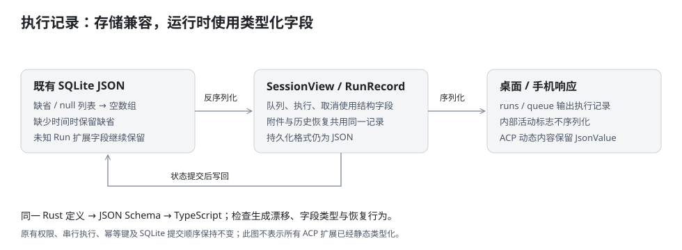
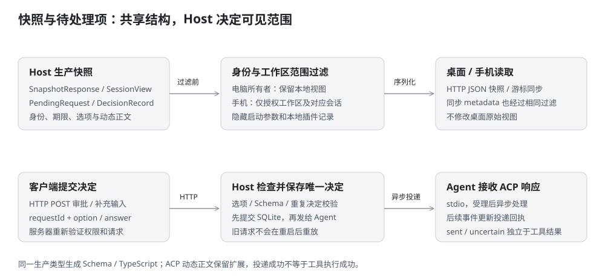
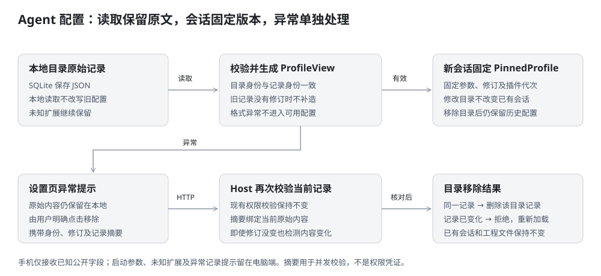

# 共享请求与回执类型

服务端实际HTTP请求定义集中在 `crates/workbench/src/contracts.rs`。Axum直接使用这些Rust结构解析请求，创建会话和消息提交也使用其中的响应/回执类型；HTTP错误信封使用同一模块的HttpErrorResponse。生成JSON Schema和TypeScript不再另抄字段。

## 当前覆盖

| 类型 | 生产用途 |
| --- | --- |
| CreateSessionRequest / CreateSessionResponse | 创建会话，目录可省略以建立托管项目 |
| SubmitMessageRequest / SubmitMessageReceipt | 文本、文件/附件、幂等键提交；受理、排队和重复标志 |
| QueueRequest | 撤回、暂停、恢复及新上下文继续 |
| UpdateSessionRequest | 会话标题和归档 |
| WorkspaceImportRequest | 导入已有工程 |
| ApprovalDecisionRequest | 使用Agent提供的选项作审批决定 |
| AttachmentUploadRequest | 文件名、MIME类型与base64正文 |
| PluginTicketRequest | 激活或丢弃已准备的插件候选 |
| HttpErrorResponse | code/error/status/requestId错误信封 |
| ProfileRequest / ProfileRecord / ProfileResponse | 配置保存/移除命令、实际保存记录及移除结果 |
| ProfileView / PinnedProfile / ProfileIssue | 目录视图、会话固定配置及异常目录记录 |
| RunRecord / SessionView | 实际会话投影、执行列表及排队记录 |
| SnapshotResponse / SnapshotMetadata | 实际快照封装及游标同步元数据 |
| WorkspaceView / Provider / DeviceView | 工作区、Provider公开描述与当前设备身份 |
| PendingRequest / PermissionOption / DecisionRecord | 待处理身份、期限、选项和持久决定回执 |

插件包/操作目录记录内容与ACP动态字段尚未全部迁移到共享业务DTO，内部领域错误也仍有后续迁移。这里不把JsonValue或若干请求类型称为整个业务模型已经完成。

## 生成与检查

- `npm run contracts:generate`：运行Rust导出示例，生成 `packages/client-contracts/schemas.json` 与 `src/generated.ts`。
- `npm run contracts:check`：从当前Rust重新导出，逐字核对已提交产物，再运行TypeScript正/反类型检查。生成文件过期时失败，不能自动改写后把检查当作通过。
- `npm test` / `npm run check`：纳入上述漂移检查。`npm run build`先构建共享客户端包。

检查需要Rust工具链；普通前端构建直接使用已提交的生成产物。生成排序不依赖本机语言环境。

生成器支持本组Schema使用的对象、数组、可空联合与引用等结构；无法解释的结构直接失败，不默认为any。自定义ACP或插件JSON可以继续使用明确的JsonValue，不伪造其业务类型。公共SDK跨版本兼容承诺仍未冻结。

## 客户端接入

`@vibeone/client-contracts`提供使用生成类型编译的请求构造器。正式桌面与手机共用的创建会话、发送消息已使用构造器生成路径和正文，幂等键沿用同一份草稿请求身份。当前`AgentSettings`的保存/修改/移除也通过构造器发送；旧`Management`入口继续兼容。字段改名或新增必填字段会使构造器/类型检查失败，需要同步调整生产调用。

其他构造器覆盖工作区、审批、元数据及队列，供后续调用逐步接入。JSON Schema描述字段类型、可空与缺省规则，不代替工作区权限、文件读取、Schema输入验证或业务大小限制。TypeScript作者模式会检查已知字段名；Host仍保留忽略未知请求字段的兼容行为。

workspace省略时由Host采用空字符串默认值，null仍无效；profileId可以省略或为null；files/attachments省略时默认空列表，不能传null；freshContext继续用camelCase。创建请求的省略规则与现有托管项目行为保持一致。消息受理回执必须有字符串operationId，遇到身份损坏的旧执行记录会拒绝受理，避免返回null身份。

## 验证

Rust检查Schema与实际Serde对缺字段/null的判断一致；TypeScript正例与@ts-expect-error反例覆盖缺少Provider、错误数组、非法null、snake_case及缺失回执身份。实际故意改坏生成文件已被检查拒绝，随后恢复原文件。

真实Host使用构造器导入工作区、创建/改名、幂等提交与审批，核对只有一个Run/用户输入及稳定回执；路径比较使用文件系统规范路径，适配macOS的/var与/private/var别名。完整桌面/HTTPS手机回归继续验证正式创建/发送链路及旧行为。

## Agent Profile 保存与删除

`ProfileRequest`直接由HTTP解析器使用；`ProfileRecord`在存储前验证实际将保存的记录，成功保存/移除返回类型化的`ProfileResponse`。设置页通过共享`saveProfile`和`removeProfile`构造器调用。保存构造器要求name/provider；移除构造器携带id及可用的revision/recordHash。Host仍校验名称长度、Provider、程序绝对路径、参数限制和修订冲突。

请求可省略id/revision/command/args等字段；字段一旦提供必须为正确的非null类型。特别是revision:null不会当作“没有修订条件”而绕过并发保护；args:null或非字符串元素也会被解析器拒绝。空command和空参数列表仍支持。响应省略未设置的command/args，不引入多余null字段。旧存储数据及会话已固定配置的读取路径保持兼容；此处没有宣称全部ACP动态业务模型已完成类型迁移。

Schema与Serde对字段省略、显式null、负修订号和错误参数元素做一致性检查；真实Host验证保存、改名递增修订、旧修订拒绝、非法null拒绝、按配置建会话固定修订和删除。TypeScript反例保证缺少保存字段、null修订或错误参数无法通过作者类型检查。

## 会话、Run 与队列记录

`SessionView`是实际快照和增量响应使用的会话投影；其中`runs`与`queue`均改为`Vec<RunRecord>`。任务提交、幂等判断、队列开始/撤回、完成/取消、附件保留、产物关联和历史回放使用同一结构字段。响应Schema由这些实际生产类型生成，未用另一份手抄接口替代。

Run身份、文本、状态、幂等键、文件引用、附件身份、时间及错误使用已知类型。状态仍用字符串，以兼容后续状态。附件元数据和ACP消息/工具正文继续以明确的JsonValue承载动态部分；待处理公共字段与Snapshot封装已由后续切片补齐，但并未宣称所有上游协议字段已静态化。

恢复仍读取原来的JSON。历史inputs/runs/queue/decisions缺失或为null时保持兼容；Run的files/attachmentIds/attachments缺失或null时规范为空列表。旧记录没有createdAt/startedAt/finishedAt时不补造时间；Run未知扩展字段通过flatten保留并再次序列化。新结构可能为缺少的key/error输出null，为缺少的列表输出空数组。id/status等已有业务身份字段必须类型正确，不把损坏的记录伪装成有效执行。内部active/observed_active标志不进入响应。

生成器对只有default等说明性属性的无约束Schema输出JsonValue；带扩展字段的对象使用JsonValue索引签名，可选属性允许undefined。无法解释的约束仍直接报错。类型反例覆盖非字符串执行身份、非字符串文件路径及错误队列元素；Rust使用实际SessionView序列化结果验证Schema，并核对扩展字段、缺省时间和私有标志。

## 快照封装与待处理项

`SnapshotResponse`直接构造生产快照，包含`SnapshotMetadata`和`SessionView`；HTTP快照直接返回该结构。内部原有需要JSON查询的代码通过同一结构序列化取得Value，没有另一份字段拼装。游标读取也使用同一快照，并从类型字段读取revision/storageError；同步响应的metadata仍经过相同设备过滤。

工作区公开视图来自实际存储记录；Provider从实际序列化结构生成类型，command/args属于内部启动字段，不进入公开描述。设备视图只包含id/role。手机过滤在类型结构上裁剪授权工作区和对应会话，删除会话/目录Profile的command/args，隐藏本地示例路径、插件事件、插件配置、通知和后台操作记录，存储错误替换成不含本地路径的提示。电脑所有者保持完整本地视图；过滤不修改原始快照。

`PendingRequest`承载id、runId、createdAt、expiresAt和可选的`PermissionOption`列表。权限选项的optionId/name/kind使用字符串，其扩展字段继续保留；toolCall、requestedSchema、URL或其他ACP动态正文放在flatten扩展中，手机与桌面不重新解释协议。投影转换失败时返回错误，不发布无法操作的待处理项。处理一个身份只移除该请求，不清空其他待处理项。

`DecisionRecord`使用类型化id/requestId/option/answer/delivery/createdAt。Host先验证请求和选项/输入，再保存唯一决定，随后通过现有ACP通道投递；失败标记uncertain，后续事件更新回执。answer的JSON保留false、0及自定义结构。delivery表示投递状态，与工具成功是不同事实；重启不重放旧决定。历史null列表仍沿用恢复兼容，缺少时间字段不补造。

历史回填可能遇到旧版或已损坏的、早已失效的权限/输入事件。这类事件不恢复为可操作请求：保留原始事件和消息历史，回填结果记录一次兼容提示并继续。在线新事件仍严格校验。回归已先复现旧权限选项阻断回填，再验证修复后正文保留、原始事件仍在且待处理列表为空。

插件/操作记录内容仍是明确JsonValue，领域错误也仍有后续迁移。自动检查覆盖所有者/手机实际序列化Schema、零授权、脱敏、原始视图不变、错误选项类型、动态输入及决定内容往返，以及错误请求不发布和按身份移除。

## Profile目录与固定配置

`ProfileView`是实际快照中的配置目录视图，身份、名称和Provider必填；`PinnedProfile`用于实际会话保存和执行，可兼容没有目录身份的插件启动配置以及旧记录缺少部分说明字段。两者复用修订、程序、参数和插件代次等类型字段。目录读取不改写原始记录，旧配置没有revision时保持缺省；保存新修订后才开始计数。未知扩展在电脑端及会话历史中保留，手机仅接收已知公开字段，启动参数和未知扩展均过滤。

格式或目录身份不匹配的记录不进入可用配置，快照通过`profileIssues`返回本地问题提示，其他配置和会话继续可用。原始记录仍在SQLite中；读取不会自动修复、覆盖或删除。用户可在电脑端Agent设置页明确移除异常记录。客户端携带目录身份、可用的旧修订和`recordHash`，Host在目录锁内核对当前原文摘要与修订；即使修订号没变，原文变化也会拒绝。摘要是并发检查，不是权限凭证。手机看不到本地问题列表，也不能管理主机配置。

修改或移除目录后，已有会话继续保存原来的固定配置。用户正常编辑仍采用原来的已知字段替换语义，不自动继承未知扩展。参数为空列表与省略参数保持区别：前者覆盖默认参数，后者使用Provider默认值。严格类型仍拒绝错误启动字段，不把损坏记录当成可执行配置。

回归覆盖旧配置缺少修订、未知字段保留、目录身份不匹配、异常原文不变、旧摘要拒绝、按目录身份移除、固定配置重启后保留、手机过滤未知扩展，以及正式设置页的异常提示和实际移除。测试只在停止的临时Host数据库中放入异常夹具，不修改用户数据。

## 插件后台操作公开响应

94/95增加实际 `PluginLifecycleRequest` 和动作枚举，以及正式页面采用的 `pluginLifecycleOperation` 共享构造器。新入口先返回202，再按操作ID查询，旧Host按能力标识回退原接口。详情见 [插件生命周期回执](plugin-lifecycle-operations.md)。

93将 `PluginOperationReceipt`、`PluginOperationSummary`、`PluginOperationRecord` 和 `PluginOperationListResponse` 接到实际202响应、列表、详情和Snapshot元数据。状态字符串保留未来值，结果使用JsonValue保留false/0/null；缺少结果字段和显式null有不同序列化结果。摘要不发布结果，全部公开响应只构造已知字段，不复制指纹或未来私有字段。缺少说明/时间的旧记录继续可读，不补造时间。

操作目录键是对账身份；正文身份异常时拒绝详情和重复假回执，摘要显示目录身份及固定异常提示，原有活跃状态继续用于重启保护。Schema与类型反例覆盖回执身份、数字时间、结果不能进入摘要和指纹不能进入详情。真实存储验证未知字段过滤及任意JSON结果。详见 [插件后台操作](plugin-operations.md)。
