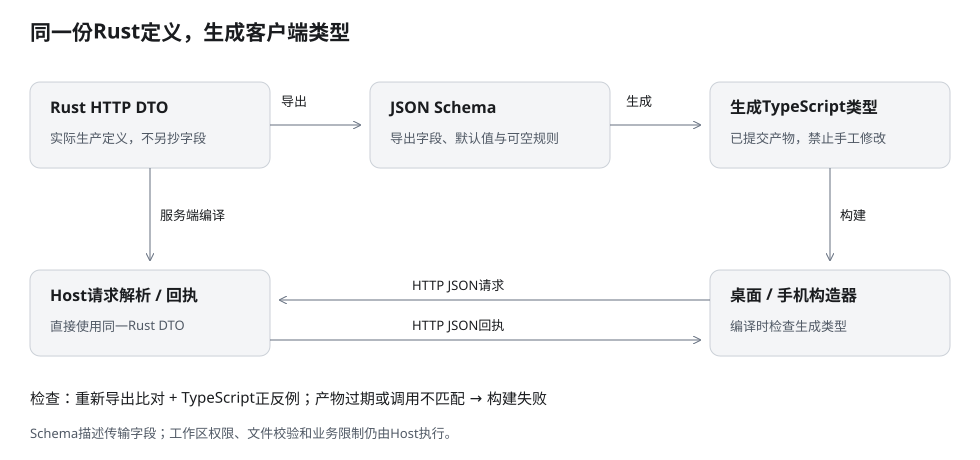

# 共享请求与回执类型

服务端实际HTTP请求定义集中在 `crates/workbench/src/contracts.rs`。Axum直接使用这些Rust结构解析请求，创建会话和消息提交也使用其中的响应/回执类型；HTTP错误信封使用同一模块的HttpErrorResponse。生成JSON Schema和TypeScript不再另抄字段。

## 当前覆盖

| 类型 | 生产用途 |
| --- | --- |
| CreateSessionRequest / CreateSessionResponse | 创建会话，目录可省略以建立托管项目 |
| SubmitMessageRequest / SubmitMessageReceipt | 文本、文件/附件、幂等键提交；受理、排队和重复标志 |
| QueueRequest | 撤回、暂停、恢复及新上下文继续 |
| UpdateSessionRequest | 会话标题和归档 |
| WorkspaceImportRequest | 导入已有工程 |
| ApprovalDecisionRequest | 使用Agent提供的选项作审批决定 |
| AttachmentUploadRequest | 文件名、MIME类型与base64正文 |
| PluginTicketRequest | 激活或丢弃已准备的插件候选 |
| HttpErrorResponse | code/error/status/requestId错误信封 |
| ProfileRequest / ProfileRecord / ProfileResponse | 配置保存/移除命令、实际保存记录及移除结果 |

Profile全量快照、完整Session/Run/队列响应、插件包/操作记录与ACP动态字段尚未全部迁移到共享业务DTO。这里不把JsonValue或若干请求类型称为整个业务模型已经完成。

## 生成与检查

- `npm run contracts:generate`：运行Rust导出示例，生成 `packages/client-contracts/schemas.json` 与 `src/generated.ts`。
- `npm run contracts:check`：从当前Rust重新导出，逐字核对已提交产物，再运行TypeScript正/反类型检查。生成文件过期时失败，不能自动改写后把检查当作通过。
- `npm test` / `npm run check`：纳入上述漂移检查。`npm run build`先构建共享客户端包。

检查需要Rust工具链；普通前端构建直接使用已提交的生成产物。生成排序不依赖本机语言环境。

生成器支持本组Schema使用的对象、数组、可空联合与引用等结构；无法解释的结构直接失败，不默认为any。自定义ACP或插件JSON可以继续使用明确的JsonValue，不伪造其业务类型。公共SDK跨版本兼容承诺仍未冻结。

## 客户端接入

`@vibeone/client-contracts`提供使用生成类型编译的请求构造器。正式桌面与手机共用的创建会话、发送消息已使用构造器生成路径和正文，幂等键沿用同一份草稿请求身份。字段改名或新增必填字段会使构造器/类型检查失败，需要同步调整生产调用。

其他构造器覆盖工作区、审批、元数据及队列，供后续调用逐步接入。JSON Schema描述字段类型、可空与缺省规则，不代替工作区权限、文件读取、Schema输入验证或业务大小限制。TypeScript作者模式会检查已知字段名；Host仍保留忽略未知请求字段的兼容行为。

workspace省略时由Host采用空字符串默认值，null仍无效；profileId可以省略或为null；files/attachments省略时默认空列表，不能传null；freshContext继续用camelCase。创建请求的省略规则与现有托管项目行为保持一致。消息受理回执必须有字符串operationId，遇到身份损坏的旧执行记录会拒绝受理，避免返回null身份。

## 验证

Rust检查Schema与实际Serde对缺字段/null的判断一致；TypeScript正例与@ts-expect-error反例覆盖缺少Provider、错误数组、非法null、snake_case及缺失回执身份。实际故意改坏生成文件已被检查拒绝，随后恢复原文件。

真实Host使用构造器导入工作区、创建/改名、幂等提交与审批，核对只有一个Run/用户输入及稳定回执；路径比较使用文件系统规范路径，适配macOS的/var与/private/var别名。完整桌面/HTTPS手机回归继续验证正式创建/发送链路及旧行为。

## Agent Profile 保存与删除

`ProfileRequest`直接由HTTP解析器使用；`ProfileRecord`在存储前验证实际将保存的记录，成功保存/移除返回类型化的`ProfileResponse`。设置页通过共享`saveProfile`和`removeProfile`构造器调用。保存构造器要求name/provider；移除构造器携带id/revision。Host仍校验名称长度、Provider、程序绝对路径、参数限制和修订冲突。

请求可省略id/revision/command/args等字段；字段一旦提供必须为正确的非null类型。特别是revision:null不会当作“没有修订条件”而绕过并发保护；args:null或非字符串元素也会被解析器拒绝。空command和空参数列表仍支持。响应省略未设置的command/args，不引入多余null字段。旧存储数据及会话已固定配置的读取路径保持兼容；此处没有宣称整个Profile快照、Session和Run已经完成类型迁移。

Schema与Serde对字段省略、显式null、负修订号和错误参数元素做一致性检查；真实Host验证保存、改名递增修订、旧修订拒绝、非法null拒绝、按配置建会话固定修订和删除。TypeScript反例保证缺少保存字段、null修订或错误参数无法通过作者类型检查。
