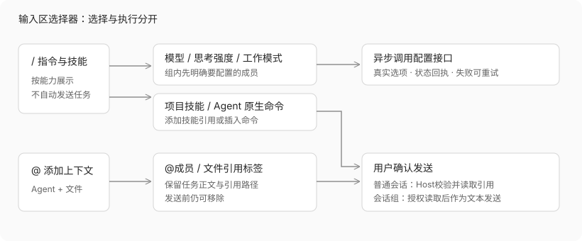

# 输入区指令、技能与上下文

输入 `/` 打开「指令与技能」，输入 `@` 打开「添加上下文」。独立 Agent、项目管家和会话组共用输入组件。菜单位于输入区上方，使用亮暗主题的面板底色、紧凑单行条目、轻量分类和明确选中态；说明过长时省略，不把工作台所有入口堆进指令菜单。

## `/`：技能与会话控制

默认先展示模型、思考强度、工作模式，再展示 Agent 通过 ACP 上报的指令与项目技能。模型与思考强度使用真实 `configOptions` 和配置接口；不硬编码模型或推理档位。尚未连接、Agent没有提供该能力时显示空态说明。执行中、队列未结束或只读设备不能修改配置；失败保留菜单并展示错误，成功关闭菜单并移除触发词。

会话组先选择要配置的成员，再选择该成员独立上下文的模型或思考档位；只有一个成员时直接显示该成员选项。这不会更改其他成员或该 Agent 的独立会话。组内不把某个成员专有的 ACP 指令当作全组通用命令。

技能从当前工作区 `.agents/skills/*/SKILL.md` 与 `.claude/skills/*/SKILL.md` 发现，读取前置元数据的描述；不扫描用户机器上的全局技能。每个来源最多检查50个目录，每批并发4个；跳过符号链接。与上游原生命令同名时保留原生命令。选择技能添加 `SKILL.md` 引用与任务提示，补充内容后再发送，选择本身不会执行任务。

`/files`、`/changes`、`/terminal`、`/runs`、`/artifacts`、`/agent` 仍支持手动输入的旧快捷方式，但不在默认建议中展示。同名上游指令优先；带参数、附件或引用时按普通任务发送。未知 `/` 指令可直接发给 Agent；配置子菜单无候选时 Enter 不发送消息。

## `@`：Agent与文件

根目录提供「全部」「Agent」「文件」筛选。普通会话列出当前项目的 Agent，会话组列出组成员。选择 Agent 插入 `@名字`；组内提及用于处理成员选择，普通对话中的提及不自动创建跨 Agent 调用。

文件候选来自当前会话授权工作区。支持当前目录筛选、进入子目录、返回上级和 `@src/main` 路径输入；含空格路径使用引号保留。选择文件移除触发词并添加可移除的引用标签，悬停可查看完整路径。目录可以作为当前层清单引用，不递归打包整个目录。文件与目录合计最多5项。`@` 不再混入技能，技能统一从 `/` 选择。

普通会话引用通过既有 `files` 消息字段发送，Host在受理和执行前进行范围、格式与大小校验。会话组当前使用文本消息传输：发送前经授权文件API读取文本或目录清单，再与任务正文组成组消息。二进制、截断内容或总消息超过12000字节时阻止发送并保留草稿与引用，不静默忽略内容；失败后可减少引用重试。组内技能引用走相同路径。会话组暂不提供二进制附件通道。

目录按会话和路径缓存；刷新入口重新读取当前目录。目录最多展示300项，当前是目录浏览与目录内筛选，不是全仓库递归搜索。目录权限仍以Host为准，不因菜单出现而扩大授权。

## 键盘与提交

↑/↓选择，Enter或Tab确认，Esc在配置子菜单返回、在主列表关闭，Shift+Enter换行。中文输入法组词时不触发选择或提交；文件无匹配项时Enter不会误发任务。光标中段选择会替换整个触发词并保留周围正文。

选择技能、文件、Agent或进入配置子菜单均不发送任务。发送失败保留草稿与引用；Host受理成功后清空。草稿与引用仍按会话在本设备保存。

## 本次验证

局部单元检查覆盖命令分类、真实技能描述、授权引用文本及二进制/大小拒绝；隔离组件检查覆盖组成员模型/思考配置请求、文件引用、技能、键盘和亮暗样式。桌面窗口已查看会话组 `/` 和 `@` 菜单，未发送模型任务，未运行全量桌面/手机回归。
