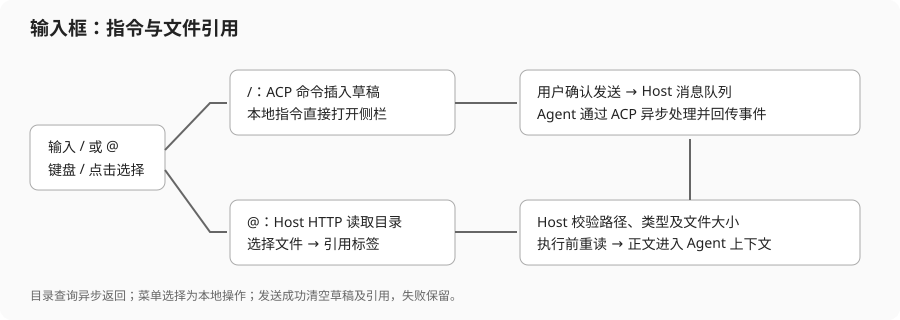

# 输入框指令、技能与文件引用

输入 `/` 或点击「指令」打开建议菜单；输入 `@` 或点击「引用文件」打开工作区文件菜单。菜单位于输入框上方，沿用当前亮暗模式和主题颜色。

## 指令

- Agent 指令来自当前会话 ACP 的 `initialCommands` 和 `available_commands_update`，名称及说明沿用上游。选择后将 `/name ` 插入光标处，补充参数后发送，由 Agent 解释执行。
- 工作台提供 `/files`、`/changes`、`/terminal`、`/runs`，选择后立即打开相应侧栏，不发送消息。直接输入完整本地指令后点击发送，也会打开侧栏；带有参数、文件引用或附件时作为普通任务发送。若同名 Agent 指令存在，优先保留 Agent 指令。
- 未匹配到菜单候选的 `/` 指令可以按 Enter 直接发送给 Agent，以支持尚未上报的命令；它是否有效由 Agent 决定。
- 未连接或尚未初始化的 Agent 可能没有上报指令。插件通过 ACP 上报的命令同样显示在 Agent 指令中；普通插件管理或 UI 扩展不会被伪装成 Agent 可执行工具。

## 项目技能

`/` 菜单还会发现当前工作区 `.agents/skills/*/SKILL.md` 和 `.claude/skills/*/SKILL.md`。条目显示来源目录，同名技能可按来源区分；与 Agent 或本地指令重名时保留指令优先。选择技能将提示文字插入当前光标处，同时添加可移除的 `SKILL.md` 文件引用，补充任务后再发送。Host 沿用文件引用校验，并把技能正文放入 Agent 的本轮上下文。选择本身不会启动执行。

发现过程使用当前 Host 的授权目录 API，桌面和手机一致，不读取客户端机器上的技能目录。只发现真实目录中的普通 `SKILL.md`，跳过符号链接；每个来源最多检查 50 个目录，并发最多 4 个目录请求。目录 API 每层最多返回 300 项，因此这是有界发现，不保证列出超大目录的所有技能。打开菜单时刷新技能来源，关闭后取消请求；失败显示重试提示，已有 ACP 和工作台命令仍可使用。

技能里的相对资源仍需要 Agent 按引用路径自行读取。当前不扫描用户家目录中的全局技能，也不自动安装技能或为普通插件新增工具权限。技能正文与其他文本文件共享每轮 5 个、每文件 32 KiB 的限制。

## 文件引用

菜单读取当前会话工作区的真实目录，输入名称筛选当前目录；选择文件夹进入子目录，支持返回上级，也可直接输入 `@src/main`。进入目录后使用 `@"目录/` 形式保留含空格的路径。进入目录后可点击「引用…文件夹」添加文件夹标签；根目录可引用当前工作区。文件夹引用只提供当前层目录清单（最多 300 项、约 32 KiB），不递归读取或打包文件正文。路径以 `/` 结尾保留类型，Host 在受理与执行前重新校验目录。符号链接不列入候选；Host 仍执行规范路径和工作区范围校验。

选择文件会将 `@` 片段替换成可移除的引用标签。文件和文件夹合计每轮最多 5 项；文件须为不超过 32 KiB 的文本文件。发送失败保留文本与引用；成功后清空。引用列表按会话在本机保存，发送时作为 `files` 数组进入既有消息队列。Host 在接收和执行前读取文件，因此传给 Agent 的是执行前内容。不可读、二进制或超限文件会由 Host 拒绝，并显示错误。

目录读取按会话和路径缓存，切换目录采用延迟请求并取消过期请求；每个目录最多显示 300 项。目录菜单右上角的刷新按钮重新读取当前目录，可发现 Agent 或外部工具新建的文件，也可重试失败请求。查询使用只读 HTTP 请求，不触发额外会话快照刷新。当前是目录浏览与目录内筛选，不是全仓库递归搜索。

## 键盘及设备

↑/↓ 选择，Enter 或 Tab 确认，Esc 关闭，Shift+Enter 换行。菜单存在候选时 Enter 选择候选；文件查询没有匹配项时 Enter 不会误发消息，Tab 可离开菜单；中文输入法组词时 Enter 不触发选择或发送。选择替换光标所在的完整触发词（包含光标右侧的词内后缀），保留后面的正文。带引号的文件路径会同时移除结束引号。只读、归档、历史和非操作设备沿用现有发送权限限制。手机菜单限制高度并可滚动。

## 验证

单元验证光标片段识别、链接与邮箱排除、尾文保留、Agent 命令优先。桌面浏览器验证快捷面板、真实文件筛选、键盘选取、消息携带文件正文与成功清空；同一次回归继续覆盖原有消息、审批、主题、重连和工作台功能。

本轮补充验证：完整 `/terminal`、`/files` 点击发送只切换侧栏，不新增用户消息；菜单打开后外部新建文件可通过刷新找到；无匹配指令的 Enter 可以发送；包含空格的目录和引用文件正文继续通过真实 Host 回归。

## 快速输入的光标一致性

快捷入口、目录进入/返回和候选选择，在受控输入值提交后的布局阶段恢复光标；不再通过下一动画帧恢复旧选区。这样点击入口后立即输入或替换查询时，后到的回调不会把光标拉回旧位置，也不会干扰文件筛选。桌面回归专门延迟动画帧，验证输入查询及光标位置保持不变。

项目技能回归覆盖：真实工作区目录发现、同名来源区分、符号链接排除、目录读取失败、选择后生成引用、技能正文实际进入用户消息，以及成功发送后清空。

## 分类和引用发送（2026-11-07）

指令菜单区分 Agent 指令、工作台、项目技能，技能保留来源；读取失败可以在菜单中重试。引用标签显示文件或文件夹类型，支持移除。只有引用、没有文字也可以发送；Host 将对应文件正文或文件夹清单注入本轮上下文。文件夹不是额外工作区授权，也不会上传整个目录。目录清单使用转义后的名称，不跟随符号链接。

真实 Host 回归验证文件夹只有清单、不含子文件正文，拒绝越界或把文件伪装成文件夹；桌面回归验证目录进入、引用标签、实际消息包含清单以及成功后清空。

兼容旧 Host：新增 `directoryReferences` 能力标识，只有当前 Host 声明支持时才显示文件夹引用入口。桌面更新后若仍连接旧 Host，需要在执行结束后通过设置重启工作主机；文件引用和原有指令仍可使用。

## `@` 技能引用（2026-11-07）

`@` 根目录菜单现在将「文件与文件夹」和「项目技能」分组展示，输入技能名可筛选 `.agents/skills`、`.claude/skills` 中发现的技能。同名文件与技能分别保留，技能标明来源。进入文件子目录后只展示该目录内容，避免技能混入路径导航。

选择技能（点击、Enter 或 Tab）会插入任务提示并添加 `SKILL.md` 引用卡片；补充任务后发送，Host 实际读取技能正文并交给 Agent。只选择技能不会创建 Run。目录刷新同时重新发现技能；技能读取失败可重试，文件列表仍可使用。普通 App 插件不能仅凭出现在菜单中获得 Agent 工具权限。

自动回归覆盖 `@` 技能键盘选择、不自动发送、实际消息包含技能正文，同时保留 `/` 指令、文件夹导航、文件引用、亮暗模式和手机布局验证。

## 再次编辑与引用展示

关闭建议后，点击已有 `/` 或 `@` 触发词，或将焦点重新移回该词，可再次打开建议。光标停在路径或命令中间时，确认候选会替换完整触发词，不残留旧后缀。Esc 关闭本次建议，不会自动发送。引用卡片展示简短文件名或目录名，悬停可查看完整相对路径；移除按钮仍以完整路径区分同名文件。

本次验证覆盖重新聚焦打开、Esc 关闭、中段替换、尾部正文保留及既有实际发送链路。当前菜单范围是上游 ACP 指令、工作台指令、项目技能与工作区文件，并非截图中其他产品的全局插件市场。
