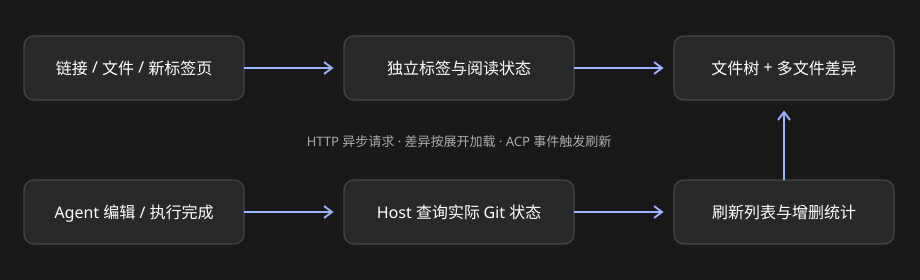

# 工作面板标签页与文件差异

右侧工作面板承载终端、文件、变更和网页。点击顶部加号打开新标签页，选择工具后在该标签内使用；每个标签可独立关闭。收起整个面板保留当前会话内的标签和阅读状态。文件引用与网页链接在旁边打开，可同时保留多个文件或网页；切换会话后重新建立该会话的工作面板。

面板外壳和工具栏保留已批准原型；差异与文件内容采用 `@pierre/diffs`，文件树采用 `@pierre/trees`，详见 [Pierre 渲染接入](pierre-rendering.md)。

## 面板宽度

工作面板与内部文件树各自支持拖动调整、达到阈值收起和恢复宽度，见 [分隔条交互](resizable-work-panels.md)。

## 变更浏览

变更页读取会话工作目录的实际 Git 状态，按照目录层级列出所有变更文件。文件标识显示修改状态和可用的增删行数；点击文件展开对应差异，多个文件可以同时展开并连续阅读。初始展开首个文件，其余折叠；各文件读取实际补丁以建立原生文件标题和增删统计。读取失败可单独重试。

已跟踪文件展示未暂存差异；仅有暂存变更时展示暂存差异。未跟踪文本文件以新增行呈现，二进制内容显示文件说明。增删统计取自相对 HEAD 的 Git numstat，未跟踪或无法统计的文件保留状态标识，不编造行数。底部与聊天变更入口展示工作区统计，不代表仅由本轮 Agent 产生的变更。

Agent 完成本轮后，聊天变更入口与已打开的文件/变更页自动刷新。用户也可通过文件工具栏的工作区菜单手动刷新。终端标签打开真实交互Shell，Agent命令输出与事件在执行记录页查看；详见[交互终端与桌面网页](native-terminal-browser.md)。

## 编辑事件

ACP（Agent Client Protocol，Agent 客户端协议）的编辑事件可能直接提供 `path/oldText/newText`，也可能通过 `changes[].path` 与 `patch.text` 提供 Git 格式差异。两种形式均解析；编辑详情显示实际文件链接、增删统计、着色差异行，原始数据保留在次级折叠入口。

## 本轮验证范围

使用 Web/Host 构建与编辑事件解析的局部检查；不自动触发真实 Agent 任务，也不执行整套桌面/手机回归。复杂仓库、多个工作目录、长差异和网页嵌入限制由用户进一步体验。

## 差异视图视觉细节

差异区隐藏Git补丁的传输头（`diff --git`、`index`、`---`、`+++`）及`@@`范围标记，只呈现实际上下文、增删代码和正确行号；原始补丁仍保留在工具原始数据内。深浅模式分别设置红绿差异底色和统计色。文件按扩展名显示类型图标，变更树增加修改/新增/删除标识；JS/TS、Rust、JSON、CSS、HTML、Shell、Python按语言进行语法着色，其余安全显示纯文本。

文件标题在差异滚动区顶部吸顶，使用不透明面板背景与独立层叠，上方标题不会透出下方代码或行号。目录部分弱化，文件名保持前景色；标题会在当前文件结束时随下一文件切换。

## 工具起始页

窗口顶栏只保留工作区展开/收起按钮。右侧新增标签页以浏览器地址栏为起点，下面是变更、终端、文件三个条状入口，分别展示图标、名称与一句说明。输入HTTP/HTTPS网址直接浏览，普通搜索词提交给百度；网页仍使用原生Chromium隔离视图。

首页也可以打开右侧起始页，不必离开当前页面。文件、变更、终端使用当前对话或当前项目的有效对话目录；尚无目录上下文时明确提示先选择项目对话。执行记录、产物与Agent设置继续从输入框本地斜杠指令访问。

## 工具异常隔离

文件与变更工具自行初始化产物保存状态，首页和会话页均可打开。每个工具标签页单独捕获渲染异常，失败时展示重试入口，对话与其他标签页继续保留。

## 目录展开

目录组件使用末尾带斜杠的标识，Host目录条目不带末尾斜杠；读取与缓存统一规范为不带末尾斜杠的相对路径，避免展开后丢失子项。目录请求失败后，可折叠再展开重新请求。
