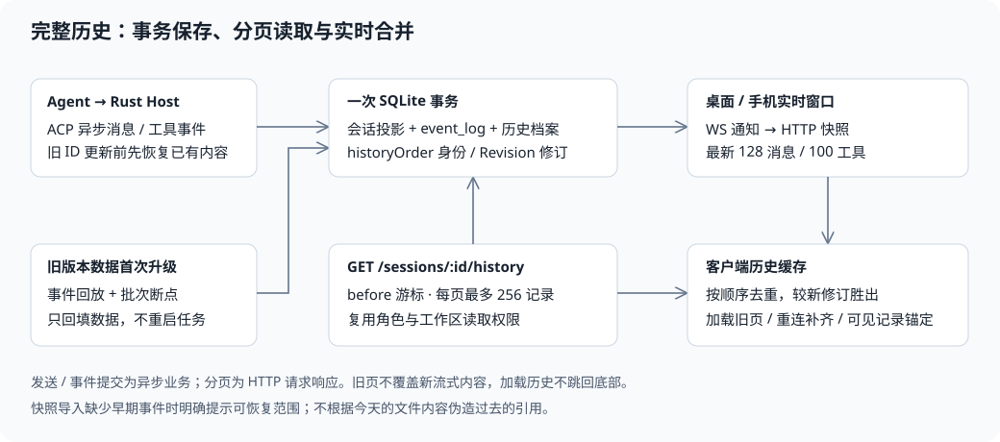

# 持久会话历史与分页

状态：已实现；原生窗口交付与整体验收见 [原型完整验收](prototype-completion.md)。

## 目标

运行投影仍限制128条消息与100项工具；完整记录由SQLite持久档案承担，不靠无限扩大Host内存数组。分页同时返回消息与工具，避免早期工具退化为无关联的JSON或被错误归到新一轮。

## 模块与调用接口

历史模块负责记录身份、顺序、版本、事务写入、分页及旧数据回填。HTTP只暴露当前会话的受限分页读取；桌面与手机用同一合并逻辑。归属、角色和工作区仍由Host校验。

每条记录保存稳定`historyOrder`（首次观察顺序）和`historyRevision`（修改修订）。前者用于分页及渲染顺序，后者避免晚到的旧页覆盖新chunk。`runId`保留真实关联，缺少关联时不猜测；用户pending输入在真正的上游user消息到达后被替换。

## 流式及旧记录

当一个ID已经被运行投影淘汰，后续更新前先读取该记录的已有内容，再按ACP chunk/snapshot语义处理。档案与投影、事件在同一SQLite事务提交。长文本超过既定显示上限时明确标记，不能静默当作完整正文。

首次升级使用已有event_log回放，以可恢复断点保存进展；未提供早期事件的旧导出只恢复实际存在的快照，并说明完整性无法验证。不会根据今天的工程文件重造过去的文件引用内容。

## 阅读行为

“加载更早记录”在顶部追加历史并保留当前可见内容的位置；阅读导航覆盖已载入的对话轮次。断线重连后重新同步已载入范围，按版本合并并补齐断线期间间隙，不把过期响应写进另一会话。失败可重试，输入和审批的现有离线限制继续保留。

## 验证要求

真实Host覆盖超128记录、工具与消息共同分页、旧chunk更新、pending替换、重启、旧数据回填与越权。浏览器检查加载后不跳到底部、导航可达和流式新内容继续更新。接口与数据流图见下文。

## 接口与合并规则

`GET /v1/sessions/{id}/history?before=<historyOrder>&limit=128` 返回 `records`、`hasMore`、`nextBefore` 和 `warnings`。`records` 元素为 `{kind: "message" | "tool", item: ...}`，本页按首次观察顺序排列。省略 `before` 表示最新一页；`before` 是排除游标，`limit` 必须为1–256。游标仅在当前会话内有效。所有读取遵守该设备的工作区授权，viewer（只读设备）可以读，未授权设备不能读。

客户端初次读取最新页，并补齐到当前已见记录的最早位置。消息/工具统一使用 `historyOrder` 作为身份，因此 pending（待上游接受）输入被接受后只更新原记录。`historyRevision` 较大者胜出；页面、快照交错到达时也适用。每个会话组件持有自己的缓存，切换会话、断线或组件卸载取消旧请求。断线重连重新同步已加载区间，历史请求失败显示重试。

“加载更早记录”按独立分页游标向前读取。加载前取可见消息/工具的顺序和像素偏移，插入后恢复该位置；不以总高度差定位，因此末尾同时流式输出不会把阅读位置带走。阅读导航包含已载入的轮次，工具拥有Run关联但用户输入尚未载入时也可定位，不伪造用户原文。

历史档案不限制会话总记录数；客户端只累积本次已载入和已看过的记录。当前单条消息正文仍限制65,536字符，超出时明确标记；历史页保存该受限投影，而原始事件仍在 event_log。导出历史仅有快照时，不能保证缺失的更早正文已恢复。

## 本轮验证结果

- `tests/history.test.mjs`：每轮183条消息与140项工具，37项分页、稳定身份、旧消息/工具增量、pending替换、无输入回显、继续执行和参数拒绝通过。
- `state/history.rs`：回填中断重启、同ID不同角色、同批次内重复更新后淘汰、仅快照导入不信任外来顺序且显示范围说明通过。
- `tests/recovery.test.mjs`：完整分页跨进程崩溃恢复，业务活动时间保持通过。
- `tests/desktop.test.mjs`：加载旧页的可见正文偏移保持、断线期间新增整轮长历史后的缺口补齐、继续发送，以及200刻度的实际导航组件键盘/点击可达通过。导航压力使用组件夹具，业务历史另外使用真实Host验证。
- `tests/remote.test.mjs`：390px HTTPS手机分页、无横向溢出、viewer允许读取、跨工作区及未认证拒绝通过。

静态UI检查对既有 `thinking-shimmer`（思考扫光）报渐变文字提示；该效果来自已批准的运行状态需求，结束、离屏和减少动画时会停用，不作为装饰性标题使用。
