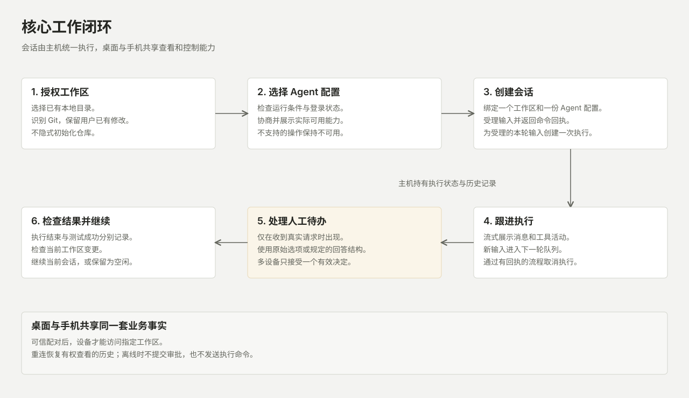
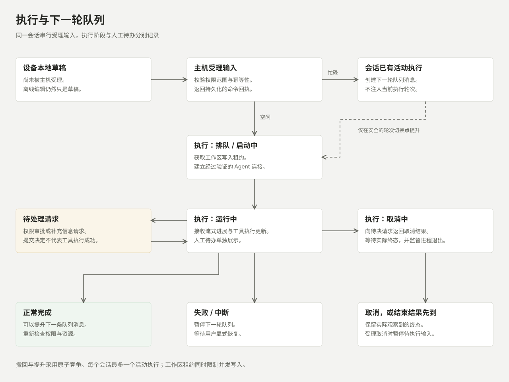

# VibeOne 核心功能设计

日期：2026-11-06。状态：核心功能实现基线，部分桌面与 ACP v2 链路已交付开发预览；完整实现进度见实施计划。紧凑版桌面与手机原型，以及亮色、暗色主题，继续作为视觉基线。

本文定义产品行为与分阶段交付内容。[架构设计](architecture.md)说明运行时归属，[功能实现设计](functional-implementation.md)说明通信与持久化，[领域术语表](../GLOSSARY.md)定义统一术语。本文对消息排队和状态处理的细化，已同步到对应文档。

## 1. 产品目标与首版范围

用户选择可用的 Agent 配置即可创建会话并发送任务；工作区可选，未选择时在 `~/.vibeone/projects/` 创建独立项目，也可关联已有目录；在桌面或手机上查看执行进展、处理真实权限请求，最后检查工作区变更。关闭桌面窗口不应决定任务是否继续执行。

首版面向单用户、单执行主机和多个已授权设备。可以存在多个会话，但实际并发受 Agent 能力与工作区访问约束；不同 Agent 之间不默认共享记忆。



| 功能域 | 首版主要能力 | 后续扩展 |
| --- | --- | --- |
| 工作区 | 导入或重新关联目录、识别 Git、查看变更、避免同一目录被并发写入 | 自动管理 Worktree 池、自动合并分支 |
| Agent | 探测与配置接入方式、检查登录状态、协商能力、选择配置 | 通用模型与账号管理平台 |
| 会话 | 创建、重命名、归档、列表筛选、查看本地历史、连续多轮执行 | 不同 Agent 之间自动转移会话 |
| 执行 | 流式消息、工具活动、上游实际提供的计划、取消、有容量限制的下一轮队列 | 自主工作流编排、Agent 团队 |
| 人工处理 | 权限请求收件箱、上游原始选项、并发决定冲突处理；能力允许时单独处理补充信息请求 | 通用自动审批规则 |
| 代码变更 | 当前 Git diff，区分已暂存、未暂存和未跟踪文件，记录采集来源 | 完整 IDE、自动提交、合并或回退 |
| 手机控制 | 可信配对、工作区授权、查看进度、发送、取消、审批、断线恢复 | 公网中继、原生手机应用、可靠后台推送 |
| 扩展 | JS 动态 App / Node Worker、TS 编译为 JS、声明式 Agent 接入、配置表单、通知与生命周期管理 | 公开插件市场、公开 SDK 稳定承诺、不可信代码沙箱 |

桌面与真实手机的控制闭环通过验证后，核心首版才算完成。第三方插件公开分发放在后续阶段，其内部扩展接口提前建立。

插件机制不是仅预留接口：首版支持 JS 直接开发、TS 编译为 JS，验证 App 动态注册、Node Worker、宿主 RPC、Scope 和实例清理。Rust 是 Host 实现语言，原生 Rust Worker 为可选能力。包结构、JS SDK 与协议详见 [插件机制设计](plugin-design.md)。

## 2. 功能入口与职责

| 页面或入口 | 主要功能 | 当前选择与上下文 |
| --- | --- | --- |
| 工作台 | 继续已有会话或创建新会话 | 工作区、Agent 配置、会话 |
| 待处理 | 查看待审批和待补充信息请求 | 请求、会话、工作区；请求状态不归属于某一台客户端设备 |
| 变更检查区 | 检查当前工作区变更 | 工作区、文件、变更类别、采集时间 |
| 工作区管理 | 导入、重新关联、检查访问权限、从列表移除 | 已授权目录；移除记录不删除文件 |
| Agent 设置 | 程序探测、配置管理、登录引导、能力展示 | 接入方式及当前有效配置 |
| 主机与设备 | 连接、配对、授权、撤销、生命周期管理 | 当前主机和已授权设备 |
| 扩展设置 | 查看扩展能力、配置及启用状态 | 扩展能力标识与安装版本 |

现有三种桌面布局展示同一套业务事实。手机保留主机、会话、待处理和设置入口。后续新增功能页面延续当前紧凑界面的设计规范。

## 3. 领域关系与身份约束

下文保留部分英文实体名，便于与代码和术语表对应：工作区为 `Workspace`，Agent 配置为 `AgentProfile`，会话为 `Session`，一次执行为 `Run`。

```text
执行主机 Host
  工作区 Workspace ──< 会话 Session ──< 执行 Run ──< 工具调用 ToolCall
                            │               ├──< 审批请求 ApprovalRequest ──0..1 个已受理决定
                            │               ├──< 补充信息请求 InputRequest
                            │               └──< 产物 Artifact
                            └──< 队列消息 QueuedMessage ──0..1 次提升后的执行
  Agent 接入 AgentProvider ──< Agent 配置 AgentProfile ──< 会话
  设备 Device ──< 工作区授权 WorkspaceGrant
```

一个会话绑定固定的工作区与 Agent 配置身份。编辑配置会产生新的配置修订，正在执行的 Run 保留启动时记录的修订；新设置只能在明确、安全的轮次切换点生效。切换到另一种 Agent 接入方式时创建新会话。上下文交接需要显式操作，作为后续能力实现。

Run 表示一次提示输入触发的执行尝试，既不是整个会话，也不是单次工具调用。因为回执丢失而重试同一命令时，复用原幂等键；主动重试失败任务时，创建新的 Run 和幂等键，并用 `retry_of` 关联上次执行。

首版暂不引入跨会话的独立 Task 实体。会话标题用于整理工作，不再增加第二套任务生命周期。

## 4. 首次使用与工作区管理

1. 桌面连接已有且健康的 Host，或启动新的 Host；启动失败进入诊断页面，不能显示成空会话列表。
2. 用户通过桌面目录选择器导入目录。Host 检查目录身份、访问权限和 Git 可用性，不隐式初始化 Git 或安装软件。
3. 用户选择可用的 Agent 配置，解决登录或兼容性问题后创建会话。
4. 配置真实、可信的 HTTPS 访问入口后开放手机配对；仅使用本地桌面时无需配置手机连接。

重复导入同一目录时，身份一致就返回已有工作区。目录移动后，经过校验可重新关联。从工作台移除工作区保留原文件；仍有活动任务时，应先等待完成或显式停止。归档历史在保留策略允许的范围内仍可查看。

非 Git 目录也能执行任务和引用文件，但变更检查区需明确显示 Git diff 不可用。已有未提交修改的 Git 目录可以正常使用；原有修改保持可见，不归因于 Agent。

## 5. Agent 探测与配置

一份 Agent 配置包含接入方式标识、可信可执行程序与参数、环境变量引用、登录状态、有效配置修订，以及能力验证记录。敏感值保留在 Host 配置的凭据存储中。

程序探测使用用户明确选择的可执行文件，或可信接入方式提供的探测规则。不能静默安装软件包、运行未锁定版本的联网包执行器，或意外启动模型任务。某些桥接器需要独立运行环境，这是接入前置条件，不意味着插件作者必须编写前端代码。

首批验证候选为通过 `claude-agent-acp` 接入的 Claude Code，以及通过 `codex-acp` 接入的 Codex。这只是候选方案，不代表兼容性已经实测。两者都属于适配路径，不强制要求首批工具中必须有一个原生暴露 ACP。已有适配项目说明存在连接路径，不意味着覆盖原 CLI 的全部功能。[Claude 适配项目](https://github.com/agentclientprotocol/claude-agent-acp)、[Codex 适配项目](https://github.com/agentclientprotocol/codex-acp)。

| 能力 | 产品行为 |
| --- | --- |
| 结构化消息与工具更新 | 渲染已支持的更新类型；未知类型保留有容量上限的诊断记录 |
| 权限决定 | 真实请求与响应链路验证通过后，才开放远程审批 |
| 取消 | 在当前轮次结束或进程监督模块确认终止前，显示“取消中” |
| 加载与恢复会话 | 支持时提供显式恢复操作；不支持时仍可查看本地历史 |
| 模型、模式与配置 | 仅展示上游公布的选项，使用得到确认的有效值 |
| 文件、图片等输入内容 | 仅对支持的内容类型开放附件功能 |
| 用量与费用 | 展示上游提供的数值及统计范围；缺失时显示未知，而不是 0 |
| 澄清与补充信息 | 仅通过经过验证的结构化适配路径展示独立补充信息请求 |
| MCP 与 Skills 配置 | 遵循所选工具支持的配置方式，不承诺 ACP 能统一覆盖 |

能力验证记录关联工具版本、适配器版本、协议版本、平台和测试结果。能力状态分为支持、不支持、未知。不能通过修改界面上的布尔配置，就把未知或不支持的能力变成可用。

首版采用 ACP v2 Draft，显式协商 `protocolVersion: 2`，不静默降级为 v1。prompt 响应只表示已接受；客户端独立接收消息与工具更新，以匹配会话的 `state_update` 返回 `idle` 判断本轮前台工作结束。更新可能早于 prompt 回执，因此连接建立时即安装接收处理器。[ACP v2 生命周期说明](https://agentclientprotocol.com/protocol/v2/prompt-lifecycle)。

## 6. 会话创建、消息与排队

### 6.1 创建会话

先在本地创建引用工作区与 Agent 配置的会话，再启动模型工作。空会话可以编辑，不立即启动 Agent。第一条被受理的输入才触发执行，并按对应接入方式的要求建立上游会话。

用户可以重命名会话，按工作区、状态或标题筛选本地列表，以及归档空闲会话。活动会话需要先完成或停止才能归档。归档从活动列表隐藏会话，不删除历史，也不隐式停止任务。首版包含本地标题筛选；全文历史搜索和外部工具历史导入后置。

### 6.2 发送与回执

输入区支持多行文字和用户明确选择的已授权文件引用。Host 在实际分发时再次校验附件与协商过的输入类型。草稿保存在各自设备上，首版不在桌面与手机之间同步逐字输入。

提交后、Host 回执返回前，输入区显示“提交中”。只有被 Host 受理的输入才显示为已发送消息或队列消息。请求超时后，使用原幂等键查询回执。离线时可编辑草稿，但不能创建执行，也不能把控制命令静默排入联网后自动发送的队列。

`session.submit` 是串行追加操作，不针对最后一条时间线事件执行比较并交换。它校验会话绑定与有效配置修订；其他设备刚接受了一条无关消息，不会仅因此拒绝当前输入。配置实际改变时，返回冲突供用户检查。同一个命令键携带不同内容时应拒绝，不能静默复用旧输入。

### 6.3 会话忙碌时

一个会话最多只有一个活动 Run。运行中或等待人工决定时发送的新消息，在 Host 上生成 QueuedMessage，并明确回执为“下一轮执行”。它不会注入当前 prompt，也不会回答审批请求。

- 按会话内的受理顺序逐条分发，每次执行一条。
- 队列消息的已提交正文不可直接修改，可以在提升为 Run 前撤回；需要修改时，撤回后将替换消息重新提交到队尾。草稿编辑仍在设备本地完成。
- 队列提升与撤回采用原子竞争。若提升已完成，撤回操作返回对应 Run，用户可以取消该 Run。
- 正常完成一轮后，只有该轮请求全部处理完毕、资源检查通过，下一条消息才可以启动。
- 失败、取消、中断或尚未解决的投递不确定状态，会暂停剩余队列；由用户显式恢复或移除待执行消息。
- Host 恢复后，先检查会话恢复状态与授权，不直接自动执行旧队列。
- Host 强制校验队列容量，满载时返回明确错误。同一条消息只能进入即时 Run 调度或下一轮队列中的一种路径。



## 7. 执行与状态展示

Host 分开保存执行阶段和人工待办：

```text
执行阶段：queued（排队）→ starting（启动）→ running（运行）→ completed（完成）或 failed（失败）
                                           ├→ interrupted（中断）
                                           └→ cancelling（取消中）→ cancelled（已取消）
                                                                  └→ completed 或 failed
                                                                     （结束结果可能先于取消生效）
人工待办：待审批请求 + 待补充信息请求
连接状态：connecting（连接中）| ready（就绪）| disconnected（断开）| closed（关闭）
```

Run 调度可能等待工作区写入占用解除；这与等待上一轮结束的队列消息不同。界面显示“排队中”时，应同时说明工作区忙碌或 Agent 并发额度已满等原因。

`waiting_approval` 是活动 Run 存在待审批请求时派生的展示状态，不能替代其执行阶段。待澄清的问题显示“需要补充信息”。允许多个请求同时存在，需保留数量并逐项展示。手机断开连接不改变 Host 上的执行阶段。

时间线区分用户输入、Agent 输出、工具调用、计划、请求、通知和执行结果。工具进展更新已有条目，不按每个 token 新建一行。上游没有提供计划时，不生成虚构的进度清单。长输出分页或按需展开；仅当用户接近最新内容时自动跟随滚动。

Run 完成只说明本轮 prompt 已结束。工具成功、测试结果和工作区是否干净是独立事实。Agent 自述应标为 Agent 输出；有实际工具输出时，测试成功状态应以该证据为依据。

取消操作保持幂等。已处于终态的 Run 直接返回实际结果。取消生效时，使待决请求失效，并使用协议规定的 cancelled outcome 响应上游权限请求；不能假设上游一定提供“拒绝”选项。如果正常结束先发生，保留 completed 等实际终态，不改写为 cancelled。强制终止需要在结果中可见，并可能要求建立新的上游会话。[ACP v2 权限处理说明](https://agentclientprotocol.com/protocol/v2/tool-calls)。

排队中的 Run 可在启动前取消，不会创建运行进程。启动中的取消中断启动流程，并由进程监督模块完成清理。针对活动 Run 受理取消时，同时原子暂停该会话的待执行输入，即使随后收到的正常完成结果先赢得终态竞争。针对已经结束的旧 Run 的取消，不应影响后来启动的新 Run。

## 8. 待处理收件箱与决定提交

收件箱展示需要人工回答的请求，不把所有运行中或失败会话都当成待办。桌面和手机展示同一组有权访问的请求。详情包含工作区、Agent、Run、时间、原始动作和可选操作；缺失信息明确显示“未提供”。

审批提交包含原始选项标识、请求版本和幂等键。Host 校验设备当前授权、有效上游连接和请求状态。每个请求只接受一个决定；另一台设备收到当前结果。相同幂等键的网络重试返回已有回执。

界面分别展示待处理、本地提交中、决定已记录、响应已发送、已失效或到期、投递状态不确定。响应已发送不代表工具已经执行。Host 重启会使旧等待句柄失效，已记录的旧决定不重放到新请求。

补充信息使用独立 Schema、答案校验和响应操作。适配器不支持时禁用对应交互路径，不能伪造一个权限选项承载普通文字回答。

拒绝权限只回答这一次动作，不自动把整个 Run 判为失败；Agent 仍可能选择其他方式继续。停止整个任务使用独立的取消操作。

## 9. 工作区变更与结果

首版变更检查区只读。分别展示已暂存、未暂存和未跟踪的变更，附采集时间、可用的分支信息，以及二进制或超大文件提示。不静默暂存、提交、回退或合并。

Run 可以记录开始与结束时的变更快照，附来源与采集状态。基线缺失或不完整时，不能声称某个文件只由该 Run 修改。Git 索引与引用操作需协调；读取快照时若与外部工具产生竞争，应重新采集或明确标为不完整，不能声称快照具备原子一致性。

活动 Run 持续持有对应工作区目录的写入租约，等待人工决定期间也不释放；同一目录的其他 Host 管理写任务需要等待。其他会话仍可以查看或排队。该机制约束 Host 管理的并发写入，不代表能限制 Agent 直接访问操作系统或无关外部程序。自动创建 Worktree 后置。

## 10. 手机配对与断线恢复

手机访问需要可达且可信的 HTTPS 入口。配对凭据短期有效、仅使用一次，并由桌面确认设备及工作区授权。仅扫描二维码不直接获得权限。兑换后，长期凭据不保留在二维码 URL 中。

角色对应可以组合的权限，不隐含继承关系：`viewer` 可查看，`operator` 可发送与取消，`approver` 可审批，`owner` 管理授权与配置。设备按所需操作获得相应权限组合。远程设备仅选择已授权的工作区和配置，不能授权任意本地目录或修改可信程序的启动配置。

重连时重新校验身份，获取授权范围内的一致性快照与事件位置，或从有效游标续传，并核对尚未确认的命令回执。Host 启动代次变化后，旧的活动等待句柄失效。设备授权被撤销时，断开已有订阅并拒绝后续命令。离线时禁用待办操作，不建立离线审批队列。

主机休眠或离线时，显示连接状态与最后同步时间。手机前台控制属于首版；可靠锁屏通知作为独立增强能力验证。

## 11. 模块职责与可替换接口

| 模块 | 对外接口 | 内部负责的实现 |
| --- | --- | --- |
| 工作区 | 导入、定位、获取或释放写入租约、检查变更 | 目录身份、Git 读取、租约冲突、已授权文件引用 |
| Agent 接入运行时 | 探测、建立连接、发送 prompt、回答请求、取消 | 进程启动与监督、ACP 映射、能力协商、上游身份和限制 |
| 会话执行 | 提交、撤回队列输入、恢复队列、取消、读取 | 轮次排序、配置修订记录、恢复、队列提升、Run 状态转换 |
| 待处理 | 列表、读取、审批决定、补充回答 | 请求有效性、唯一决定提交、投递记录、审计 |
| 设备访问 | 配对、确认、授予权限、撤销、鉴权 | 凭据、工作区范围、角色检查、授权撤销 |
| 同步 | 快照、订阅、读取回执 | 授权投影、持久化顺序、缺口检测、背压 |
| 扩展目录 | 检查、激活、配置、排空 | 扩展能力、版本化绑定、Agent 接入实例租约及客户端 App 注册 |

桌面与手机调用相同的 Host 应用层接口。Agent 接入运行时不持有用户授权决定权，也不直接修改会话投影。插件贡献的扩展不能替换待处理决定的核心提交路径。核心接口经过实际验证前，公开插件 SDK 细节保持草案状态。

初期可以把这些模块组织在较小的 Rust 工作空间中，不必立即按目标架构的完整 crate 清单创建空包。

## 12. 交付顺序与阶段出口

| 阶段 | 交付内容 | 完成标准 |
| --- | --- | --- |
| F0：接入验证 | CLI 协议验证工具、可控测试 Agent、候选配置、最小 JS/TS 插件与 Node Worker | 检查两条真实工具路径；记录真实审批往返、取消与恢复限制；JS 与 TS 构建产物使用相同 loader，Worker 握手、调用和退出通过 |
| F1：本地无界面执行 | 工作区、Agent 配置、会话、Run、事件和历史、扩展目录及声明式 Provider | 重启后历史保留；单会话单活动 Run；工作区写入租约有效；扩展可注册与清理；不依赖 UI |
| F2：桌面工作台 | 将原型接入真实投影、队列、待处理和只读变更，加载本地 JS 通知插件、App 面板与设置表单 | 完成发送→流式进展→批准或拒绝→结束→检查；重试和取消不重复创建工作；插件失败不破坏核心流程 |
| F3：手机控制 | 可信访问入口、配对、授权、快照与事件恢复 | 真实手机跑通同一控制闭环；处理并发审批和设备撤销 |
| F4：扩展分发 | 公开并稳定插件 SDK、完善第三方分发与版本兼容承诺 | 不修改 Host 即可增加第三方接入扩展；更新失败保留原有效版本 |

冻结公共契约前先完成 F0 验证。F1 与 F2 可以按小型端到端切片交付，F3 则依赖可靠的待处理与同步能力。本轮产出仍为设计，不表示生产 Rust Host 或 Tauri 功能已经实现。

## 13. 必须覆盖的异常场景

| 场景 | 预期结果 |
| --- | --- |
| 同一设备重试发送 | 返回同一条已受理输入、Run 或队列回执 |
| 两台设备同时向空闲会话发送 | 串行受理，最多一个活动 Run，另一条进入队列 |
| 其他会话正在使用工作区 | 明确显示调度等待原因，不出现 Host 管理的并发写入 |
| 用户撤回消息时恰好开始执行 | 原子操作只产生一个胜者；已提升时返回 Run 标识 |
| 权限被拒绝但 Agent 继续执行 | 请求结束，Run 持续活动直到真实结果产生 |
| 取消与本轮结束同时发生 | 保留实际终态，不强制把成功改成取消 |
| 本轮失败且队列仍有多条消息 | 暂停队列，保留历史与待执行输入 |
| 决定已记录但 Host 随后崩溃 | 显示投递不确定，不重放旧决定 |
| 中断会话无法加载上游历史 | 可以查看本地历史；继续时按需创建明确区分的新尝试或新会话 |
| 执行中配置修订发生变化 | 当前 Run 保留启动时配置；下一轮在安全且得到确认的配置切换点生效 |
| 当前 diff 包含用户手动修改 | 显示工作区变更及采集范围，不无依据地声称修改归属 |
| 手机命令超时 | 先查询原命令回执，再决定重试操作 |
| Agent 能力未知 | 明确显示未知或禁用操作，不以模拟成功代替 |

## 14. 仍需通过实现验证的事项

- 首批两种接入方式的确切兼容版本，以及启动和登录行为。
- 各适配器实际支持的操作，包括结构化补充信息与会话恢复。
- 首个真实手机的 HTTPS 部署方式；目前未配置证书或远程基础设施。
- 根据实际负载确定存储保留限制和队列容量，不使用未经验证的性能承诺。
- 跨平台进程树监督，以及后台安装与运行 Host 的具体行为。

这些事项不阻塞功能设计，但属于 F0、F1 阶段明确的验证条件，不是原型已经具备的功能。

## 统一存储与历史续聊

会话、配置、插件与托管项目统一归于 `~/.vibeone`；主目录不可写时，桌面使用现有可写的 `~/.config/vibeone` 或 `~/.local/share/vibeone`；会话数据与项目文件分开，已有工程仅关联原路径。目录迁移在旧 Host 空闲并退出后执行，保留旧路径兼容别名，不覆盖已有目标数据。

历史会话保留原消息并显式提供“在新上下文继续”。该操作只解除本地执行暂停，下一条输入启动新 Agent 上下文，不自动重放历史消息或审批。原生上游会话恢复仍需按 Agent 的恢复能力单独接入。

## 聊天实时活动区

每轮对话由用户消息、处理过程和最新回复构成。思考摘要、工具动作与较早的过程回复归入该轮活动；默认折叠，只在执行中滚动预览最近三项，长摘要展示最新片段，展开后可按项查看完整摘要与工具输入输出。完成后自动停止预览，保留可展开记录。

活动顺序与工具归属由 Host 随会话持久保存；旧版未记录所属轮次的工具单独列为早期记录，不错误归入新任务。工具状态与可展示思考摘要均来自实际 ACP 事件；没有摘要时显示等待，不生成模型隐藏思考。

默认跟随最新输出；用户向上滚动、阅读历史详情或在活动列表中上滚时暂停跟随；点击“回到最新消息”或发送新消息恢复跟随。活动详情内的滚动不传播到主时间线，支持亮暗主题、手机尺寸与减少动画设置。
