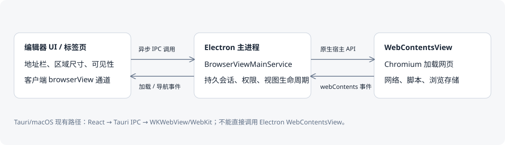

# 桌面网页浏览实现调查

## 结论

本机 Cursor 的 Browser Tab 使用 Electron 的 `WebContentsView` 承载网页。编辑器界面通过 IPC（进程间通信）请求主进程创建独立网页视图，并同步区域尺寸和可见性；网页由 Electron 的 Chromium 内核加载。这个路径不是把目标站点放进编辑器 DOM 内的 `iframe`，也不是只渲染页面截图。

VibeOne 目前同样已经使用原生子网页视图，而不是 `iframe`；但在 macOS 上它来自 Tauri/Wry 的 WKWebView，使用 WebKit。两者的宿主 API、浏览内核和网站看到的浏览器环境不同。因此，不能把 Cursor 的 `WebContentsView` 调用直接粘贴到当前 Rust/Tauri 宿主中。

这能解释两者存在兼容性差异的技术基础，不能证明某个站点安全验证的具体触发原因。本次没有登录 Cursor 浏览器、读取 Cookie/历史，也没有在两边完成百度相同操作的运行时对照；不能宣称替换内核必定消除验证码。

## 已观察到的实现

| 关注点 | 本机打包资源中的静态证据 | 含义与边界 |
| --- | --- | --- |
| 网页宿主 | `out/main.js` 的 `browserViewMainService.js` 从 `electron` 导入 `WebContentsView`，`createBrowserView` 构造该对象 | 网页拥有独立 `webContents`；不是普通编辑器 `iframe` |
| 主进程隔离参数 | 创建参数含 `contextIsolation: true`、`nodeIntegration: false`、`sandbox: true`、`webviewTag: false` | 普通网页未直接获得 Node 能力；这些参数本身不构成完整安全审计 |
| 嵌入和布局 | 主窗口 `contentView.addChildView`；`setBounds` 将坐标/宽高四舍五入后交给原生视图；`setVisible` 控制标签显示 | 编辑器布局与网页渲染分离；切换标签可隐藏视图而保留网页状态 |
| 导航 | `webContents.loadURL`、`goBack`、`goForward`、`reload` | 由浏览器正常加载站点，不是从服务端抓 HTML 再注入 |
| 会话 | 构造视图接受 `partition`；打包模块 `browserViewPartition.js` 定义 `persist:` 前缀和 `-browser` 后缀；会话数据服务校验该格式再调用 `session.fromPartition` | 包中具备持久浏览分区机制；未读取用户当前使用的具体分区值，不推断“每个标签一个分区” |
| 存储落盘 | `flushStorageData` 调用会话 `cookies.flushStore()` 和 `flushStorageData()` | 有明确的浏览数据持久化路径；不与用户日常 Chrome 自动共用账号 |
| IPC 调用 | 编辑器包中 `getChannel("browserView")`，调用 `createBrowserView/setBounds/setVisible/navigate/...`；主进程注册同名通道 | 控件留在编辑器 UI，宿主执行浏览器动作并返回 Promise；加载、导航、标题、错误通过事件回传 |
| 浏览器工具 | `sendCDPCommand` 通过 `webContents.debugger` attach 后发送命令，并先检查禁止的方法 | 具备 Chrome DevTools Protocol（Chrome 开发者工具协议）接口；不是凭文件名猜测浏览能力 |
| 预加载脚本 | `preload-browser.js` 通过 `vscode:browser-view-message` 将 Alt+点击链接请求传回宿主；还存在面向指定身份认证域名的局域网权限兼容处理 | 仅能证明脚本中的这些具体处理；该兼容逻辑并非百度专用补丁，不应原样搬入 VibeOne |
| User-Agent | 在 `browserViewMainService` 定位范围内没有找到 `setUserAgent` 或用户代理覆盖配置 | 当前调查不足以确认最终运行时 UA；不能说“改成某个 UA 就等价于 Cursor” |

### 调用关系

## 对当前实现的影响

现有 `apps/desktop/src-tauri/src/browser.rs` 已通过 `WebviewBuilder` 和 `Window.add_child` 嵌入网页，并由 `browser_layout` 同步坐标和尺寸。前端标签页、地址栏和网页加载本来就分属 UI 与原生宿主；应保留这个边界。

若希望获得接近 Chromium 的日常浏览兼容范围，选择应落在浏览引擎层，不能继续仅调整页面 CSS 或伪装 Chrome UA：

| 方案 | 可复用内容 | 需要承担的工作 |
| --- | --- | --- |
| 保留 Tauri/WKWebView | 当前桌面、React 界面、Rust Host 与 Node 插件运行时 | 继续修复可确认的 WebKit 导航与会话问题；无法承诺 Chromium 一致性 |
| Tauri 接入独立 Chromium/CEF | 当前桌面与业务 UI，大部分 Host/插件后端 | 新增原生子视图桥接、浏览进程管理、跨平台打包、签名与浏览内核更新；不是安装一个 React 包即可完成 |
| Electron 作为桌面宿主 | React 界面、Rust Host 服务、Node 插件协议 | 将窗口、通知、PTY、网页视图等宿主接口迁移；可直接采用 `WebContentsView` 的同类接口，但需要维护 Electron 分发 |

本次只完成调查与差异说明，没有替换桌面宿主。若浏览兼容性成为优先目标，可单独评估 Chromium/CEF 与 Electron 宿主的投入，不把当前 WKWebView 的修改标记为已经迁移 Chromium。

## 调查范围与证据

调查时间：2026-11-07。本机应用声明版本为 `3.27.14`；仅分析 `/Applications/Cursor.app/Contents/Resources/app` 内的已安装程序资源，不访问用户数据目录、不执行恢复出的代码。

源文件 SHA-256：

| 文件 | SHA-256 |
| --- | --- |
| `package.json` | `37f716a9e465e48c30e4512ad027c95f2ead94f97fef0c7a8aefb4cd7b2cc111` |
| `out/main.js` | `2ee1fbb61a4d85de1b1b3d75ae66ad7ead780205818bd06a274c7c0e9a50207b` |
| `out/vs/workbench/workbench.desktop.main.js` | `5197ce48a203b89b28c2e1ec0c8eefd393ea40ecb7d37c5e33cc594629ed771b` |
| `out/vs/platform/browserView/electron-main/preload-browser.js` | `61bbfcf8ca1e642f935adc064c8b6b54f56c3ad34a8c76fd86bdf87d4a1efd14` |

REA Evidence：

- 包元数据与预加载脚本分析：`ev_c4274e052c5db738cd5d32b1754089ddc1f5593773f98cbab446c0dc0beeb210`。精确选择两个源文件，其他文件未纳入该轮语义分析，应用图覆盖为 partial。
- `out/main.js` 的部分分析：`ev_4833761c0f8aee630e06d5a1e319069558b7dc7619be95a774a49f918b758237`。已完成语法解析，60 秒语义分析预算到达上限，保留部分证据；未把它描述为完整反编译。没有重复同样的全量分析。
- 关键创建、分区、布局、导航、IPC 与 CDP 调用另由上述哈希文件的有界静态源码检查核对。`workbench.desktop.main.js` 只核对 `getChannel("browserView")` 附近的客户端代理，未全量分析 41 MB 编辑器包。

已证实的是打包资源中的实现代码。当前网站是否触发风控、最终 UA、正在使用的分区、实际登录状态，以及未检查模块动态覆盖的行为，仍属于运行时未知；没有从“静态存在某调用”推断“当前页面必定执行到该调用”。

接口背景：[Electron WebContentsView](https://www.electronjs.org/docs/latest/api/web-contents-view)、[Electron Session](https://www.electronjs.org/docs/latest/api/session)。
