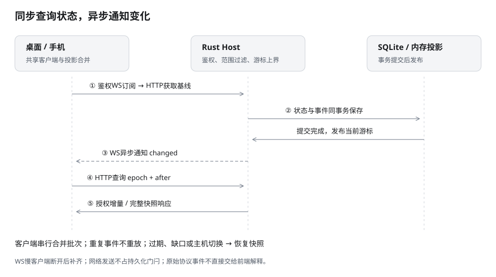

# 游标增量同步

桌面和手机共用同步客户端。WebSocket（WS/WSS）只通知状态变化，实际状态通过同一授权HTTP接口查询；网络断开不会在客户端批准、撤销或重新执行任务。原始ACP事件仍由Host解释，客户端不重复实现Agent状态机。

## 服务划分与流程

1. 客户端先建立鉴权WS订阅，再调用 `GET /v1/sync`。首次响应包含完整授权快照、当前游标cursor和本次主机启动epoch（游标所属的主机实例）。
2. 状态变化、命令回执或重连触发 `GET /v1/sync?epoch=…&after=…`。同一连接串行查询；查询进行中收到的新通知合并为下一次查询，不能让旧响应覆盖新状态。命令调用等待对应刷新结束后返回。
3. Host在一致的已提交上界内读取变化的会话ID，只返回这些会话的最新投影。一个会话的多个流式事件合并为 `session.projected`，包含稳定事件ID、该会话最后事件游标和当前会话状态。未变化的会话对象在客户端保留。元数据及可见会话ID列表用于更新配置、插件、工作区和移除失去可见性的会话。
4. 客户端按批次游标及事件ID去重。未知事件、缺口或不完整投影不能推进可信游标，而是重新请求完整快照；兼容诊断只保留恢复次数和固定原因，不保存未知事件正文。

## 一致性与恢复

SQLite事务提交到内存状态发布之间，与同步读取使用同一异步门闩。这样不同会话并发更新时，不会返回“较高游标已到达、较早提交的会话尚未发布”的混合状态。门闩仅覆盖持久提交/发布及同步查询，不覆盖Agent执行、模型等待或网络响应发送。查询只读取事件ID及序号，不加载原始工具输出。

初次连接、epoch改变、未来游标、落后超过4096条提交事件，或主机存储异常时返回完整快照。4096是增量追赶窗口，不删除原始历史；超过窗口直接恢复当前状态，不逐条重放旧审批。原始事件分页接口继续独立提供。

WS订阅缓冲超限时关闭慢连接；客户端重连后用已有游标补齐，必要时取快照。鉴权失败与设备撤销不会降级到匿名读取。HTTP旧主机返回404时，或未来同步信封版本无法解释时，当前连接退回既有快照查询；切换连接重新协商。

## 权限及边界

同步接口沿用桌面令牌与手机Secure/HttpOnly Cookie。Host先按设备工作区范围过滤快照，再生成会话投影和可见ID；未授权会话、原始事件或本机启动参数不通过增量响应泄露。每个请求重新检查设备有效性，撤销仍会关闭已有WS。

此接口传递合并后的会话投影，保证当前状态恢复；不承诺逐token事件传输。完整历史继续通过独立分页读取，通知首次基线和旧审批失效规则保持不变。游标仅在当前连接内存保存，页面刷新重新建立可信基线。

## 验证

- 客户端检查去重、保留未变对象、可见性移除、epoch切换、缺口/未知事件恢复、串行查询与回执竞争、旧主机兼容及鉴权失败不降级。
- Host检查首次/无变化/多会话创建、连续流合并、重复查询稳定ID及未来/异实例游标恢复。
- 真实SQLite提交4097条变化后验证过期游标回退，桌面与可信HTTPS手机继续执行完整功能回归，并检查设备范围及撤销。

## 存储读取故障

真实SQLite读取失败先返回503/STORAGE_UNAVAILABLE，标记主机不可写并发出状态通知；下一次同步读取已知故障时，可以返回带 `reset: storage` 的缓存快照。HTTP200的缓存响应不意味着数据库恢复，客户端仍应显示存储故障。它不会重放旧请求或补发审批。

故障提示在HTTP、缓存快照和会话错误中使用固定说明，原始数据库异常不进入公开状态。事件日志分页也沿用同一错误身份，并在领域层验证整数游标；具体流程见[查询故障与缓存重置](diagrams/query-storage-reset.svg)。
