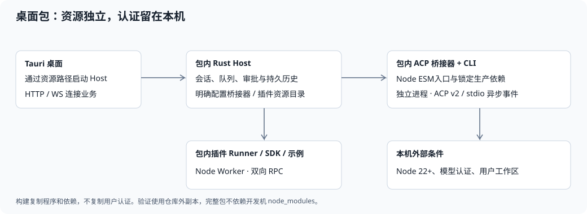

# 桌面包与独立运行资源

> 正式桌面入口已迁移为Electron，当前构建命令与产物位置见[Electron桌面说明](electron-desktop.md)。本文保留Tauri兼容包的资源与历史验收说明；旧构建入口为`desktop:bundle:tauri`。

## 包内与本机的边界

Tauri桌面包包含Rust Host、桌面/手机前端、Node插件运行时、SDK、内置示例，以及锁定版本的ACP桥接器（把编码工具暴露为ACP进程的适配程序）。本机仍须提供Node22+和模型认证；构建不复制用户认证目录、令牌或已有会话数据。

| 内容 | 资源位置 / 来源 |
| --- | --- |
| Rust Host | `Contents/Resources/bin/vibeone-host` |
| 手机网页 | `Contents/Resources/web`，只经独立HTTPS入口提供；loopback仅提供业务API |
| 插件Runner/SDK | `Contents/Resources/runtime` |
| 示例App/Worker/Provider | `Contents/Resources/examples/workspace-tools` |
| Codex适配器 | `bridges/codex-acp` → `@agentclientprotocol/codex-acp` 2.5.0 |
| Claude适配器 | `bridges/claude-agent-acp` → `@agentclientprotocol/claude-agent-acp` 0.101.0 |
| 生产依赖、SDK及本平台CLI | `bridges/node_modules`，按实际安装的锁定依赖树复制 |
| 可审计清单 | `bridges/bridge-manifest.json`，记录平台、CPU、入口、包名、版本与相对路径 |

`package-bridges.mjs`复制dependencies、必需peerDependencies及已安装optionalDependencies，排除devDependencies，保留嵌套不同版本、可执行权限和原包许可证文件。版本须与package-lock一致，缺少必需依赖即失败；不会临时联网下载另一个版本来凑齐。当前macOS ARM64闭包为125个包，包含Codex CLI0.165.0和Claude Agent SDK0.3.318及其本平台二进制。因此完整调试包显著大于仅带演示功能的预览包。

桌面启动Host时明确设置`VIBEONE_BRIDGES_DIR`到包内目录，同时设置插件/网页/示例资源目录。明确指定的桥接器目录不回退到全局CLI或开发仓库，防止“开发机可用、移走源码就失效”。本地开发模式使用准备好的资源目录；普通源码CLI未指定该变量时仍可查找源码安装项或全局桥接器，全局项不会被标成已知锁定版本。



## 构建与验证

```sh
npm ci
npm run desktop:bundle
npm run bundle:smoke
```

本机产物为`apps/desktop/src-tauri/target/debug/bundle/macos/VibeOne.app`，当前架构对应当前构建平台，不宣称通用/全平台包。macOS包最低10.15；完整使用还须满足Node22+及所含本平台CLI的要求。发行签名、公证和其他平台实机仍未完成。

`bundle:smoke`把全部资源复制到仓库外的临时目录，并且只启动这个副本中的Host、Runner、Provider和适配器。验证：

1. 两个适配器的`initialize`响应必须为ACP v2并提供session能力；不发送模型任务。
2. 包内Codex/Claude CLI版本命令成功，不依赖全局编码工具路径。
3. 可信临时CA下的HTTPS网页与实际JS资源可读取。
4. 示例Worker通过反向RPC读到临时工作区文件，插件贡献的Provider真实完成一轮，消息进入持久历史。
5. 停止并清理测试Host/临时目录；不操作用户正在运行的Host、认证或会话。

此验证覆盖资源独立性，不代替原生窗口、系统通知或真实模型认证。真实模型复验见[ACP兼容记录](acp-compatibility.md)，原生待验见[原型逐项验收](prototype-audit.md)。
