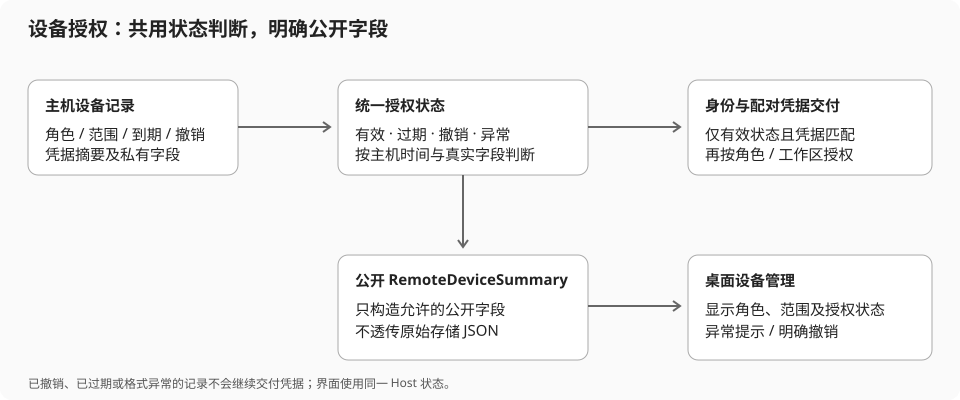

# 设备授权状态与公开字段

设备页使用 Host 计算的授权状态，展示角色、授权工作区和完整到期时间。工作区显示实际名称；已找不到的工作区保留标识便于核对。已过期和异常记录仍可明确撤销；已撤销记录禁用重复操作。缺少设备标识时显示说明并禁用无法定位的撤销操作。

## 四种状态

| 状态 | 判断与行为 |
| --- | --- |
| `active` 已授权 | 角色、范围、标识、到期时间、凭据摘要及撤销标记有效，未过期且未撤销 |
| `expired` 已过期 | 有效授权记录已到期，凭据不再用于连接 |
| `revoked` 已撤销 | 明确保存了布尔 `revoked: true`，停止后续授权与配对凭据交付 |
| `invalid` 记录异常 | 关键字段缺失或类型错误、未知角色、空/异常授权范围或无效摘要，连接被拒绝 |

Host 身份解析、重复授权确认及配对凭据交付复用同一有效性判断，避免页面显示和服务校验各自解释。字符串形式的 `"false"` 或 `"true"` 都不能替代撤销布尔字段。异常记录不自动修复为有效授权；可定位的记录通过原有撤销接口处理，再重新配对。

## 公开响应

`RemoteDeviceSummary` 从实际 Rust 状态响应生成 Schema/TypeScript，字段明确为：`id`、`name`、`role`、`workspaces`、`createdAt`、`expiresAt`、`revoked`、`status`。角色枚举是 `viewer`、`approver`、`operator`；未知角色投影为 `null`，异常记录仍保留可见提示。缺失标识或时间以 `null` 表示，避免界面崩溃或显示 Invalid Date。

响应逐字段构造，不再复制原始设备 JSON 后仅移除 `tokenHash`。凭据摘要和未来新增的其他私有存储字段都不会随设备列表返回。原始记录仍保存在主机，投影不改写未知字段。

当前 Host 的状态按主机时间判断，页面优先使用它，避免手机时间偏差误报。旧 Host 没有状态字段时，页面从旧公开字段回退判断，缺失关键字段明确显示异常。

## 验证

真实 SQLite 回归先复现未知私有字段泄漏，再验证明确公开字段、异常撤销标记/角色/范围/标识/到期时间/摘要拒绝和生成 Schema。真实 Host 测试覆盖有效设备与撤销后状态；正式桌面通过可信 CA 的 HTTPS 配对实际设备，核对角色/工作区显示并撤销。手机角色权限及撤销继续使用真实 TLS 回归，不替代物理设备验收。
