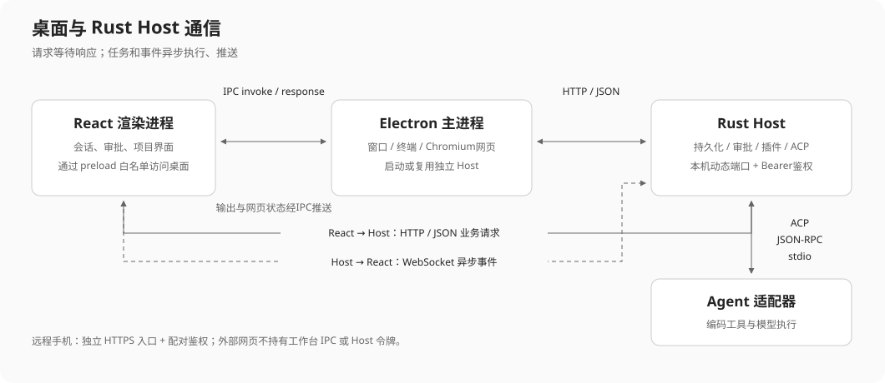

# Electron桌面实现

桌面主入口改为Electron，继续复用React正式工作台与独立Rust Host。已移除Tauri外壳源码、配置、npm依赖与兼容入口。共享资源生成至`target/desktop-resources`，图标源码位于`apps/desktop/assets/icons`。Host的数据目录继续使用`~/.vibeone`，保留项目、会话、上下文恢复记录及配对配置；迁移前对当前数据做本地备份。浏览器引擎的本地界面偏好存储与Tauri分离，首次启动按系统主题初始化。可通过`VIBEONE_ELECTRON_OUTPUT`指定独立输出目录，避免覆盖正在运行的应用。

## 进程职责

Electron主进程管理窗口、目录选择、通知、Host启动、PTY终端与网页视图。预加载脚本只暴露允许的桌面命令和事件订阅；React通过统一`native.js`适配器调用。Rust Host继续处理ACP、数据、审批、排队、插件和远程服务。关闭桌面窗口会结束交互终端与网页视图，不终止独立Host中的Agent任务。

网页采用独立`WebContentsView`与`persist:vibeone-browser`浏览器分区，保存登录Cookie和站点存储；使用Chromium默认UA，不伪造浏览器身份。远程网页关闭Node集成、不加载工作台预加载脚本，保持上下文隔离、沙箱及Web安全策略。仅允许HTTP/HTTPS导航，新窗口请求在当前网页视图内打开；敏感站点权限默认拒绝，不绕过验证码、证书或登录校验。模型或网页不能取得工作台令牌。实现依据[Electron WebContentsView](https://www.electronjs.org/docs/latest/api/web-contents-view)及[窗口打开处理](https://www.electronjs.org/docs/latest/api/window-open)。

交互终端使用`node-pty`与既有xterm界面，支持输入、尺寸变化、Shell退出及关闭，不再显示执行记录代替Shell。Agent执行记录仍由原记录页面提供。

主界面通过受信任的`vibeone://app`来源加载；Host允许此来源，仍要求本机Bearer凭证。外部网页分区没有工作台IPC能力，主进程只接受主界面顶层帧的调用。

## 桌面与Host通信

React渲染进程通过预加载脚本的白名单接口调用Electron主进程，采用异步IPC请求/响应（`ipcRenderer.invoke` / `ipcMain.handle`）。主进程负责启动或复用Host并返回连接信息；目录选择、通知、交互终端和网页视图也由主进程直接处理。

业务数据主要由React直接访问Rust Host：`http://127.0.0.1:<动态端口>/v1/...`上的HTTP/JSON请求，使用Bearer令牌鉴权。React通过`ws://127.0.0.1:<动态端口>/v1/events`订阅异步事件，连接后首先发送令牌，再根据事件刷新游标增量或快照。Electron主进程管理Host生命周期时也调用同一HTTP接口。HTTP和IPC请求都以Promise异步等待响应；Agent任务接受后继续异步执行，不占住桌面请求直到任务完成。

终端输出、网页加载与导航状态由Electron通过`webContents.send`推送，再由预加载脚本按通道ID分发给React。外部网页不加载该脚本，也不能访问Host令牌。手机走独立HTTPS远程入口及配对鉴权，不复用本机Bearer接口。

ACP是Host与Agent适配器之间的JSON-RPC协议，经子进程标准输入/输出传输；不是Electron与Host之间的协议。

## 开发与打包

- `npm run desktop`：准备Host及前端资源，启动Electron。
- `npm run desktop:electron:bundle`：构建本机Electron应用，位于`target/electron/VibeOne-darwin-arm64/VibeOne.app`（平台及架构随机器变化）。
- `npm run desktop:build`：使用release Host构建Electron应用。

打包包含当前平台Electron、PTY原生模块、Rust Host、桥接器、插件运行时与Web资源。macOS打包修正PTY辅助进程的执行权限。本版本为本机开发包，正式分发签名、公证和其他平台体验仍待后续验收。

## 本机验证记录

已在本机Electron窗口确认原有会话可见、项目空间入口和固定管家正常；百度主页与搜索结果可操作，PTY终端能实际输入命令并返回输出。组内转交、上下文隔离、发送去重及停止时序通过隔离协议检查；真实Codex管家已完成首次介绍回复；完整多工具协作与手机空间管理仍交由后续体验验收。未运行全量桌面/手机回归。

窗口退出时终端/网页可能继续回传事件；主进程在窗口不存在、已销毁或渲染内容已销毁时丢弃事件。已确认带终端的原生窗口退出不报错，重新启动后项目与管家历史保持。
