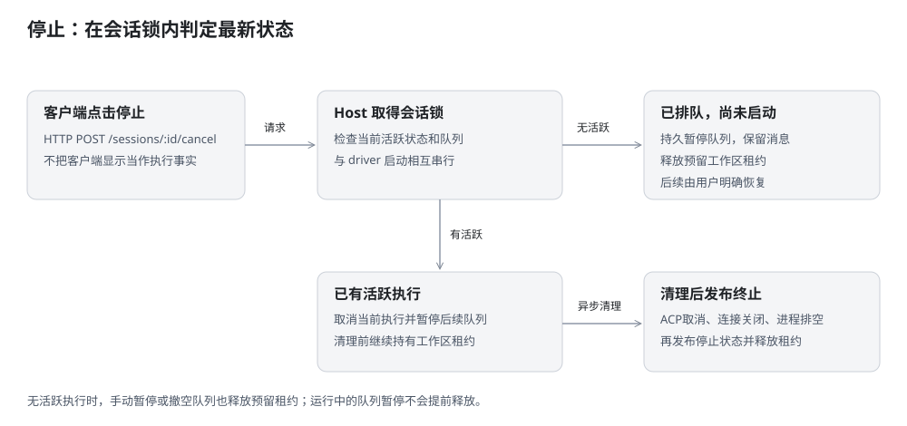

# 停止执行与队列交接

停止按Host拿到会话锁后的最新状态处理，不依据客户端最后一次看到的状态。HTTP成功表示停止请求已受理；实际运行的进程仍按原来的取消、关闭连接和排空流程结束，再异步发布终止状态。

## 已接收但尚未启动

如果没有活跃执行但已有排队消息，停止会持久化暂停队列，保留消息，发布已停止摘要，并释放预留的工作区租约。driver取得会话锁后会再次检查暂停状态，因此不会把这些消息自动启动。继续执行仍需要用户明确恢复队列；停止不自动撤回排队内容。

没有活跃执行时，手动暂停或撤空队列也会在提交状态后释放预留租约。有活跃执行时，仅暂停后续队列不会释放当前工作区租约，避免其他会话在工具仍工作时进入同一工作区。

## 验证边界

使用真实SQLite和当前线程调度，先复现“提交受理后、driver首轮执行前，停止被当作空闲无操作”的失败，再验证队列暂停、租约释放和没有Agent消息。另一个回归复现了空闲暂停后租约未释放，并覆盖暂停/撤回两个分支。正常执行的进程排空和队列恢复继续由Host集成覆盖。

手机回归先等待上一轮完成，再确认目标`/wait`的Run身份和运行状态；停止后核对同一个Run已经取消且队列暂停，避免仅凭上一轮提示通过。一度发生的手机提示超时没有留下失败快照，添加状态探针后的原情景未再次失败，因此不把该超时视为上述边界缺口的唯一根因证据。

活跃进程的详细清理链路见[进程排空图](diagrams/cancellation-drain.svg)。
