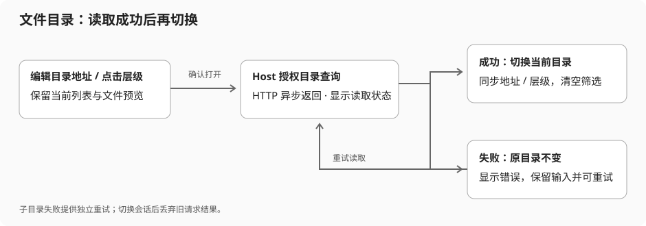

# 文件目录导航与读取恢复

目录地址输入是本页草稿，当前目录是上一次成功读取的位置。编辑地址不会立即切走文件列表。点击「打开目录」后，页面请求当前会话的 Host 目录接口；只有成功返回才更新当前目录、地址与目录层级导航，并清空文件筛选。失败保留原列表、已选文件与地址草稿，显示真实错误，便于修改后重试。

层级导航展示「工作区」及当前目录各级名称。点击任一级重新读取并定位到该目录；根目录通过「工作区」返回。含空格等路径仍完整传给 Host，由工作区路径校验决定是否可访问，客户端导航不扩大授权。

展开子目录时，目录请求按路径共享正在执行的 Promise。读取失败显示错误和「重试读取」，不再永久显示正在读取。重试只重新读取该目录。目录刷新沿用原有预览和目录缓存；导航时提供读取状态，离开会话/面板后，旧代次的异步结果不能覆盖新界面。

## 验证

正式桌面浏览器模拟一次真实 HTTP 503，验证子目录错误后可重试并看到文件。继续验证：编辑路径不改变列表、提交含空格目录后切换、提交不存在路径保留原列表和输入、通过层级导航返回工作区。原有文件内容、行号、差异、暂存切换与保存产物回归继续保留。手机页面检查导航与文件区域不产生页面横向溢出。
