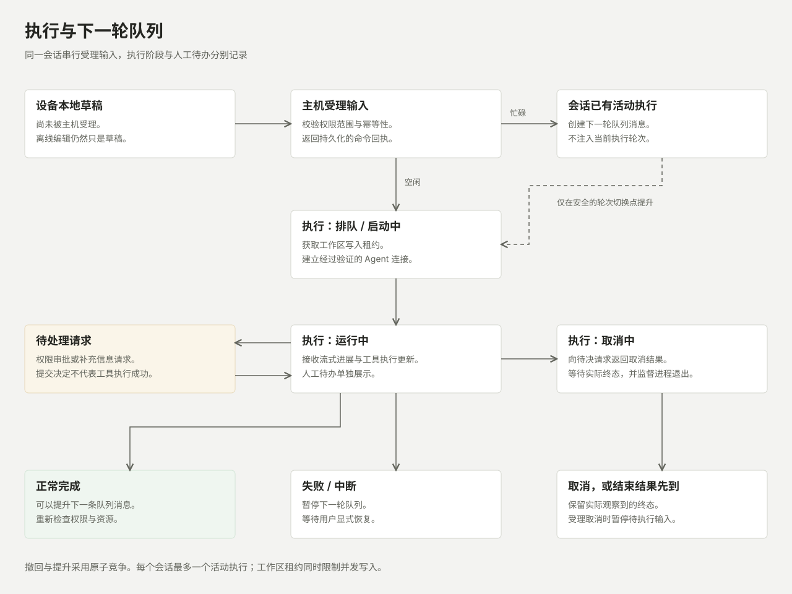
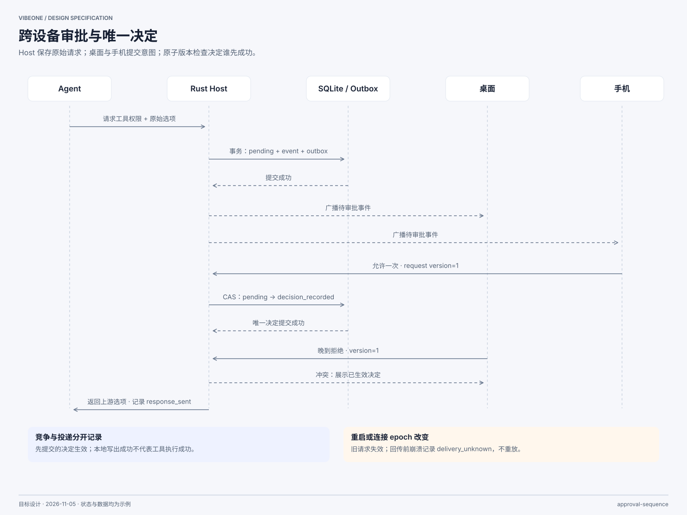
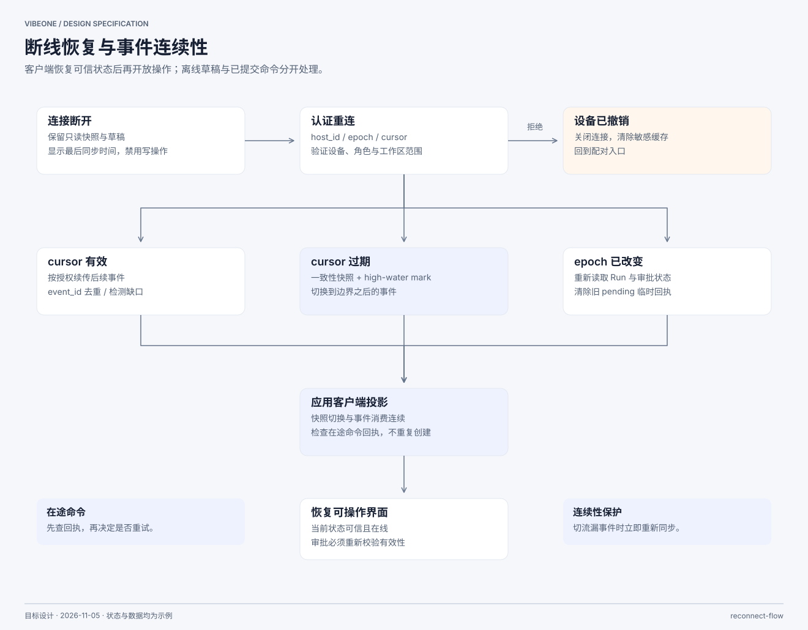
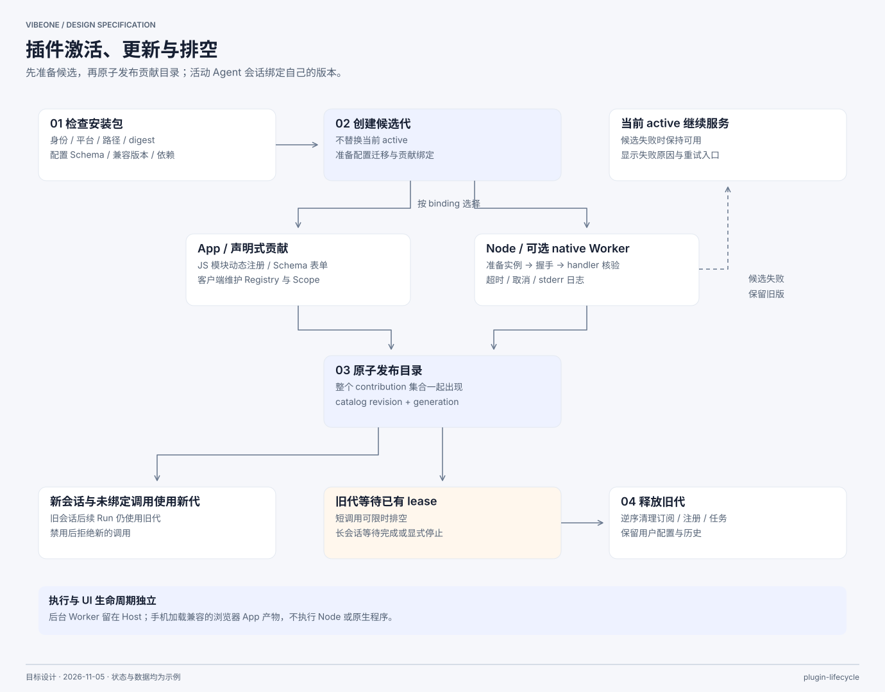
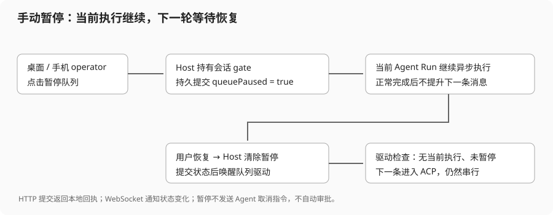

# VibeOne 功能实现设计

版本：0.3 · 2026-11-05。状态：待实施。主要功能范围见 [主要功能设计](core-functions.md)，架构边界见 [架构设计](architecture.md)，交互样式见 [UI 规范](ui-specification.md)。

## 1. 功能范围

| 功能域 | 首版交付 | 后续扩展 |
| --- | --- | --- |
| 工作区 | 导入目录、识别仓库、目录授权、变更查看 | 并行 Worktree 任务队列 |
| Agent | 探测、配置、能力展示、启动与取消 | 更多专有协议桥接 |
| 会话 | 结构化消息、工具时间线、历史、错误恢复 | 搜索、只读历史导入 |
| 审批 | 多端收件箱、原始动作详情、批准/拒绝、冲突处理 | 受限策略扩展 |
| 远程 | 单主机配对、角色、HTTPS/WSS、断线续传 | 多主机、中继与增强推送 |
| 插件 | JS App 动态注册、Node Worker、TS 构建为 JS、声明式资源、配置与候选更新 | WASM、不可信代码隔离 |
| 设置与诊断 | 设备、日志、连接、运行时版本、导出脱敏诊断 | 支持包自动分析 |

## 2. 启动与工作区

启动时桌面发现已有 Host，通过认证健康检查确认 host_id 和协议版本；无实例时启动 Host。Host 获取数据目录实例锁，完成数据库迁移，再开放 ready。失败时显示“服务未启动”及可操作错误，不能伪装成零会话的空列表。

导入工作区通过系统目录选择器；Host 验证根目录、可读写性、Git 信息和路径身份，保存 workspace_id。远程设备仅能选择已授权工作区，不能传任意本机路径创建授权。

工作区记录包含 canonical root、display_name、repository_id、write_policy 和配置版本；客户端只在必要场景显示路径。写权限 Run 启动时占用目录锁，冲突则排队或要求创建隔离工作区。

验收：重复导入能识别；无权限目录有明确修复提示；不擅自初始化 Git；目录被移动后提供重新定位而非静默新建。

## 3. Agent 发现与配置

Provider 返回启动描述：可执行文件、参数数组、cwd 策略、允许环境、版本探测和 capabilities。Host Supervisor 负责实际启动和子进程回收。标准 ACP 工具可以只用声明包，不必常驻插件 Worker。

配置按 Host → Workspace → Session 覆盖；明确显示当前有效值及来源。凭据只保存 secret_id，不出现在前端事件或导出诊断。登录过程由对应工具的认证机制完成，UI 显示认证状态与继续入口。

能力状态采用 supported / unsupported / unknown，展示来源和限制。不可用的模型切换、会话恢复和交互审批不能提供有效按钮；未知用量显示“未提供”。

验收：缺失程序、版本不兼容、认证失效、协议握手失败分别报错；探测过程不意外启动模型任务。

## 4. 会话与执行

### 4.1 发送与启动

1. 用户选择工作区、Agent 和配置，输入任务，可附带获准的文件引用。
2. 客户端提交 `session.submit`，携带 session_id 或新会话配置、idempotency_key、expected_version。
3. Host 校验设备权限、配置版本、工作区与并发额度；会话空闲时原子保存 Run、命令回执及事件，忙碌时原子保存 QueuedMessage 与对应回执。
4. Supervisor 准备进程，完成 ACP v2 initialize、认证检查和 session/new 或可用的 session/resume。
5. 发出 session/prompt，接受回执只表示消息插入，不表示执行完成；Actor 独立持续处理更新及反向请求，以活动状态后的 idle 与停止原因收束前台执行，运行失败保存结构化错误。

UI 点击发送后为“提交中”，Host 受理后才插入可信运行记录；输入草稿可以本地保留。网络重试复用同一个幂等键；用户修改内容重新发送才产生新命令。

`session.submit` 是串行追加操作，版本前置条件针对会话绑定及有效配置修订，而不是最后一条时间线事件。其他设备新发一条消息不会仅因此造成版本冲突；实际配置改变时则需返回冲突。相同幂等键携带不同输入必须报错。

### 4.2 流式投影

消息、工具调用、计划、用量分别建模；ACP v2 消息按消息类型和 messageId 联合定位，chunk 追加、快照替换、content 为 null 清空、遗漏 content 保留已有内容。不同消息类型即使 ID 相同也不能合并。工具按 toolCallId 增量更新，避免每个 token 都新建时间线行。目标中的持久事件具有 seq；当前预览仅支持内存快照与 WS 变更通知，临时动画不写入领域记录。

工具输出按需展开并分页，长日志不撑满会话；仅当用户已在底部时自动滚动，否则显示“有新进展”。多个并发工具按调用关系展示，不把完成时间当作发起顺序。

### 4.3 取消与完成

`run.cancel` 对仍活动的 Run 先进入 cancelling，再发送协议取消；Actor 仍接受并归档必要的结束更新。超出宽限期仍未退出时，Supervisor 按平台清理进程树。取消成功后标记 cancelled；若正常完成或失败结果先到，保留实际终态。待决权限请求按协议返回 cancelled outcome，不假设一定存在名为“拒绝”的选项。

Run completed 只表示该轮 Agent 执行结束，不代表代码已通过测试或已经合并。右侧变更区显示工作区当前 diff，并标记采集时刻；没有基线证据时不把所有差异归因于此 Run。

Agent/Host 异常退出后标记 interrupted，保留历史；若上游支持恢复，用户显式选择继续，否则以历史为上下文创建新会话。禁止静默重放原 prompt。

### 4.4 下一轮队列

同一 Session 只有一个活动 Run。忙碌时的新输入进入 Host 持久化队列，`session.submit` 返回明确的 `queued_message_id`，不向当前 prompt 注入消息，也不代替审批答复。回执带 `disposition: run_created | message_queued` 及对应实体 ID，同一输入只走一条路径。

正常完成、原请求已全部结清且资源检查通过后，下一条消息可以原子提升为新 Run。失败、取消、中断或投递状态不确定时暂停后续队列，用户显式恢复。Host 重启后先恢复事实和授权状态，不能直接自动消耗旧队列。

队列消息允许提升前撤回；与调度竞争时由同一原子状态转换决定胜者。已提升的撤回返回 Run ID，用户可取消该 Run。修改已提交内容采用撤回后重新提交，进入队尾。队列上限由 Host 校验，超限返回明确错误，不能丢弃旧消息。

执行阶段与 Attention 分开存储；`waiting_approval` 由活动执行和待批计数派生。普通补充信息单独计数、单独响应。审批拒绝不自动代表 Run 失败，Agent 可以继续尝试其他操作。

## 5. 审批与补充信息

### 5.1 审批创建

接收到权限请求后生成 approval_id，关联 host_epoch、connection_epoch、run_id、tool_call_id、原始选项、request_version 和可用期限。Host 在一个事务保存 pending、领域事件与通知 outbox，提交后才通知客户端。

详情展示工作区、Agent、原始命令/路径、差异、申请原因、选项范围和请求时间；可选摘要只能辅助原始信息。未知字段标“未提供”。期限只有 Host 实际设定时才显示，不能用示例倒计时造成虚假紧迫感。

### 5.2 决定提交

客户端提交 option_id、expected_version 和 idempotency_key。身份来自连接会话。Host 在线校验授权、epoch、状态与版本，通过 CAS 原子写入唯一决定。

第一份成功提交生效，另一台设备的晚到决定返回冲突与当前状态；UI 提示“已由其他设备处理”并撤下操作按钮。使用上游原始选项，不伪造“永久允许”。

### 5.3 投递与失效

区分 pending、decision_recorded、response_sent、delivery_unknown、expired、invalidated。Host 将决定返回上游后记录本地写入结果，UI 显示“决定已发送，等待后续进展”；收到实际工具更新后才显示其执行结果。

Host 重启时旧等待句柄已失效，旧请求进入 invalidated。提交与回传之间崩溃进入 delivery_unknown，保留审计并要求新调用重新请求。断线不自动放行；到期、取消和 Agent 提前退出均使原按钮失效。

补充信息使用独立 `interaction_id` 和 schema，普通问答与工具授权分开处理。两者可共享收件箱列表，但详情标题和动作文案必须不同。

## 6. 配对与多端同步

### 6.1 配对

桌面创建单次短时配对码，手机通过可信 HTTPS 入口兑换，再由桌面确认设备名称和角色。Host 只保存必要的凭据校验材料；配对码使用后立即失效，过期和重复兑换都返回明确错误。

角色按工作区授权：viewer 只读；operator 可创建/取消任务；approver 可处理权限；owner 可管理设备与插件。角色组合由 Host 记录，不依靠前端隐藏按钮实现授权。远程首版不开放通用 shell。

### 6.2 重连与一致性

客户端按 host_id + epoch 保存最后应用的事件 cursor，重连后先验证身份与授权：

- cursor 可用：续传获准范围内的后续事件。
- cursor 过期：取带 high-water mark 的一致性快照，再续传此边界后的事件。
- epoch 改变：清理旧临时状态，重新读取运行/审批事实；不得应用旧 pending 回执。
- 设备被撤销：关闭连接、清除本地敏感缓存并返回配对入口。

快照与后续事件订阅必须由 Host 提供连续性：先确定快照边界或缓冲后续事件，再切流；不能用两个无关联请求拼接而漏掉中间事件。客户端按 event_id 去重，检测缺口后重新同步。

### 6.3 离线与后台

断线显示最后同步时间并保留只读快照；输入草稿可编辑，但发送、取消和审批需在线。已发命令超时后先查询回执，不能直接认定失败并换新幂等键重试。

PWA 后台可能暂停连接，通知是增强通道；推送只传不透明对象 ID 和最小状态。打开通知后拉取在线详情，不通过锁屏推送直接批准。没有推送授权时，应用仍应完整可用。

## 7. 插件安装、运行与更新

### 7.1 包结构与绑定

目标包结构统一为 `plugin.json`、构建后的 JS App / Worker、配置 Schema、声明资源及可选平台原生构件；安装快照与用户配置/secret/data 分离。作者可写 JS 或 TS，运行时只加载 JS。格式与 SDK 详见 [插件机制设计](plugin-design.md)，版本化字段在最小运行时验证后冻结。

每个 contribution 包含 id、kind、kind_version、binding 和配置引用。binding 显式选择 declarative、app 注册或 worker handler，Host 只接受已支持的 kind；无消费者的 kind 拒绝或标不兼容，不静默安装成成功。

首版扩展点：Agent 启动描述、通知渠道、命令、设置表单、状态卡片。App 的 `activate(ctx)` 注册面板、命令、Hook 和服务，由 Scope 清理；跨进程调用使用序列化 DTO。

### 7.2 安装与激活

先只读检查路径、平台、摘要、版本、依赖和入口，给用户展示来源与本机代码信任范围；安装不执行包内任意 install script。声明资源编译为目录；有后台逻辑时准备 Node 或 native Worker 并握手，验证 handler 绑定后准备发布；客户端另行加载构建后的 App ESM。

一个候选版本的 Host contribution 集合原子发布，客户端按 catalog revision 获取；App 在各客户端独立准备和替换注册，激活失败需明确展示，不能宣称跨设备同时生效。Worker 通过受身份与 generation 约束的 Host RPC 调用服务，stdout 只输出协议，stderr 进入限额日志。

进程分离提供故障边界，不意味着原生程序受到 OS 权限限制；首版仅运行用户信任的 native 插件。若未来支持不可信代码，需要单独的受限运行时契约。

### 7.3 更新、禁用与卸载

新候选准备失败时保留旧 active，设置页展示失败原因与重试。新版本发布后，新会话与未绑定旧代的新调用使用新代；旧会话通过显式 lease 固定 Provider 代次，后续 Run 也沿用旧代，直到显式关闭或经过验证的迁移。短请求可设置排空期限，长会话需等待完成或用户选择停止。配置 Schema 不兼容时先迁移候选配置，失败不破坏原配置。

禁用后停止接受新调用，撤下 UI 贡献并保留配置；已有任务按明确策略排空。卸载先处理活跃会话和依赖，再移除安装物；清除用户数据是独立选择。Scope 逆序撤销 App 注册、服务、Hook、订阅和后台任务；共享 Node 进程退出时按受影响实例集合处理，不能声称撤销已发生的外部副作用。

## 8. API 草案

以下是用例契约草案，不是已实现接口。HTTP 命令经统一 dispatcher 执行，WS 用于订阅；两端共用权限与错误模型。

插件后台命令使用 HTTP 202 返回 operation_id 受理回执，Worker 通过独立 JSON-RPC 完成调用，Host 落库后经 WS/WSS 推送进度与终态；SDK Promise 等到终态才结束。查询使用 HTTP 200 返回当前数据，操作可通过 HTTP 查询核对。具体服务边界与异步时序见 [插件机制设计](plugin-design.md#24-同步异步与返回方式)。

| 契约 | 输入重点 | 返回重点 |
| --- | --- | --- |
| `workspace.import/list` | 本地选择结果、显示名 | workspace、授权与诊断 |
| `agent.detect/configure` | provider、配置版本 | 能力、认证状态、有效配置 |
| `session.create/get` | workspace、provider / session_id | 元数据、投影、恢复能力 |
| `session.submit` | 会话、幂等键、版本、输入 | command receipt、run_created / message_queued 及对应 ID |
| `session.queue.withdraw/resume` | 队列项 / 会话、幂等键、版本 | 撤回、已提升的 Run 或恢复调度回执 |
| `run.cancel` | run_id、幂等键、版本 | command receipt、实际执行阶段 |
| `approval.list/decide` | 范围 / option_id、请求版本 | 决定、投递状态或冲突 |
| `device.pair/revoke` | 单次码 / device_id | 配对状态 / 撤销回执 |
| `sync.snapshot/subscribe` | 授权范围、cursor | revision、high-water mark、事件 |
| `plugin.inspect/install` | 包引用、digest、安装意图 | 检查结果、operation_id |
| `plugin.enable/update/disable` | plugin_id、期望代 | operation_id、catalog revision |
| `plugin.command.invoke` | contribution、generation、输入 | 执行回执或结构化结果 |

统一错误包含 code、message、retryable、correlation_id 和已脱敏 details。主要错误：permission_denied、version_conflict、host_offline、capability_unavailable、approval_stale、plugin_incompatible、runtime_failed。客户端不能把所有异常降为“未知错误”。

## 9. 事务与通知

Run/审批状态、领域事件和通知 outbox 同事务保存；WS 和插件消费提交后的事件。通知使用 event_id 幂等，重试有次数与退避；失败不能回滚已提交的审批决定。大附件只传 artifact_id、大小和摘要，下载重新鉴权。

数据库表及事件字段见架构文档。配置更新、插件发布与审批提交分别做版本检查，不用一个全局锁阻塞全部功能。日志禁止记录密钥、完整环境变量或设备长期凭证。

## 10. 功能验收

- 两个真实工具完成发送、结构化进展、取消及能力展示，至少一条真实交互审批链路。
- 同一命令重试不产生重复 Run；跨端竞争审批只有一个决定。
- 断线、cursor 过期、epoch 改变和设备撤销分别有可测试分支。
- 插件候选失败保留旧版本；声明包不多启动 Worker；活动会话不会被短请求排空期限误杀。
- 桌面与手机可独立完成核心任务；离线、空数据、首次使用、错误与加载状态均有对应界面。

## 输入框指令与文件引用

已接入真实 ACP 命令建议、工作台快捷指令与 `@` 工作区目录/文件选择，支持多文件引用标签及键盘操作。详见 [输入框指令与文件引用](composer-interactions.md)。

## 文件与变更浏览器

右侧提供按需展开的真实目录树、已展开文件筛选、完整路径、选中态和列表开合。文件采用只读行号视图，Git统一差异使用hunk真实行号、增删颜色与数量，支持暂存/未暂存切换。空文件、非Git、二进制、256KiB截断和5000行显示限制分别说明。过期请求不能覆盖新会话或新选中文件；读取与产物保存始终经过Host范围校验。覆盖进度见 [原型功能补齐清单](prototype-completion.md)。

## 回答与跨面板操作

最终回答可复制原始 Markdown，成功/失败分别提示，不复制 HTML 排版后的文本。执行记录与终端命令仅在实际 runId 能匹配当前对话轮次时提供定位；没有关联标识时不推测对应轮次。定位会暂停自动跟随，手机返回对话视图。

网页的返回/前进使用会话内最近100条显式打开地址，不能读取跨域 iframe 内部导航历史；每次加载仍经过 HTTP(S) 地址限制与 iframe 隔离。预览支持扩大/恢复；重新拖动恢复手工宽度。最后完成的执行可显示工作区当前变更入口，数量来自 Host 的真实 Git 查询，明确包含其他来源的修改。

## Agent 配置控件

输入区的「模型与模式」及 Agent 侧栏共同使用上游 ACP `configOptions`：`select` 渲染可用值（包括分组名称），`boolean` 渲染开关；未知类型只在完整配置中展示说明，不猜测数值。配置经 Host `/configure` 转发并等待上游回执，失败保持原值。运行、队列未清空、归档、历史只读、离线及非 operator 设备不能修改。

Profile 设置增加「恢复默认入口」，仅清空未保存的命令和参数；用户保存修订后才用于新会话，不改变已有会话。常规设置补齐 Agent 管理、数据详情跳转及串行/队列规则说明。

## 手动暂停下一轮队列

有排队消息时，operator 可暂停或恢复队列。暂停只持久设置 `queuePaused`，不调用 ACP 取消：当前 Run 继续，正常完成后仍不提升后续消息。恢复可以在当前 Run 执行中提交，驱动仍等待当前执行结束后串行提升。空队列暂停、暂停与恢复/撤回混合请求会拒绝；新上下文恢复仍需空闲并显式选择。

Host 快照通过 `features: ["queuePause"]` 声明支持，旧主机的暂停按钮不可用；结束执行后在数据与诊断中重启加载新版 Host。状态提交、队列提升均持有原有会话 gate，继续使用 SQLite 事务和 WebSocket 快照通知。

## 项目会话栏与最近排序

左侧可切换「最近」和「按项目」，项目名称来自Host工作区目录，展开项只包含该工作区真实会话；搜索时显示匹配项并展开所在项目。添加项目进入既有工作区管理，远程设备不显示该主机管理入口。

最近列表依据持久 `lastActivityAt` 排序，旧快照缺少此字段时回退至Run时间；创建、消息及状态提交更新活动时间，重启不丢失。桌面可收起/展开会话栏，Cmd/Ctrl+K恢复侧栏并聚焦搜索。视图选择与侧栏开合保存在本设备，手机继续用会话列表/返回导航。

## 上传附件与图片

输入区已接文件选择、粘贴图片、拖入文件、移除与缩略预览；允许只发送附件。字节由Host在私有SQLite中保存，消息仅引用服务端ID，进入既有幂等Run与串行队列。ACP按真实 `session.prompt` 能力发送图片/文本/嵌入文件，不以文件名冒充发送内容；失败记录可恢复到输入框后修改，恢复不会自动发送。详情与SVG见 [附件与图片实现方案](attachments.md)。

## 持久历史与长会话阅读

会话运行窗口保留128条消息与100项工具，完整消息/工具档案与事件、会话在同一SQLite事务保存。按 `historyOrder`（稳定顺序）和 `historyRevision`（修改修订）分页并合并实时快照，早期记录的后续增量先恢复原文再拼接。待上游接受的用户输入保留同一历史身份，结束执行后即使已被窗口淘汰也会结算接收状态。

桌面和手机共享分页缓存；加载更早记录保持可见记录位置，断线重连同步已加载区间，工具保留真实Run关联。首次升级按事件回填并保存断点，缺少早期原始记录的导入会显示恢复范围说明。具体接口、限制和流程图见 [持久会话历史与分页](conversation-history.md)。

## 通知权限与冷启动基线

通知设置分别管理本设备开关和实际系统授权；macOS通过Tauri命令调用UserNotifications，浏览器使用Notification API。刷新及窗口聚焦会重新读取状态，失败如实反馈。首次有效快照只建立基线，后续新事件才提醒。接口、数据流与实机边界见 [通知与系统授权](notifications.md)。

## 工作区目录导入

工作区设置可粘贴绝对路径，也可通过“选择目录”填入，再点击“导入工作区”确认。前端先拒绝相对路径，Host继续执行实际目录存在性、规范路径与持久工作区校验；失败保留输入，成功清空并显示导入结果。重复导入同一规范路径复用原工作区，不移动工程文件。断线时保留路径但不可提交；该管理入口仅开放给本机管理员。
