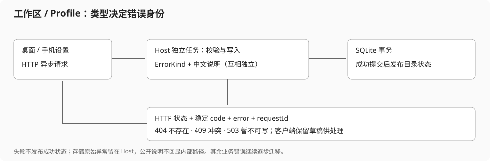

# HTTP错误契约

桌面和手机共用同一种HTTP失败信封。业务接口、鉴权、路由和请求解析的4xx/5xx均输出JSON；成功的JSON、文件内容与WS升级保持原来格式。`features`中的`structuredErrors`表示主机支持此契约。

```json
{
  "code": "CONFLICT",
  "error": "同一幂等键的插件操作内容不同",
  "status": 409,
  "requestId": "a3ae0841-73a6-41df-b14e-fc45ff450830"
}
```

以上是格式示例。code为不超过128字节的非空ASCII标识，供程序分支判断；error保留接口原有中文说明；status与实际HTTP状态一致。已有专用码（例如OPERATION_NOT_FOUND）不被通用码覆盖。其他请求解析失败使用中文通用指引，不回显框架的原始页面。

## 通用码

| HTTP状态 | 通用code | 含义 |
| --- | --- | --- |
| 400 | INVALID_REQUEST | 请求格式、参数或当前业务输入不符合要求 |
| 401 | UNAUTHENTICATED | 未配对、凭据过期或已撤销 |
| 403 | FORBIDDEN | 来源、角色或范围不允许 |
| 404 | NOT_FOUND | 接口或记录不存在；专用码优先 |
| 405 | METHOD_NOT_ALLOWED | 不支持此请求方法 |
| 408 | REQUEST_TIMEOUT | 请求等待超时 |
| 409 | CONFLICT | 幂等内容、修订或决定冲突 |
| 413 | PAYLOAD_TOO_LARGE | 当前接口请求正文超过限制 |
| 415 | UNSUPPORTED_MEDIA_TYPE | 请求内容类型不符合要求 |
| 422 | VALIDATION_FAILED | JSON字段类型或结构不符合要求 |
| 429 | RATE_LIMITED | 请求频率超限 |
| 500 | INTERNAL_ERROR | 主机服务内部失败 |
| 502 / 503 / 504 | UPSTREAM_UNAVAILABLE / SERVICE_UNAVAILABLE / UPSTREAM_TIMEOUT | 上游或主机暂时不可用/超时 |

未单独列出的5xx使用INTERNAL_ERROR，其他失败状态使用REQUEST_FAILED。已迁移接口按下文的领域错误映射状态；尚未将全部内部Result&lt;_, String&gt;替换为领域错误枚举，因此部分旧接口的“记录不存在”等业务校验仍可能返回400，不能宣称已有完整领域错误分类。

## 响应身份与兼容

每次API响应由主机生成requestId，错误JSON和`x-vibeone-request-id`响应头使用同一值，不接受客户端指定的身份。它用于区分本次响应，不是持久操作回执；不提供按requestId查询历史的接口。后台操作仍用operationId对账。

失败信封由Rust `ErrorResponse` DTO序列化，保留Allow、Retry-After等原响应头，重算JSON内容类型及长度，并禁止缓存错误。仅输出约定字段，说明最多4000字符；令牌、Cookie、请求正文和响应对象的其他字段不加入错误身份。未知API路径单独返回API错误，不落入手机SPA页面回退。

客户端统一抛出HostRequestError，保留status、code和requestId；实际HTTP状态优先于正文自报status。旧主机没有code时按HTTP状态补通用码，仍保留原说明；未知新码原样保留，不把中文说明解析成程序条件。无效/非JSON旧错误使用通用说明。401的手机退出配对行为不变。

## 验证

真实Host检查401/403、404/405、400非法JSON与查询、415、422、413、409及专用404码；错误身份每次不同且与响应头一致，成功快照保持原结构。真实HTTP服务检查503、Retry-After保留及未知字段剔除。客户端检查旧格式、未知码、无效字段和实际状态优先。

桌面完整交互与HTTPS手机回归继续核对消息、附件字节、人工处理、插件、游标恢复及撤销；手机未知API路径检查确保返回授权错误JSON，不能返回页面HTML。此契约是14的一部分，业务DTO生成和全部领域错误替换仍独立待交付。

## 工作区和配置领域错误

工作区导入与 Profile 保存/移除现在返回 `DomainError`（领域错误），在失败发生处选择 `ErrorKind`（错误类别）；HTTP 层只映射类型，不匹配中文提示。修改文案不会改变错误身份。其余尚未迁移的业务接口继续使用旧兼容映射，不能据此宣布所有领域错误完成。

| code | HTTP | 处理含义 |
| --- | --- | --- |
| INVALID_INPUT | 400 | 修正名称、启动程序或参数后重试 |
| PROFILE_NOT_FOUND | 404 | 记录已移除或身份不存在，刷新目录 |
| PROFILE_CONFLICT | 409 | 修订或原始记录摘要变化，刷新后重新编辑 |
| PROFILE_LIMIT_REACHED | 409 | 配置数量或修订上限，先清理配置或另建记录 |
| WORKSPACE_NOT_FOUND | 404 | 目录不存在，重新选择 |
| WORKSPACE_FORBIDDEN | 403 | 操作系统拒绝访问，检查目录权限 |
| STORAGE_UNAVAILABLE | 503 | 存储写入/查询失败，状态不作成功发布，检查诊断 |
| HOST_UNAVAILABLE | 503 | 主机停止中或已检测到存储失败，不接受新写入 |
| INTERNAL_ERROR | 500 | 内部任务或编码失败，检查诊断 |

存储异常保留在 Host 内部诊断状态；公开错误使用固定说明，不回显 SQLite 路径或原始异常。HTTP 身份仍由统一中间件补充，原有中文说明及调用方对未知码的兼容保留。命令继续在独立任务中执行，浏览器断开不会取消已经受理的写入。



验证包含实际 HTTP 的不存在、无效输入、修订/摘要冲突以及成功变更后的状态；真实 SQLite 关闭后验证存储失败与后续拒写，不以文案模拟存储错误。

## 发送、停止与队列领域错误（79）

`messages`、`cancel` 和 `queue` 的失败现在由实际状态分支构造领域错误，HTTP 不再从这些路径的中文说明猜测冲突。成功受理的消息仍返回 `202` 和原来的 `operationId`；相同幂等键及相同内容返回原回执，不重复执行。失败的输入不创建 Run（执行轮次）或队列项。

| code | HTTP | 含义及处理 |
| --- | --- | --- |
| INVALID_INPUT | 400 | 输入为空/超长、幂等键格式无效或队列操作参数矛盾，修正后重试 |
| SESSION_NOT_FOUND | 404 | 会话不存在，刷新列表 |
| SESSION_UNAVAILABLE | 409 | 会话已归档、历史只读或连接失效，先检查会话状态 |
| CONFIGURATION_BUSY | 409 | 配置正在修改，完成后再提交 |
| IDEMPOTENCY_CONFLICT | 409 | 同一键已绑定不同输入，核对原回执，不复用该键提交其他内容 |
| WORKSPACE_BUSY | 409 | 同一工作区被其他会话占用，等待结束或使用独立工作树 |
| RUN_LIMIT_REACHED | 409 | 队列或会话执行数达到上限，撤回排队项或另建会话 |
| QUEUE_CONFLICT | 409 | 待暂停/撤回项已不存在或当前状态不允许恢复，刷新队列 |
| CONTEXT_CONFLICT | 409 | 历史上下文尚未选择，先明确选择原上下文或新上下文 |
| INVALID_REFERENCE | 400 | 文件/文件夹范围、类型、数量或内容无效，调整引用 |
| INVALID_ATTACHMENT | 400 | 附件身份、归属、数量/总量或媒体能力不满足要求，调整附件 |
| PROVIDER_UNAVAILABLE | 503 | 插件 Provider 不可用，检查插件状态 |
| PROVIDER_CONFLICT | 409 | 固定 Provider 代次发生变化，按提示另建会话 |
| DELIVERY_UNCERTAIN | 502 | 停止意图已保存，但上游信号投递未确认；查看 Run 状态，不能据此认定已停止 |
| STORAGE_UNAVAILABLE / HOST_UNAVAILABLE | 503 | 存储失败或主机正在停止；公开响应使用固定说明 |

附件受理读取中的数据库异常与附件校验错误分别分类，不把数据库关闭误报成无效附件。提交持久化失败时释放本次预留的工作区租约，不发布成功回执。新上下文选择允许发生在尚未初始化 ACP 的空会话中，不因缺少 Agent 状态而崩溃，也不因此启动任务。

自动验证包含不存在会话、归档会话、真实范围拒绝、附件归属、20 项队列上限、幂等回执、工作区互斥与取消；关闭真实 SQLite 后分别验证附件读取失败、提交写入失败、公开错误不带内部路径、无 Run 发布及无工作区租约残留。补充信息、审批、会话创建等其余旧领域错误路径继续单独迁移，不能把本次改动视为14整体完成。
