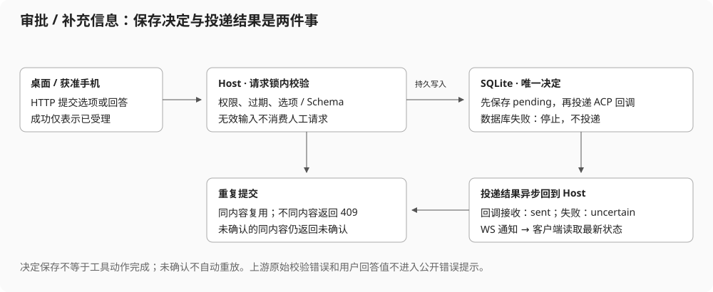
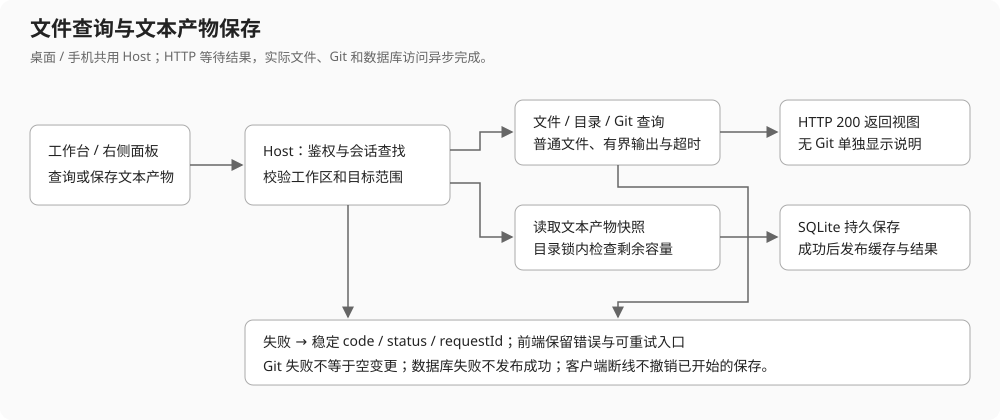
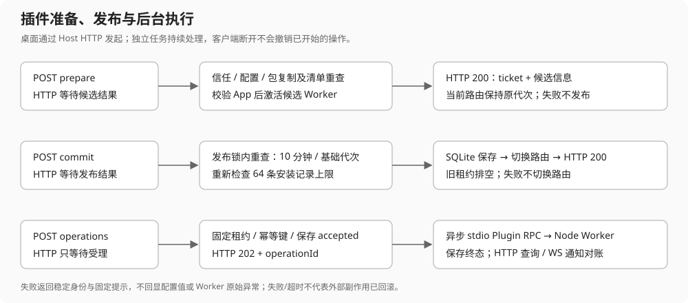

# HTTP错误契约

桌面和手机共用同一种HTTP失败信封。业务接口、鉴权、路由和请求解析的4xx/5xx均输出JSON；成功的JSON、文件内容与WS升级保持原来格式。`features`中的`structuredErrors`表示主机支持此契约。

```json
{
  "code": "CONFLICT",
  "error": "同一幂等键的插件操作内容不同",
  "status": 409,
  "requestId": "a3ae0841-73a6-41df-b14e-fc45ff450830"
}
```

以上是格式示例。code为不超过128字节的非空ASCII标识，供程序分支判断；error保留接口原有中文说明；status与实际HTTP状态一致。已有专用码（例如OPERATION_NOT_FOUND）不被通用码覆盖。其他请求解析失败使用中文通用指引，不回显框架的原始页面。

## 通用码

| HTTP状态 | 通用code | 含义 |
| --- | --- | --- |
| 400 | INVALID_REQUEST | 请求格式、参数或当前业务输入不符合要求 |
| 401 | UNAUTHENTICATED | 未配对、凭据过期或已撤销 |
| 403 | FORBIDDEN | 来源、角色或范围不允许 |
| 404 | NOT_FOUND | 接口或记录不存在；专用码优先 |
| 405 | METHOD_NOT_ALLOWED | 不支持此请求方法 |
| 408 | REQUEST_TIMEOUT | 请求等待超时 |
| 409 | CONFLICT | 幂等内容、修订或决定冲突 |
| 413 | PAYLOAD_TOO_LARGE | 当前接口请求正文超过限制 |
| 415 | UNSUPPORTED_MEDIA_TYPE | 请求内容类型不符合要求 |
| 422 | VALIDATION_FAILED | JSON字段类型或结构不符合要求 |
| 429 | RATE_LIMITED | 请求频率超限 |
| 500 | INTERNAL_ERROR | 主机服务内部失败 |
| 502 / 503 / 504 | UPSTREAM_UNAVAILABLE / SERVICE_UNAVAILABLE / UPSTREAM_TIMEOUT | 上游或主机暂时不可用/超时 |

未单独列出的5xx使用INTERNAL_ERROR，其他失败状态使用REQUEST_FAILED。已迁移接口按下文的领域错误映射状态；尚未将全部内部Result&lt;_, String&gt;替换为领域错误枚举，因此部分旧接口的“记录不存在”等业务校验仍可能返回400，不能宣称已有完整领域错误分类。

## 响应身份与兼容

每次API响应由主机生成requestId，错误JSON和`x-vibeone-request-id`响应头使用同一值，不接受客户端指定的身份。它用于区分本次响应，不是持久操作回执；不提供按requestId查询历史的接口。后台操作仍用operationId对账。

失败信封由Rust `ErrorResponse` DTO序列化，保留Allow、Retry-After等原响应头，重算JSON内容类型及长度，并禁止缓存错误。仅输出约定字段，说明最多4000字符；令牌、Cookie、请求正文和响应对象的其他字段不加入错误身份。未知API路径单独返回API错误，不落入手机SPA页面回退。

客户端统一抛出HostRequestError，保留status、code和requestId；实际HTTP状态优先于正文自报status。旧主机没有code时按HTTP状态补通用码，仍保留原说明；未知新码原样保留，不把中文说明解析成程序条件。无效/非JSON旧错误使用通用说明。401的手机退出配对行为不变。

## 验证

真实Host检查401/403、404/405、400非法JSON与查询、415、422、413、409及专用404码；错误身份每次不同且与响应头一致，成功快照保持原结构。真实HTTP服务检查503、Retry-After保留及未知字段剔除。客户端检查旧格式、未知码、无效字段和实际状态优先。

桌面完整交互与HTTPS手机回归继续核对消息、附件字节、人工处理、插件、游标恢复及撤销；手机未知API路径检查确保返回授权错误JSON，不能返回页面HTML。此契约是14的一部分，业务DTO生成和全部领域错误替换仍独立待交付。

## 工作区和配置领域错误

工作区导入与 Profile 保存/移除现在返回 `DomainError`（领域错误），在失败发生处选择 `ErrorKind`（错误类别）；HTTP 层只映射类型，不匹配中文提示。修改文案不会改变错误身份。其余尚未迁移的业务接口继续使用旧兼容映射，不能据此宣布所有领域错误完成。

| code | HTTP | 处理含义 |
| --- | --- | --- |
| INVALID_INPUT | 400 | 修正名称、启动程序或参数后重试 |
| PROFILE_NOT_FOUND | 404 | 记录已移除或身份不存在，刷新目录 |
| PROFILE_CONFLICT | 409 | 修订或原始记录摘要变化，刷新后重新编辑 |
| PROFILE_LIMIT_REACHED | 409 | 配置数量或修订上限，先清理配置或另建记录 |
| WORKSPACE_NOT_FOUND | 404 | 目录不存在，重新选择 |
| WORKSPACE_FORBIDDEN | 403 | 操作系统拒绝访问，检查目录权限 |
| STORAGE_UNAVAILABLE | 503 | 存储写入/查询失败，状态不作成功发布，检查诊断 |
| HOST_UNAVAILABLE | 503 | 主机停止中，不接受新写入；已检测到的存储失败保持 STORAGE_UNAVAILABLE 身份 |
| INTERNAL_ERROR | 500 | 内部任务或编码失败，检查诊断 |

存储异常保留在 Host 内部诊断状态；公开错误使用固定说明，不回显 SQLite 路径或原始异常。HTTP 身份仍由统一中间件补充，原有中文说明及调用方对未知码的兼容保留。命令继续在独立任务中执行，浏览器断开不会取消已经受理的写入。


验证包含实际 HTTP 的不存在、无效输入、修订/摘要冲突以及成功变更后的状态；真实 SQLite 关闭后验证存储失败与后续拒写，不以文案模拟存储错误。

## 发送、停止与队列领域错误（79）

`messages`、`cancel` 和 `queue` 的失败现在由实际状态分支构造领域错误，HTTP 不再从这些路径的中文说明猜测冲突。成功受理的消息仍返回 `202` 和原来的 `operationId`；相同幂等键及相同内容返回原回执，不重复执行。失败的输入不创建 Run（执行轮次）或队列项。

| code | HTTP | 含义及处理 |
| --- | --- | --- |
| INVALID_INPUT | 400 | 输入为空/超长、幂等键格式无效或队列操作参数矛盾，修正后重试 |
| SESSION_NOT_FOUND | 404 | 会话不存在，刷新列表 |
| SESSION_UNAVAILABLE | 409 | 会话已归档、历史只读或连接失效，先检查会话状态 |
| CONFIGURATION_BUSY | 409 | 配置正在修改，完成后再提交 |
| IDEMPOTENCY_CONFLICT | 409 | 同一键已绑定不同输入，核对原回执，不复用该键提交其他内容 |
| WORKSPACE_BUSY | 409 | 同一工作区被其他会话占用，等待结束或使用独立工作树 |
| RUN_LIMIT_REACHED | 409 | 队列或会话执行数达到上限，撤回排队项或另建会话 |
| QUEUE_CONFLICT | 409 | 待暂停/撤回项已不存在或当前状态不允许恢复，刷新队列 |
| CONTEXT_CONFLICT | 409 | 历史上下文尚未选择，先明确选择原上下文或新上下文 |
| INVALID_REFERENCE | 400 | 文件/文件夹范围、类型、数量或内容无效，调整引用 |
| INVALID_ATTACHMENT | 400 | 附件身份、归属、数量/总量或媒体能力不满足要求，调整附件 |
| PROVIDER_UNAVAILABLE | 503 | 插件 Provider 不可用，检查插件状态 |
| PROVIDER_CONFLICT | 409 | 固定 Provider 代次发生变化，按提示另建会话 |
| DELIVERY_UNCERTAIN | 502 | 停止意图已保存，但上游信号投递未确认；查看 Run 状态，不能据此认定已停止 |
| STORAGE_UNAVAILABLE / HOST_UNAVAILABLE | 503 | 存储失败或主机正在停止；公开响应使用固定说明 |

附件受理读取中的数据库异常与附件校验错误分别分类，不把数据库关闭误报成无效附件。提交持久化失败时释放本次预留的工作区租约，不发布成功回执。新上下文选择允许发生在尚未初始化 ACP 的空会话中，不因缺少 Agent 状态而崩溃，也不因此启动任务。

自动验证包含不存在会话、归档会话、真实范围拒绝、附件归属、20 项队列上限、幂等回执、工作区互斥与取消；关闭真实 SQLite 后分别验证附件读取失败、提交写入失败、公开错误不带内部路径、无 Run 发布及无工作区租约残留。补充信息、审批、会话创建等其余旧领域错误路径继续单独迁移，不能把本次改动视为14整体完成。

## 审批、补充信息与会话控制（80）

审批、补充信息、会话配置和元数据现在也在领域分支选择错误身份。无效回答或审批选项不会消费请求；相同已保存决定的重复提交不生成第二条记录，不同内容返回冲突。所有写命令（包括配置）都在独立任务中处理，关闭客户端连接不会撤销已经开始的保存或更新。

| code | HTTP | 含义及处理 |
| --- | --- | --- |
| ATTENTION_EXPIRED | 409 | 请求不存在、已过期、已处理或上游回调已失效，刷新待处理列表 |
| DECISION_CONFLICT | 409 | 同一请求已经保存其他选项或回答，不覆盖原决定 |
| INVALID_DECISION | 400 | 审批选项不在上游提供的列表中 |
| INVALID_ANSWER | 400 | 回答动作、字段或选项不符合 Agent 的要求，修正后提交 |
| UPSTREAM_INVALID | 502 | Agent 提供的输入 Schema 无效，检查接入工具 |
| AGENT_DISCONNECTED | 409 | 当前没有可用的交互或配置连接，检查会话状态 |
| CONFIGURATION_UNSUPPORTED | 400 | 配置项未由 Agent 声明，刷新配置列表 |
| INVALID_CONFIGURATION | 400 | 已声明 select/boolean 的值不在列表中或类型不符 |
| CONFIGURATION_BUSY | 409 | 正在执行/排队/修改配置、处于历史或待恢复状态，或已归档，暂不能修改 |
| CONFIGURATION_FAILED | 502 | 上游配置更新未确认，刷新实际值后再决定是否重试 |
| SESSION_BUSY | 409 | 执行、配置更新、队列或人工请求尚未结清，不能归档 |
| SESSION_NOT_FOUND / STORAGE_UNAVAILABLE / HOST_UNAVAILABLE | 404 / 503 / 503 | 与其他会话命令一致 |

审批和补充输入先持久保存唯一决定，再向当前连接的回调投递。投递失败时两者都持久标记 `delivery: uncertain`，返回 `DELIVERY_UNCERTAIN`；相同内容重试继续返回未确认，不自动重放，也不把它当成投递成功。`pending` 和 `sent` 的相同内容重试可返回原保存回执，但成功回执仅表示决定已受理，不代表工具动作成功。进程重启仍不重放旧审批或问题。

回答验证采用具名的过期、非法回答、非法 Schema 错误，不再解析校验器文案。公开提示不包含用户回答值、完整 Schema 或上游原始异常，以免私密输入出现在错误提示中。已知 select 支持分组；boolean 保留真假类型区别。未知/自定义 ACP 配置类型仍交由上游判断，不假造其选项。



验证包括真实 Host 的非法选项/回答不消费请求、相同内容去重、不同内容冲突、取消后过期、配置和归档状态冲突；真实 SQLite 故障不发布决定。单元验证审批回调先失效时保留唯一未确认记录、输入共用的持久状态转换、相同内容不重放，以及 SDK 中“验证通过后回调接收端关闭”的投递失败边界。真实网络故障的时序不由固定延时测试冒充完整证明。会话创建及其他旧业务入口的错误迁移仍继续，14尚未全部完成。

输入回调的 `input_resolved` 事件携带 `received` 布尔标记，表示本次回调是否实际收到用户回答。超时、取消及接收端关闭为false；Host只在true时将对应决定记为sent，缺失标记也不推断已发送。因此后到的取消事件不能把uncertain误改为sent。标记不包含回答值。专门红/绿回归验证该竞态，SDK虚拟时钟验证正常回答与超时分别产生true/false。

## 会话创建与附件入口（81）

会话创建、附件上传/读取/移除现在返回明确领域错误；选定 Profile（接入配置）的查找和解码也区分不存在与记录无效，环境探测复用同一结果。已受理的上传和草稿移除在独立命令任务中完成，客户端断开不把已经开始的数据库变更中断在半途。

| code | HTTP | 含义及处理 |
| --- | --- | --- |
| PROVIDER_NOT_FOUND | 404 | Agent 入口不存在，刷新列表 |
| PROVIDER_UNAVAILABLE / PROVIDER_CONFLICT | 503 / 409 | 工具未就绪、插件不可用或代次正在变化，检查接入环境 |
| PROFILE_NOT_FOUND / PROFILE_INVALID | 404 / 409 | 配置已移除或保存的记录无效；在 Agent 设置中检查，原始异常记录保留 |
| WORKSPACE_NOT_FOUND / WORKSPACE_FORBIDDEN | 404 / 403 | 所选目录不存在或访问/插件授权不允许 |
| WORKSPACE_UNAVAILABLE | 503 | 无法访问目录或创建默认项目，检查主机目录及权限 |
| SESSION_LIMIT_REACHED | 409 | 128个未归档会话已满，先归档其他会话；同样限制取消归档 |
| INVALID_ATTACHMENT | 400 | Base64、声明的图片类型或内容无效，调整文件 |
| ATTACHMENT_TOO_LARGE | 413 | 解码后单文件超过4MiB；路由请求体限制仍可返回通用PAYLOAD_TOO_LARGE |
| ATTACHMENT_NOT_FOUND | 404 | 查询的附件不存在或不属于当前会话，不泄露其他会话内容 |
| ATTACHMENT_LIMIT_REACHED | 409 | 每会话500项或256MiB容量已满，清理未引用草稿或新建会话 |
| SESSION_UNAVAILABLE / STORAGE_UNAVAILABLE | 409 / 503 | 历史/归档会话不能上传，或数据库不可用 |

创建与取消归档在同一个状态锁内检查容量，防止通过取消归档绕过限制。创建达到容量时直接拒绝，不先生成多余默认项目。配置、Provider、路径和权限拒绝不发布新会话；数据库保存失败不发布成功响应，进入已有的存储故障保护。写入结果未确认时，不自动删除已创建目录或其中内容。

附件配额使用存储层明确的AttachmentQuota错误分类，不从数据库异常文案判断；容量冲突不会被误报为数据库故障或关闭其他操作。真正的数据库异常使用固定公开说明，并停止接受新的写入。读取仍按会话身份隔离；移除未引用草稿保持幂等，已被Run引用的附件保留历史。

验证包含真实HTTP的创建拒绝、默认项目目录被同名文件占用时原文件不变、附件非法内容/超限、去重、跨会话读取拒绝、移除后不可读及归档限制。真实SQLite关闭验证上传/读取/移除均不泄露内部路径；实际500项附件容量验证清理后恢复可用。会话上限和取消归档绕过漏洞有独立回归。文件、产物和其他旧错误入口仍继续补齐，14保持未完成。


## 文件、变更、产物和历史入口（82）

这些查询和产物保存直接使用领域错误身份，不再从中文说明推断状态。错误仍包含 `code`、`status`、`requestId`；文件系统和数据库原始异常不会进入公开说明。

| code | HTTP | 含义及处理 |
| --- | --- | --- |
| SESSION_NOT_FOUND | 404 | 会话不存在，包括文件、变更、产物列表及历史查询 |
| WORKSPACE_NOT_FOUND / WORKSPACE_FORBIDDEN / WORKSPACE_UNAVAILABLE | 404 / 403 / 503 | 工作区已移除、无权访问或暂不可用 |
| RESOURCE_NOT_FOUND / RESOURCE_FORBIDDEN / RESOURCE_UNAVAILABLE | 404 / 403 / 503 | 工作区内目标缺失、越界/无权访问或暂不可用 |
| INVALID_INPUT | 400 | 文件/目录类型错误、空差异路径或非法历史分页参数 |
| GIT_UNAVAILABLE | 503 | Git 入口不可执行，检查安装及权限 |
| GIT_QUERY_FAILED | 502 | Git 查询失败，不能据此认定没有变更 |
| GIT_TIMEOUT | 504 | Git 查询超过单次 8 秒上限 |
| ARTIFACT_UNSUPPORTED | 400 | 当前产物快照只支持文本 |
| ARTIFACT_LIMIT_REACHED | 409 | 全局 256 项产物容量已满 |
| STORAGE_UNAVAILABLE / HOST_UNAVAILABLE | 503 | 存储故障或主机正在停止，检查诊断 |

文件预览先检查普通文件类型，Unix 打开时还使用非阻塞标志并再次检查类型，命名管道不会等待写入端。预览上限为 256 KiB；截断时去掉末尾不完整的 UTF-8 字符，真实非法编码或零字节仍按二进制处理。引用继续遵守每文件 32 KiB 限制，不会因预览截断策略放宽。

Git 状态、差异与工作区执行租约共用隔离命令构造器：移除继承的 `GIT_*` 覆盖变量，显式指定工作目录，禁用交互和 fsmonitor。状态命令失败返回错误，不返回空变更列表；无 Git 工作树单独显示说明。差异路径支持父目录已一起删除的情况，按最近存在的祖先检查工作区范围，现存但失效的符号链接仍拒绝。

产物使用保存时的文件内容快照；容量检查和持久保存共享目录互斥锁，多个同时保存也只能占用剩余名额。数据库写入失败不发布缓存产物。HTTP 客户端断开后，已经开始的保存任务仍会完成；本入口未新增幂等键，响应丢失时先查询产物列表再决定是否重试，不能把断线当作未保存。历史分页在领域层检查游标及 1–256 的分页大小；实际读取故障记录存储不可用状态，并返回固定说明。




## 插件检查和 App 资源（83）

检查清单与获取已启用插件的 App 源码使用明确领域错误；有效清单和 App 的成功响应保持原形状。插件准备阶段复用同一资源校验，但准备/发布/执行的其他旧错误仍另行迁移。

| code | HTTP | 含义及处理 |
| --- | --- | --- |
| INVALID_INPUT | 400 | 未提供插件目录 |
| PLUGIN_INVALID | 400 | 清单 JSON、入口类型、声明或 App UTF-8 编码无效 |
| PLUGIN_INCOMPATIBLE | 409 | 插件 API 范围、扩展点或绑定不兼容 |
| PLUGIN_RESOURCE_NOT_FOUND | 404 | 插件目录、清单或入口缺失 |
| RESOURCE_FORBIDDEN | 403 | 入口越过包范围或无读取权限 |
| PLUGIN_RESOURCE_TOO_LARGE | 400 | 清单超过 64 KiB、App 源码超过 1 MiB，或包内容超过 20 MiB |
| PLUGIN_NOT_FOUND | 404 | 查询的插件没有安装 |
| PLUGIN_DISABLED | 409 | 插件已停用，不能获取运行中的 App |
| PLUGIN_UNAVAILABLE | 503 | 插件资源暂不可访问 |

清单、Worker 入口和 App 入口必须是普通文件，Unix 打开时使用非阻塞标志，打开后再次检查文件类型。清单和 App 读取都按实际读取字节检查上限，文件在检查后增长也不能绕过读取上限。清单解析及 App 读取进入阻塞线程池，HTTP 异步等待结果；读取不会执行插件源码。准备阶段先验证复制后的 App，再启动 Worker；验证失败清理该候选目录，不发布新代次。

自动回归使用真实命名管道复现旧实现卡住，再验证新实现拒绝；同时覆盖清单/入口缺失、目录冒充文件、越界与符号链接、非法 UTF-8、超限、API 不兼容以及有效包的准备/发布/App 源码查询。测试主机退出请求也有独立超时，避免故障路径把验证进程长期挂住。


## 插件生命周期与后台操作（84）

插件准备、发布、停用、兼容同步调用和持久后台操作都由实际状态分支选择领域错误，成功响应保持兼容。旧同步调用的执行失败现为 502/503/504，错误不再伪装成请求参数 400。代次冲突改为 409，未公开处理器/未授权工作区改为 403。

| code | HTTP | 含义及处理 |
| --- | --- | --- |
| PLUGIN_TRUST_REQUIRED | 403 | 尚未明确信任本地代码与声明权限 |
| PLUGIN_CANDIDATE_LIMIT_REACHED | 409 | 同时待确认候选达到 8 个，先完成或取消 |
| PLUGIN_LIMIT_REACHED | 409 | 安装记录达到 64 个；发布时也会重新检查 |
| PLUGIN_MANIFEST_CHANGED | 409 | 检查后或复制期间清单变化，重新检查并授权 |
| PLUGIN_CANDIDATE_EXPIRED | 409 | 候选不存在、已消费或超过 10 分钟，重新准备 |
| PLUGIN_GENERATION_CONFLICT | 409 | 其他窗口已发布更新或请求绑定的代次已变化 |
| PLUGIN_CONFIGURATION_INVALID | 400 | 配置类型、字段或必填项不符合声明；不回显填写值 |
| PLUGIN_PERMISSION_DENIED | 403 | 工作区未授权或处理器未通过清单公开 |
| PLUGIN_ACTIVATION_FAILED | 502 | Worker 激活失败，检查入口与运行环境 |
| PLUGIN_OPERATION_FAILED | 502 | Worker 执行失败；不回显 Worker 原始异常 |
| PLUGIN_UNAVAILABLE / PLUGIN_TIMEOUT | 503 / 504 | 运行连接不可用或请求超时，核对已发生动作后再决定是否重试 |
| OPERATION_LIMIT_REACHED | 409 | 已有 32 个活跃后台操作，等待已有操作结束 |
| OPERATION_NOT_FOUND | 404 | 操作记录不存在 |
| IDEMPOTENCY_CONFLICT | 409 | 同一操作键绑定了不同请求 |
| INVALID_INPUT | 400 | 幂等键、输入大小、代次/工作区参数类型或调用结构无效 |
| STORAGE_UNAVAILABLE / HOST_UNAVAILABLE | 503 | 存储失败或主机停止，拒绝继续发布/受理 |

发布锁内重新检查候选有效期、基础代次和安装容量，再保存 SQLite，成功后才切换当前路由。两个窗口分别在第 63 个记录时准备新插件，也只能再发布一个；替换已有插件仍可进行。候选拒绝不改变旧路由，现有代次租约继续排空。

包复制通过目录能力句柄读取普通文件，拒绝符号链接和特殊文件；实际内容合计最多 20 MiB、文件及目录合计 5,000 项、目录嵌套最多 64 层。读取上限不只依赖先前的文件大小，复制保持可执行权限；复制失败清理本次目标。复制后的清单再次检查并与已授权清单比较，补充默认 Worker 资源失败也清理候选。

准备、发布、停用、同步调用及后台受理在独立命令任务中运行，HTTP 断开不撤销已经开始的操作。准备仍等待候选结果，兼容同步调用仍等待结果；它们没有新增持久幂等回执，丢失响应不能自动断言没有副作用。新插件调用继续使用 `operations` 的持久幂等键对账。配置校验和 Worker 失败都采用固定公开说明；原始配置值、异常文本和内部路径不进入这些错误。

后台操作受理/终态记录分别保持原来的事务顺序。执行失败的持久记录保留领域 `code` 和固定 `message`；超时或连接失败不能推断副作用已回滚。SQLite 受理失败不创建操作，也不调用处理器；发布失败不切换路由。



上表HTTP状态用于受理拒绝、管理命令失败或兼容同步调用失败。后台操作已经受理后，原202回执不会被改写；随后查询仍以HTTP200返回终态记录，失败身份位于 `error.code` / `error.message`。
