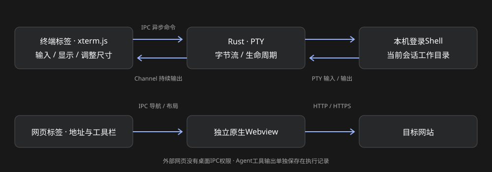

# 交互终端与桌面网页

## 交互终端

右侧“终端”标签直接打开当前会话工作目录中的登录Shell，使用本机的`SHELL`设置（macOS通常为zsh）。支持命令输入、历史、Tab补全、ANSI颜色、Ctrl+C和终端尺寸变化。每个终端标签拥有独立PTY（伪终端）与Shell进程；通过加号可再建终端，切换标签保留进程和屏幕内容，关闭标签或退出桌面释放对应进程。Shell退出后可以重新打开。

终端通过桌面IPC（进程间调用）连接Rust，输入写入PTY，输出通过Channel（消息通道）以字节流传回xterm.js，避免中文被流式分块截断。调整面板尺寸会同步PTY的行列数。终端属于用户本机交互，不计作Agent工具调用，也不会自动写入聊天。浏览器/手机访问不开放本机交互终端。

Agent的工具、命令输出、退出码和执行历史集中在“执行记录”页，不再占用“终端”标签；ACP终端事件的base64输出在记录内解码呈现。

## 网页浏览

桌面端使用独立的原生Webview（系统网页视图）加载HTTP/HTTPS网页，直接进行顶层导航，不再把外部网站塞入iframe。支持输入网址、默认补充HTTPS、前进、后退、刷新、点击网页链接，以及在系统浏览器打开。地址栏跟随实际导航更新。

网页位置随面板尺寸同步；切换标签或收起工作面板隐藏视图，重新打开继续浏览；关闭网页标签释放对应视图。网页内容拥有独立浏览上下文，权限仅授予本地`main`工作台，网页标签不能调用桌面IPC、Host连接或终端。原生浏览相关命令额外校验调用者标签，只允许HTTP/HTTPS网址，拒绝应用协议、文件URL和含凭证地址。

浏览器与手机端保留受限iframe预览；站点禁止嵌入时使用系统浏览器。桌面网页可用性仍取决于网络、站点和操作系统WebKit，加载迟迟未完成会提示检查网络与重试。

## 实现范围

- 终端：portable-pty + xterm.js，最多16个活动终端。
- 网页：Tauri子Webview，最多16个活动网页；使用Tauri 2的`unstable`子视图接口。
- 打开终端本身即启动Shell；验证只运行只读命令，不在用户项目中创建测试文件。
- 局部验证PTY真实输入/输出/退出/尺寸；桌面检查网页加载和终端输入，不执行全套桌面/手机回归。

## 浏览兼容性

macOS网页视图使用完整的桌面Safari兼容浏览器标识，保留WebKit真实内核标记，避免缺少产品字段导致站点回退到简化或嵌入页面。对已通过HTTPS访问的同一主机，后续HTTP跳转自动升级，保留路径、查询参数与片段；尚未建立HTTPS的普通HTTP站点维持原行为。没有迁移用户账号、Cookie或其他应用的配置。站点本身的登录和身份核验仍由用户处理，不能保证所有第三方风控页面都不会出现。
