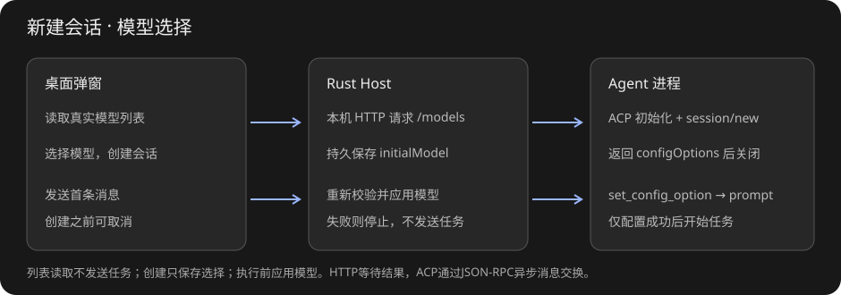

# 新建会话弹窗

新建会话使用居中的紧凑弹窗，沿用工作台亮暗色系和系统字体。原对话保留在背景，关闭弹窗返回原位置。支持关闭按钮、Escape及点击遮罩；创建期间锁定表单，避免重复操作。选择器展开时Escape先收起菜单，再次按下关闭弹窗。

## 配置

- 会话图标：11种颜色、6种形状，实时预览；创建后沿用会话栏的本机头像存储，不修改Agent配置。头像仅保存在当前设备。
- 项目：选择已有项目或根据工作目录自动归入项目；切换项目同步选中其首个目录。
- 工作目录：显示目录名与截断路径，可悬停查看完整路径。本机支持文件夹选择及更多选项中的路径输入；远程只允许已授权目录。
- Agent：显示实际工具与已保存配置，不可用工具禁用；就绪状态仅代表工具可用性，不代表账号已登录。
- 模型：默认使用Agent默认模型。优先显示同Agent、同配置的历史模型选项；首次打开空列表时读取真实选项，也可点击刷新。切换Agent或工作目录后清空当前选择，避免误用其他配置的模型。

## 模型读取与应用

本机管理端通过 `POST /v1/providers/{id}/models` 读取内置Agent及其保存配置的模型。Host启动对应工具，执行ACP初始化与 `session/new`，取得 `configOptions` 后关闭连接，全程不发送 `session/prompt`，不创建VibeOne会话。Agent自身可能保存一个空上下文；这取决于其实现。读取需要本机已有安装与认证，失败时可重试或使用默认模型。插件Agent暂通过已有会话提供的模型选项选择；远程不开放启动工具读取列表的接口。

所选模型以 `model: {id, value}` 随创建请求保存到 `agentState.initialModel`。创建本身不启动任务；发送首条消息时，Host连接Agent，重新校验实际模型选项，调用 `session/set_config_option`，成功持久化后才发送消息。失败时保留待应用配置并停止本轮，不静默切换模型。连接后可以在Agent设置中修正相同配置，再重试消息。

能力标识为 `providerModels` 与 `initialSessionModel`；旧Host可继续创建默认模型会话，模型选择提示重启主机。创建幂等参数包含可选模型，见[会话创建与重试对账](session-creation-idempotency.md)。

## 快速验证

局部协议检查覆盖无任务模型读取、模型持久化、重复创建对账和先配置后发送；分组模型选择器覆盖配置隔离。隔离UI检查覆盖亮暗样式、紧凑尺寸、颜色/形状、创建参数与关闭交互，不向真实Host创建测试会话。桌面重新打包交付，不运行全量桌面/手机回归。
