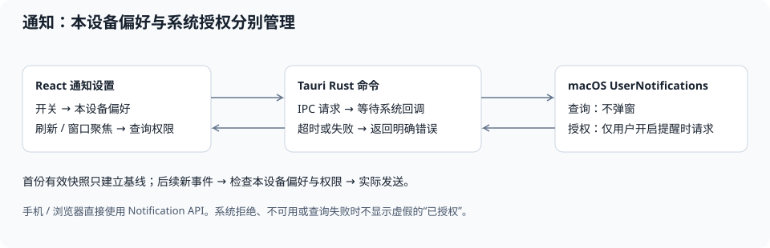

# 通知与系统授权

## 两层状态

“审批与执行结束提醒”是本设备偏好，保存于本设备浏览器存储；“系统权限”单独读取操作系统或浏览器状态。关闭本设备提醒不会撤销系统授权，系统关闭通知也不会把本设备偏好误改成关闭。页面提供刷新，并在窗口重新获得焦点时再次读取。

macOS 使用 `UNUserNotificationCenter` 的异步设置查询和授权请求，区分尚未请求、拒绝、已授权及临时授权。读取权限不会弹出授权框；只有用户开启提醒才请求 Alert/Sound 权限。查询10秒超时，授权等待120秒超时，均有错误反馈。回调只用于返回状态，不保存凭据。macOS包最低版本为10.15，以覆盖所用系统框架。

本机 Tauri 通知插件2.8.0的桌面 `permission_state` 固定返回 Granted，因此不能用其缓存值显示“系统已授权”。macOS直接查询系统设置，实际发送继续使用既有 Tauri 通知通道。非macOS原生平台尚未接专门的系统状态查询时，明确显示“当前平台未提供系统权限查询”；浏览器读取 `Notification.permission`，无此API则显示不支持。

## 事件基线

首次收到有效快照时，记录已有审批、补充输入、Run结束和插件通知作为基线，不补发历史提醒。后续出现新事件才提醒，重复快照不重复发送。未连接或快照尚未读取时不建立空基线，避免随后把旧记录视为新事件。重连时保留快照差异机制，发送前重新检查本设备开关和可用权限。

## 验证边界

浏览器自动测试通过原生桥接夹具验证UI状态、开启/关闭、外部撤销后的刷新、冷启动基线及后续Run提醒。原生Rust编译和链接检查覆盖系统绑定；系统授权弹窗、专注模式和实际横幅是否显示仍需在解锁的macOS窗口中核对，不能用夹具替代实机验收。

系统API依据：[Apple通知设置查询](https://developer.apple.com/documentation/usernotifications/unusernotificationcenter/getnotificationsettings(completionhandler:))；绑定接口使用锁定的 `objc2-user-notifications` 0.3.2，并已对照本机依赖源码检查。
