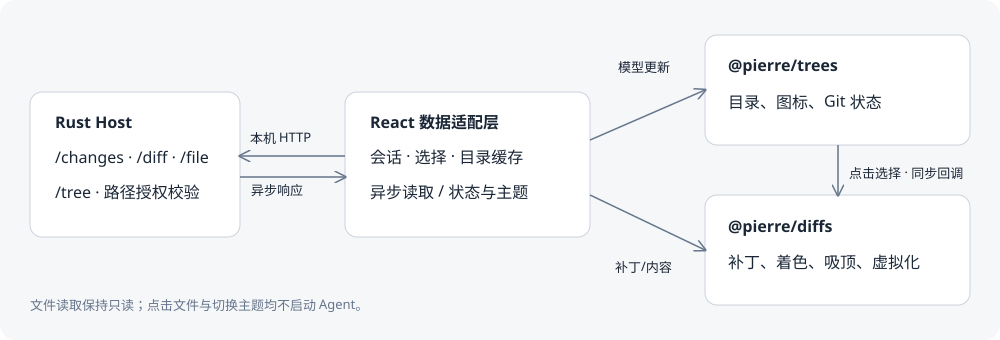

# Pierre 文件与差异渲染

## 实现范围

桌面端使用 `@pierre/diffs 1.6.4` 和 `@pierre/trees 1.0.0-beta.6` 的 React 组件，替换自制差异行、语法着色和递归文件树。版本固定在依赖文件中；文件树当前为上游 beta 版本，升级需检查其模型接口。两个包采用 Apache-2.0 许可，项目随依赖保留许可文件。

工作面板外壳、标签页、聊天布局及工具栏仍沿用已批准原型。采用相同组件库不等于复制其他应用的所有配置，交互以本项目已有工作区和会话模型为准。

## 数据与交互

- 变更页继续读取 Host 的 `/changes`、`/diff` 与 `/file` 接口。已跟踪文件使用真实 Git 补丁；未跟踪文本文件作为新增文件。文件可分别折叠，点击右侧文件树展开并定位对应差异。
- `FileDiff` 展示统一差异、行号、行内修改着色和上下文区间；`MultiFileDiff` 展示新增文件与工具返回的修改前后文本；`File` 展示只读文件。原始补丁传输头不作为正文显示。现有补丁只含 Git 返回的上下文，不承诺读取未提供的完整旧版文件。
- `Virtualizer` 负责多文件差异的可视区域渲染。文件标题使用库原生标题与吸顶行为，折叠按钮通过标题插槽注入，避免自行拼装差异行。
- `FileTree` 使用库自带彩色文件类型图标、Git 状态和键盘导航。项目文件夹展开时才向 Host 请求子目录；同一组件生命周期内按路径避免重复展开请求。刷新菜单重新读取已展开目录，失败保留既有错误提示。
- 文件树筛选、当前选择、目录展开状态由稳定的树模型维护；目录数据变化调用 `resetPaths`，Git 状态变化调用 `setGitStatus`。行尾增删数量通过 `renderRowDecoration` 注入，不伪造 Git 状态。
- 工作台亮暗切换同步传入差异组件的 `themeType`，文件树继承对应颜色变量。语法主题使用库自带 `pierre-dark` / `pierre-light`，代码背景接入工作台背景，避免出现另一套纯黑面板。
- 组件通过 Shadow DOM（影子 DOM，即隔离内部样式的浏览器结构）渲染，外部样式仅控制容器尺寸和主题变量。语法高亮使用包内置的 JavaScript 路径，不引入外部 CDN 或额外 Worker 服务。

## 错误与边界

二进制文件显示类型和大小；读取失败可重试；Host 截断内容继续显示截断提示。无法解析的工具补丁保留可展开文本，不使整个聊天页面崩溃。文件读取和路径授权仍由 Host 校验；此次更换不增加文件写入能力。

## 快速验证

已针对组件检查：真实 Git 补丁解析、原生差异/文件渲染、文件选择回调、按需加载目录、搜索过滤和亮暗切换。Web 构建后重新打包桌面；原生应用已打开实际会话，确认 4 个真实变更文件、首文件差异、其他文件折叠标题和目录树正常出现。按快速迭代约定，本次不跑全量桌面/手机回归；大型仓库和长时间使用由用户继续体验。

上游接口资料：[Pierre 仓库](https://github.com/pierrecomputer/pierre)、[Diffs 文档](https://diffs.com/docs)、[Trees 文档](https://trees.software/docs)。
