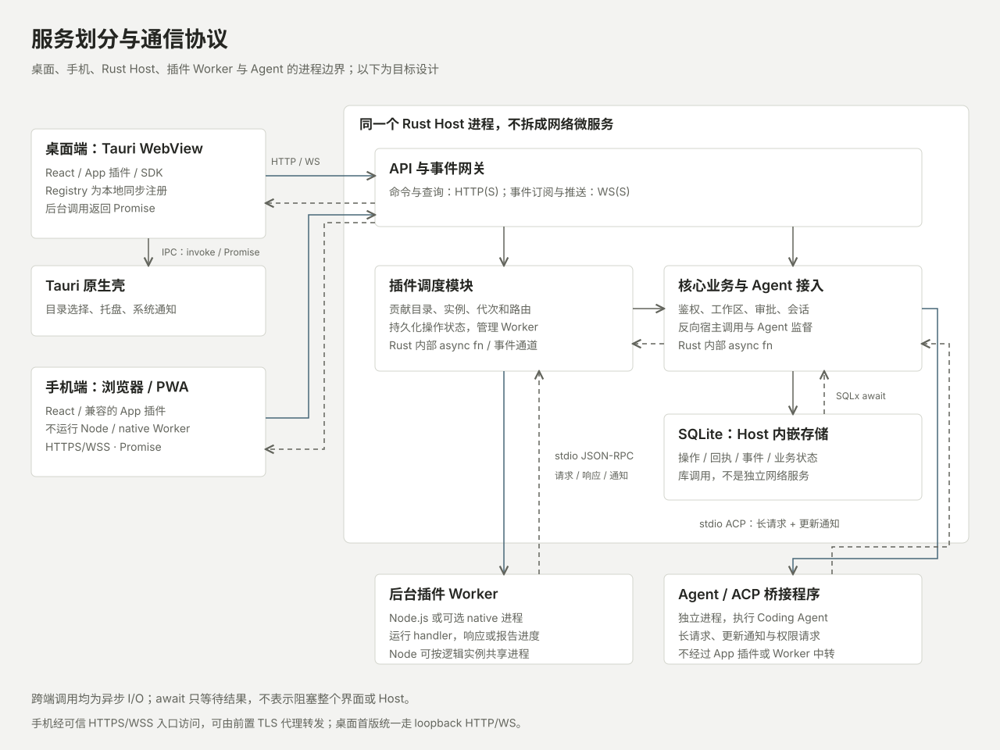
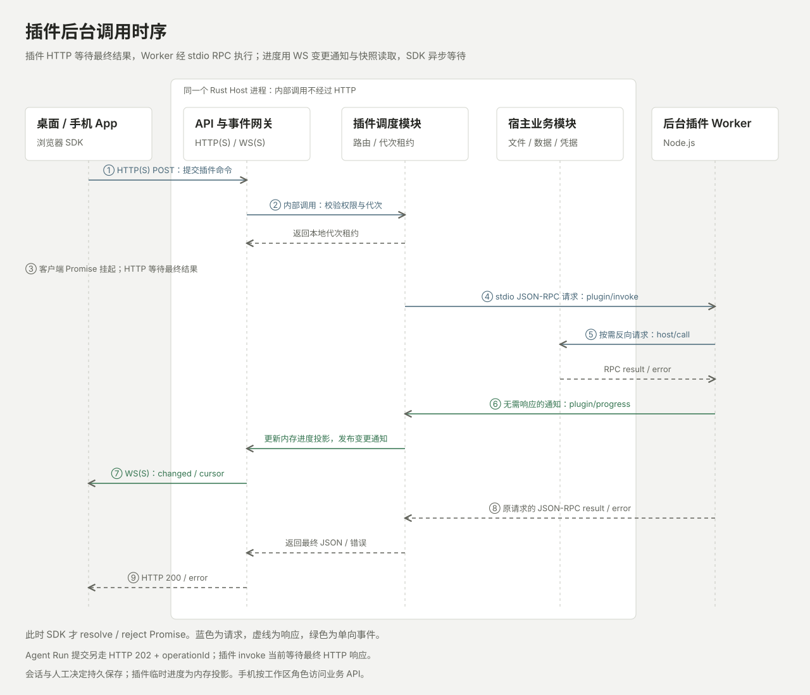

# VibeOne 插件机制设计

日期：2026-11-05。状态：实现草案。本文细化 [架构设计](architecture.md) 与 [核心功能设计](core-functions.md) 的扩展机制。包格式、SDK 和示例均待实现与验证，不代表已有公开兼容承诺。

## 1. 语言与运行方式

**Host 使用 Rust；插件默认使用 JavaScript。作者可以直接写 JS，也可以使用 TypeScript 开发，再编译为 JS。运行时只加载发布后的 JavaScript，不直接执行 `.ts` 或 `.tsx`。**

| 内容 | 开发形式 | 发布与运行形式 |
| --- | --- | --- |
| Host 与插件管理器 | Rust | 原生 Host 程序 |
| App 插件 | JS、TS，按需使用 JSX/TSX | 浏览器 ESM JavaScript，由宿主加载 |
| 后台 Worker | JS 或 TS | ESM JavaScript，由 Host 管理的 Node.js 运行时执行 |
| 可选原生 Worker | Rust 等原生语言 | 按平台构建的独立可执行程序，通过统一 RPC 接入 |
| 纯声明式扩展 | JSON 清单、Schema 和资源 | Host 直接解释，不强制启动 Worker |

TS 类型仅用于作者开发和构建，编译后擦除。纯 JS 作者可使用 SDK 的类型声明与 JSDoc 获得编辑器提示，无需改写为 TS。使用 JSX 的 JS 源码同样需要先转换为普通 JavaScript。

这不是 Rust 动态库加载方案；插件安装、注册、启停和更新均在运行时进行，无需重新编译 Host。Rust SDK 只服务可选原生 Worker，不再是普通插件作者的必经入口。

## 2. 一个插件包，两类代码入口



桌面、手机、Rust Host、后台 Worker 和 Agent 的进程边界如上。Host 的 API 网关、插件调度、核心业务属于同一 Rust 进程，内部使用函数或事件通道，不是独立 HTTP 微服务。完整运行归属补充见 [插件运行结构](diagrams/plugin-runtime.svg)。



### 2.1 App 入口

App 模块运行在客户端的宿主前端环境中，通过 `activate(ctx)` 注册面板、命令、Hook、服务和其他受支持扩展。可以提供 React 组件，不局限于声明式表单。

简单面板可以只有 App 入口；只提供模板、Skills 或固定启动描述的包，也可以完全没有代码入口。

### 2.2 Worker 入口

后台 Worker 运行在执行主机上，用于本地文件、网络、进程调用、通知、探测和需要持续运行的业务。手机不运行 Node.js 或原生 Worker，而是向所属 Host 发起授权调用。

Host 管理 Node.js 运行时及 Worker runner。Node 插件可在共享运行进程中按插件 ID 与 generation 建立独立的逻辑实例；原生 Worker 使用独立进程。逻辑实例、资源 Scope 和操作系统进程分别建模，不能将逻辑隔离宣传为安全沙箱。

共享 Node 进程崩溃会影响其中的多个插件实例，Host 按受影响集合更新状态并按预算重启。不能宣称一个插件的任何崩溃都只影响它自己。Agent 进程继续由独立监督模块持有，不归通知或界面插件所有。

### 2.3 三条不同通道

- App 模块 ↔ 前端 SDK：注册界面、命令、Hook 与服务。
- Host ↔ Worker：插件 RPC，处理后台 handler、事件与生命周期。
- Host ↔ Agent 或桥接程序：ACP，处理会话、prompt、工具更新和审批请求。

插件控制 stdout 不与 Agent ACP 混用。需要协议翻译的包可附带桥接程序，由 Host 在独立进程和管道上启动。

### 2.4 同步、异步与返回方式

这里区分“本地同步函数”“异步请求响应”和“受理后后台执行”。使用 `await` 等待跨端结果仍是异步 I/O，不表示阻塞界面或整个 Host。

| 发起方 → 接收方 | 协议或机制 | 调用与返回方式 |
| --- | --- | --- |
| App → 前端 Registry | 本地 JS 函数 | 同步注册并返回 disposer；注册回调本身可以返回 Promise |
| 桌面 WebView → Tauri 原生壳 | Tauri IPC `invoke` | Promise 异步请求响应，仅目录选择、托盘、系统通知等原生能力 |
| 桌面 App → Rust Host | loopback HTTP / WS | 首版与手机共用 HTTP 命令、查询和 WS 事件，不为业务重复增加一层 Tauri IPC |
| 手机 App → Rust Host | 可信 HTTPS / WSS 入口 | 异步请求响应与事件推送；入口可经前置 TLS 代理转发 |
| Rust 网关 → 插件或业务模块 | 内部 `async fn`、有界事件通道 | 同进程协作，不经过网络；状态提交后才发布事件 |
| Host → Worker | stdio JSON-RPC `plugin/invoke` | 异步请求，最终通过同一 RPC id 返回 result / error；执行期间可以单向通知进度 |
| Worker → 宿主业务 | 同一控制通道上的反向 `host/call` | 异步请求响应；两端持续读取，避免等待对方响应时死锁 |
| Host → SQLite | SQLx 等库调用 | `await` 持久化结果，SQLite 内嵌于 Host，不是网络数据库服务 |
| Host → App | WS / WSS 事件订阅 | 单向异步推送，客户端不向每条业务通知返回 RPC 结果 |
| Host ↔ Agent | 独立 stdio ACP | prompt 为长请求响应，进展为通知；权限请求是 Agent 发起的反向请求 |

查询和后台命令采用不同契约：

- 查询使用 HTTP 200 直接返回当前数据，调用方异步等待该次响应。
- 插件后台命令使用 `POST /v1/commands`，由 `plugin.command.invoke` 分派。Host 记录操作后返回 HTTP 202、`operationId` 和当前状态，表示已受理，不表示业务完成。
- Worker 后台执行；进度使用 `plugin/progress` 通知，最终回复 `plugin/invoke` 的 JSON-RPC 请求。Host 持久化操作状态与对应事件，再通过 WS/WSS 推送。
- `ctx.worker.invoke()` 对作者仍表现为 Promise，但 SDK 等待最终事件或状态查询结果后才 resolve / reject，不在收到 HTTP 202 时结束。
- SDK 先建立事件订阅再提交命令，按 operationId 关联、去重。断线或快速结果缺失时，使用 `GET /v1/operations/{operationId}` 查询；请求重试复用原幂等键。
- 操作状态为 queued、running、completed、failed、cancelled；崩溃导致外部结果不确定时另记 uncertainty，不自动重放可能产生副作用的命令。Worker 可能在 HTTP 回执到达客户端前启动，客户端不能依赖固定网络先后顺序。

这些路径是待实现契约；当前 React 原型尚未连接上述 Host 服务。

## 3. 插件包结构

入口清单统一采用 **`plugin.json`**。作者源码与发布产物分离：

```text
example-plugin/
├── plugin.json
├── package.json                 # 依赖与作者构建脚本
├── README.md
├── src/
│   ├── app.tsx                  # 也可以是 app.js / app.jsx
│   └── worker.ts                # 也可以是 worker.js / worker.mjs
├── dist/
│   ├── app.js                   # 浏览器 ESM
│   └── worker.mjs               # Node.js ESM
├── schemas/
│   └── config.schema.json
├── resources/
└── native/                      # 仅需要原生 Worker 时提供平台构件
```

发布包至少包含清单、所引用的构建产物、Schema、资源和完整性元数据；源码不是运行前提。Host 安装插件时不执行作者的 `npm install`、`postinstall` 或构建脚本，也不临时下载编译器。

纯 JS 模块若已经是满足依赖解析要求的 ESM，可直接作为发布入口；TS、TSX、JSX 必须先构建。普通插件的构建结果通常不含平台二进制，但其 Node 依赖是否跨平台仍需校验，不能默认所有 JS 包都可跨平台运行。

插件安装快照与用户设置、凭据引用、运行数据分开管理；更新保留原用户数据。

## 4. Manifest 草案

```json
{
  "manifestVersion": 1,
  "id": "dev.example.workspace-tools",
  "version": "0.1.0",
  "name": "工作区工具",
  "engines": {
    "pluginApi": ">=0.1 <0.2"
  },
  "entrypoints": {
    "app": {
      "path": "dist/app.js",
      "format": "esm"
    },
    "worker": {
      "path": "dist/worker.mjs",
      "runtime": "node",
      "protocolVersion": 1
    }
  },
  "config": {
    "schema": "schemas/config.schema.json"
  },
  "contributions": [
    {
      "id": "panel",
      "kind": "app.panel",
      "kindVersion": 1,
      "binding": { "type": "app", "registration": "workspace-tools" }
    },
    {
      "id": "scan",
      "kind": "app.command",
      "kindVersion": 1,
      "binding": { "type": "worker", "handler": "workspace.scan" }
    }
  ],
  "hostRequirements": ["workspace.read"],
  "dependencies": []
}
```

这是格式草案，版本号不代表已发布 SDK。入口可缺省，按贡献是否需要对应运行环境决定。原生 Worker 将 `runtime` 设为 `native`，并提供精确目标平台对应的可执行入口。

贡献完整标识为 `plugin_id/contribution_id`。绑定分为 `declarative`、`app` 和 `worker`；清单规定扩展种类与标识，运行时激活实际实现。未知 kind、重复标识、入口越界、版本不兼容或缺失必须实现的 handler，都不能被显示为激活成功。

App 注册表与 Worker handler 分别校验。`hostRequirements` 描述所需能力，不等于自动获得设备或工作区授权，也不能作为对同源 JS 恶意代码的沙箱承诺。

## 5. JS 与 TS 的作者体验

普通 JS 插件可写为下面的形式，接口名称为待实现草案：

```js
import React from 'react';
import { definePlugin } from '@vibeone/plugin-sdk';

function ToolsPanel() {
  return React.createElement('div', null, '工作区工具');
}

export default definePlugin({
  activate(ctx) {
    ctx.ui.registerPanel({
      id: 'workspace-tools',
      title: '工作区工具',
      component: ToolsPanel,
    });

    ctx.ui.registerCommand({
      id: 'scan',
      title: '扫描工作区',
      execute: (input) => ctx.worker.invoke('workspace.scan', input),
    });
  },
});
```

作者使用 TS 时保持同一运行时契约：

```ts
import { definePlugin, type PluginContext } from '@vibeone/plugin-sdk';

export default definePlugin({
  activate(ctx: PluginContext) {
    // 与 JS 作者使用相同的注册接口。
  },
});
```

构建工具把类型和 JSX/TSX 转为普通 ESM JavaScript。源码语言不进入 Host 的执行分支，运行时统一看 `dist/app.js` 或 `dist/worker.mjs`。

SDK 提供 JS 导出与 `.d.ts` 类型声明；开发工具提供脚手架、清单校验、构建、打包和本地联调。构建工具版本属于作者工具链，需要单独锁定；不把编译器打进正式 Host。

## 6. 共享依赖与浏览器限制

App 插件共用宿主的 React、React DOM 和前端 SDK 实例，避免重复 React 实例造成 Hook 与组件状态问题。构建时将这些共享模块外置，由宿主的版本化模块映射解析，不要求浏览器直接猜测裸模块名。

- App 入口仅使用浏览器支持的 API，不在前端导入 `node:fs` 或直接启动本机进程。
- 本地文件、后台进程等操作经 `ctx.host` 或 `ctx.worker` 路由到 Host，再检查当前设备与工作区授权。
- Worker 可使用 Node.js 依赖；发布产物必须包含或明确声明完整依赖，不能依赖作者机器上的 `node_modules`。
- 含原生 Node 扩展或原生 Worker 的包，需要单独提供平台兼容信息。
- SDK major、React 共享接口及扩展点版本不兼容时，提前显示诊断，不在页面中反复崩溃。

手机可以加载经过信任与兼容检查的浏览器 App 产物；不下载执行 Host 的 Node 或原生二进制。不适配手机的面板声明表面能力，手机隐藏或显示不可用说明，不能假设任意桌面 React 页面自动适配。

## 7. 动态注册：Registry、服务与 Scope

前端 SDK 提供以下注册族：

| 注册族 | 典型接口 | 用途 |
| --- | --- | --- |
| 界面 | `ctx.ui.registerPanel / registerView / registerSlot` | 面板、页面、预置插槽 |
| 命令 | `ctx.ui.registerCommand` | 命令面板、菜单与操作入口 |
| 设置 | `ctx.ui.registerSettingsSection` | 自定义设置区域或声明式表单 |
| Hook | `ctx.hooks.on` | 接收已定义的生命周期事件或受限变换 |
| 服务 | `ctx.services.provide / inject` | 插件之间声明服务与依赖 |
| 资源 | `ctx.scope.add / ctx.signal` | 清理订阅、计时器、连接与异步任务 |

新增一个 Registry 条目后通知相应消费者，界面重新读取快照，无需重启 Host。移除注册同样更新快照。消费者按 kind 和完整标识查找，不在核心代码中识别具体插件 ID。

注册操作返回 disposer，并自动登记到当前插件 Scope。卸载、停用或代次替换时等待相关清理回调，删除该插件的注册、服务和 Hook，再终止后台资源。异步激活完成前若 Scope 已取消，迟到的注册必须被拒绝或立即释放，不能复活旧插件。

插件自行创建的副作用需显式登记清理。仅有 JS 模块缓存更新，并不意味着可以自动撤销任意 `globalThis` 修改、外部文件写入或网络副作用。

服务声明有版本和所有者。缺失必需服务阻止激活；可选服务按 SDK 明确的缺失状态降级。循环依赖与重复服务身份应提供诊断。

## 8. 宿主业务扩展点

动态前端注册与后台业务 handler 统一由插件清单关联，但职责不同：

| 扩展点 | 主要职责 | 首版 |
| --- | --- | --- |
| `agent.provider` | 固定启动描述或动态探测、启动准备 | 是 |
| `notification.sink` | 消费脱敏事件、返回投递结果 | 是 |
| `app.panel / app.command / app.settings / app.slot` | 注册 React 功能与操作入口 | 是 |
| `context.source` | 显式生成上下文附件 | 后续 |
| `session.importer` | 只读导入工具历史 | 后续 |
| `workspace.provisioner` | 工作区创建与释放 | 后续，先内置 |
| `approval.policy` | 受限拒绝、人工处理或放弃判断建议 | 后续 |
| `artifact.renderer / workflow.step` | 产物展示与工作流步骤 | 后续 |

声明式表单与代码型 React 面板并存：简单设置使用 Schema，复杂交互提供组件。使用统一 SDK 与主题变量，不再以白名单表单作为全部 UI 扩展能力的上限。

Agent 接入的 `prepare` 返回经过 Host 再校验的 `LaunchSpec`，Host 负责 Agent 生命周期。插件不能通过界面注册替换设备鉴权、审批最终提交或数据库事务。

## 9. Worker SDK 与双向通信

```js
import { defineWorker } from '@vibeone/plugin-sdk/worker';

export default defineWorker(({ handle }) => {
  handle('workspace.scan', async (input, ctx) => {
    return ctx.host.call('workspace.read', 'scan', input);
  });
});
```

Node runner 加载该默认导出并持有共享 stdio 通道；插件不自行读取 stdin 或向 stdout 写业务日志。P0 SDK 版本为 `0.1.0`，Worker 定义 `apiVersion` 为 `0.1`，清单暂只接受明确的 `>=0.1 <0.2` 范围，完整 semver 兼容解析后续实现。

JS 与编译后的 TS Worker 使用同一个协议。Rust 原生 Worker 可实现同一协议，也可后续使用辅助 Rust SDK；无需借助 Rust 动态库 ABI。

Plugin RPC 采用版本化 JSON-RPC，stdio 按 UTF-8 JSON 行分帧。stdout 保留给协议，日志进入 stderr。共享 Node runner 按逻辑实例和代次路由，独立 native Worker 按进程绑定实例。

| 操作草案 | 职责 |
| --- | --- |
| `plugin/initialize` | 协议、API 与 handler 清单握手 |
| `plugin/activate` | 生效配置、实例范围和宿主接口初始化 |
| `plugin/invoke` | 调用声明的 handler |
| `plugin/cancel` | 取消指定调用 |
| `plugin/configure` | 处理经过校验的配置修订与确认结果 |
| `plugin/health` | 活性检查 |
| `plugin/deactivate` | 排空与清理 |
| `host/call` | 调用相应上下文下可用的宿主服务 |
| `host/subscribe / host/event` | 授权范围内的事件订阅与投递 |

请求响应 ID 与业务幂等键分别使用。Host 将后台连接与插件实例、generation 绑定，不把 Worker 自报身份作为授权依据。等待响应时仍持续读取反向调用，避免双向等待死锁。

SDK 管理帧限制、取消信号、并发与背压；错误区分版本不兼容、handler 缺失、权限不足、配置无效、超时、崩溃、旧代失效与外部执行不确定。

### 9.1 扩展点、注册与 RPC 的关系

插件机制采用“宿主预置扩展点，插件注册实现”。Registry 保存面板、命令、Hook、服务等贡献；Worker handler 注册表保存后台操作。消费者通过贡献标识找到实现，再决定本地执行还是跨进程调用。RPC 是传输机制，不替代扩展点契约。

App 的 `activate(ctx)` 由客户端加载器调用；客户端 SDK 在本地创建注册器、Scope 和宿主调用代理，再组成 ctx。React 组件、回调和 disposer 留在客户端，不经 RPC 传给 Rust 或 Node。

### 9.2 Node 上下文的创建与注入

以下为待实现契约。RPC 只传可序列化的数据，不传函数、服务对象、数据库连接或 AbortSignal。Node runner / SDK 在本地创建这些运行时对象，并显式传给插件。

上下文分为两个生命周期：

| 范围 | 内容 | 创建与释放 |
| --- | --- | --- |
| 插件实例及 generation | 身份元数据、有效配置、宿主代理、作用域服务、日志、资源清理 Scope、实例取消信号 | 激活时创建；该代次排空并停用时释放 |
| 单次调用 | requestId、调用授权范围、截止时间、进度发送器、调用取消信号 | 每次 invoke 创建；成功、失败或取消完成后释放 |

Node 收到 `plugin/activate` 后，用 Host 已绑定的实例身份和消息中的配置创建实例上下文，再执行插件初始化与 handler 注册。收到 `plugin/invoke` 后，查找该实例、generation 和 handler，为本次调用创建上下文，最后执行 `handler(input, ctx)`。ctx 暴露实例能力及本次调用字段；共享实例对象不保存可被并发调用覆盖的 requestId、工作区范围或取消控制器。

初始化时的 `ctx.scope` 管理实例资源，handler 中的 `ctx.scope` 管理本次调用资源。调用结束时取消调用信号、清理截止时间计时器并释放调用 Scope；插件代次停用时再释放实例 Scope。调用侧宿主代理显式绑定父请求与取消信号，即使回调离开原异步上下文，也不能退化成无父请求的宿主调用。

```text
Rust Host ── plugin/activate：身份元数据、配置 ──→ Node runner
                                                   │ 本地创建实例上下文
                                                   └→ 插件初始化、注册 handler

Rust Host ── plugin/invoke：调用 ID、输入、范围 ─→ Node runner
                                                   │ 本地创建调用上下文
                                                   └→ handler(input, ctx)
                                                          │ await ctx.host.call(...)
Rust Host ←── host/call：关联调用的能力请求 ────────────────┘
    │ 校验身份与授权，执行业务
    └──── RPC 响应 ──→ 完成 Node 代理的 Promise ──→ handler 继续执行
```

`ctx.host` 是 Node 本地代理。代理生成 RPC 请求 ID，将 Promise 的完成回调保存在 pending 表中，发送 `host/call`；收到响应后按 ID resolve / reject，并清理超时计时器。该反向请求还需关联父调用；Host 以已绑定的实例身份及父调用授权范围校验请求，不能仅相信 Worker 自报的 plugin ID 或工作区 ID。

共享 Node runner 使用 `AsyncLocalStorage` 关联当前插件实例、generation 和调用。模块加载、激活及 handler 分发都进入相应执行范围；需要恢复上下文的消息回调显式绑定该范围。插件作者使用显式 ctx，内部日志与路由可读取异步上下文；不能用可变全局“当前插件”变量代替。跨进程不会自动传播异步上下文，必须通过协议关联信息在接收端重新建立。

实例停止会取消其未完成调用；单次取消只影响目标调用。调用信号综合实例停用、显式取消和截止时间，SDK 在调用结束时释放监听器。超时或取消只能表示已发出终止请求，不能保证外部副作用已撤销。停用时拒绝未完成的宿主调用 Promise，并清理注册、订阅和服务。AsyncLocalStorage 用于执行归属和路由，不构成安全沙箱。

## 10. 配置、数据与信任模型

配置由 Host 校验、版本化并保存，Worker 和 App 读取同一已确认的有效修订。支持配置变更通知；是否无需重新激活取决于插件声明和实际确认。重配置失败保留旧有效配置；升级的候选配置先在副本准备。

插件存储使用带所有者身份的宿主接口，例如设置、KV、产物与授权事件。凭据不出现在前端配置快照或诊断中。后台 handler 需要凭据时，通过对应受控接口读取引用的值。

App 模块运行在宿主前端同一环境中，属于用户信任的代码，前端 `ctx` 不构成恶意代码隔离。不能因为“通过 SDK 调用”就声称能限制所有 JS 副作用。前端消息中的 plugin ID 也不能单独作为身份凭据。

Host 继续基于真实设备身份、工作区授权和操作契约检查业务请求；UI 注册不扩大设备控制权限。Node 与 native Worker 同样是可信本机代码，可能自行访问 OS；宿主 broker 的访问约束不等于 OS 沙箱。不可信插件运行时或隔离 iframe 需要后续单独设计。

## 11. 生命周期与动态更新

```text
发现包 → 只读检查 → 解析依赖与兼容性 → 用户确认信任
      → 准备后台候选 / 校验贡献 → 发布 Host 扩展目录
      → 客户端加载 App ESM → activate(ctx) → 注册界面与服务

停用 / 更新 → 停止新路由 → Scope 清理 → 旧实例排空
```

模块入口通过 Host 控制的版本或摘要地址加载，避免复用旧 JS 缓存。开发目录监听只触发重新校验与候选激活，不直接执行未经验证的任意变更。

动态更新包含两个不同层面：

1. **Host 目录更新**：新版本和 Worker 候选先准备；成功后原子发布完整贡献集合，失败保留旧有效版本。
2. **客户端 App 更新**：每个客户端分别加载、激活和替换注册。采用临时注册集合准备新代，成功后替换该插件的 Registry 快照并清理旧 Scope；失败保留可用旧视图或明确显示不可用，不能声称所有客户端已经同时更新。

受 SDK 管理的注册可以成批替换；插件在顶层或 `activate` 中自行产生的外部副作用无法因此获得事务回滚。激活应通过 Scope 登记资源，错误时完整清理。

已有 Agent 会话持有旧 Provider 代次租约，后续 Run 沿用旧代；新会话使用新版本。普通 App、短调用和长会话使用不同排空策略，不能用固定的短 RPC 期限终止全部旧会话。旧 App 向 Worker 发起调用时也携带所属代次；旧代不再可用时返回明确失效，不静默改调新 handler。

禁用阻止新调用、撤销 App 注册并排空。仍有会话租约时，卸载需等待或由用户显式停止相关会话。删除用户数据是独立操作。

## 12. 故障与重试

- App 加载或激活失败，显示该插件的诊断；不把半套注册留在界面中。
- 浏览器同环境的可信代码无法保证任意故障都被完全隔离；组件错误边界处理可恢复的渲染失败，不能承诺抵御恶意或失控 JS。
- 共享 Node 崩溃按整个受影响实例集合处理；独立 native Worker 按进程处理。重启有退避与预算，超过阈值等待用户操作。
- Worker 失联不自动停止仍健康的独立 Agent；依赖已丢失的业务则显式显示不可用。
- 通知与普通事件按至少一次投递处理，以事件 ID 和渠道去重；不能承诺外部副作用 exactly-once。
- 调用超时与连接断开不等于“没有执行”。存在外部副作用且无法判断时，返回不确定状态，避免无条件自动重试。
- Scope 清理不回滚已有外部副作用，旧代消息不能冒充新代实例。

## 13. 核心实现与开发顺序

| 模块 | 职责 |
| --- | --- |
| Rust 插件内核 | 包检查、安装、依赖、代次、目录、Node/native 实例监督 |
| 前端插件 Host | ESM 加载、共享模块解析、Registry、Scope、React 插槽 |
| JS SDK 与类型声明 | App / Worker 作者接口、生命周期、调用上下文、取消与日志 |
| 作者工具 | JS/TS 脚手架、构建、校验、打包、本地监听联调 |
| 业务消费者 | Agent 接入、通知、设置、命令和其他预置扩展点 |
| 可选原生 SDK | 为 Rust 等原生 Worker 封装兼容 RPC |

| 阶段 | 完成条件 |
| --- | --- |
| F0 | 同一示例分别用 JS 和 TS 编写，构建后由相同 loader 执行；最小 Node Worker 握手、调用与退出通过 |
| F1 | Manifest、扩展目录、声明式 Provider、基础 Worker 路由与 Scope 清理成立 |
| F2 | 动态加载 App 面板与命令、本地通知 Worker、配置表单；可启停并更新，失败保留清晰状态 |
| F3 | 手机复用支持的 App 组件与 Host 调用；不适配的表面明确降级，包安装仍以桌面为入口 |
| F4 | 稳定公开 SDK、完善作者工具、第三方分发和兼容承诺；按实际需求补原生 SDK |

## 14. 验收场景

| 场景 | 预期结果 |
| --- | --- |
| 作者直接写 JS | 可注册面板、命令、Hook 和服务，不强制要求 TS |
| 作者写 TS / TSX | 构建产物只有 JS 入口，用户机器不需要 TS 编译器 |
| 未构建的 `.ts` 被声明为入口 | 安装或激活前明确拒绝，不尝试临时编译 |
| 一个包只有声明资源或 App | 不强制启动业务 Worker |
| 插件重复启停 | SDK 管理的注册、服务、Hook 与资源均可清理，不重复叠加 |
| 更新时新代激活失败 | 原可用版本保留或明确显示表面不可用，不伪装完整成功 |
| 更新时存在旧 Agent 会话 | 保留旧 Provider 代次，待显式释放或验证迁移后排空 |
| 共享 Node 进程退出 | 准确标记受影响插件集合，并按重启策略恢复 |
| 手机访问桌面专用面板 | 按表面能力隐藏或说明，不在手机运行 Node/native 代码 |
| 插件试图用界面注册绕过审批 | Host 的真实设备授权与审批提交规则仍生效 |
| 插件导入重复 React | 构建或兼容检查提供诊断，共享宿主 React 实例 |
| 后台调用过程中反向请求 Host | 持续读取和有界分发，不死锁 |

本轮完成语言与机制设计调整；SDK、作者工具和插件加载器仍需按上述阶段实现。
