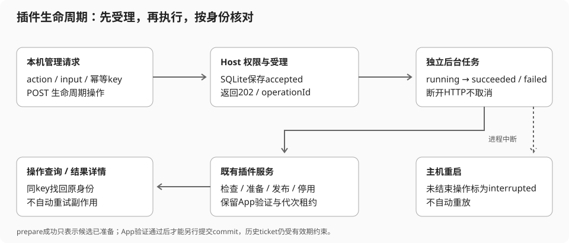

# 插件生命周期持久回执

原设计中的插件安装/更新/停用需要可对账的操作身份。新入口 `POST /v1/plugin-lifecycle/operations` 使用 `PluginLifecycleRequest`：`key` 为1至128字节幂等键，`action` 为 `inspect/prepare/commit/discard/disable`，`input` 为对应原接口参数。成功受理返回 HTTP 202、`operationId` 和状态；后续通过既有 `/v1/operations/{id}` 查询。该入口只允许本机管理端，手机设备不能调用。

## 动作与发布边界

| action | input重点 | 成功结果 |
| --- | --- | --- |
| inspect | path | 已校验清单 |
| prepare | path、trusted、范围、配置 | 候选ticket、固定插件信息和App源码 |
| commit | ticket | 发布后的插件记录 |
| discard | ticket | discarded确认 |
| disable | id | disabled确认 |

动作、目标、信任标记、输入大小及主机状态在受理前检查；其余清单、代次、资源和授权检查在执行阶段继续沿用原有服务。阶段失败保存 `failed` 和明确错误码，不冒充已经安装。App候选仍需前端验证后才能commit，未发布候选不替换旧有效代次。

这些操作与Worker命令共享32个活跃操作上限、持久目录和查询机制。先保存accepted，再由独立任务更新running与终态；HTTP连接断开不会取消已受理工作。同一key及相同动作/输入返回同一身份，不重复启动Worker或发布插件；同一key内容不同拒绝。记录以 `kind: plugin.lifecycle` 区分，Worker命令为 `plugin.command`，旧记录可以没有kind。

主机重启把未结束的生命周期操作标为interrupted，不自动重放。已经成功的prepare结果是历史候选信息；ticket仍受原有10分钟有效期、主机内存和已消费状态约束，重启后需要重新准备，不能把历史成功当作候选仍可发布。存储故障不会发布假回执，已有副作用需按操作和插件目录核对。

结果与Worker操作一样由详情接口读取，摘要不携带结果或指纹。生命周期详情可能包含检查清单、配置或App候选信息，与原接口结果范围相同，保存在主机私有SQLite中。原参数输入不作为单独日志保存，输入摘要用于幂等核对。

## 兼容与接入

旧 `/plugins/inspect/prepare/commit/discard/{id}/disable` 入口保留同步响应。Host通过 `pluginLifecycleOperations` 声明新能力。正式页面接入由任务95继续，在完成前不能把本后台入口当成页面已经迁移的证据。

## 验证

真实Host/Worker覆盖检查、相同key并发准备仅启动一个Worker、同键冲突、并发发布只执行一次、准备失败保留旧插件、丢弃候选后发布拒绝、停用及回执正文丢失后对账。存储测试覆盖先保存、共享容量、重启中断与不重放。
