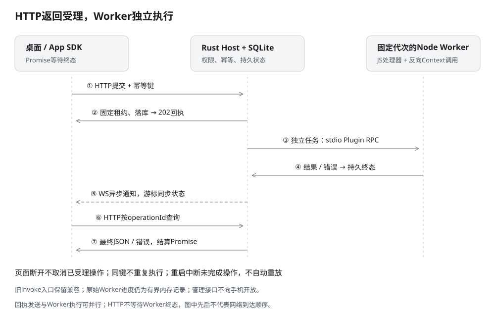

# 插件后台操作回执

桌面插件命令现在先取得持久回执，再等待执行结果。HTTP请求结束或页面关闭，不代表已受理操作被取消。Agent Run与插件后台操作分别记录，不用Agent会话的202回执冒充插件执行完成。

## 调用链路

| 调用 | 返回与含义 |
| --- | --- |
| `POST /v1/plugins/{id}/operations` | 校验清单、授权范围及代次，保存受理记录后返回202与operationId |
| `GET /v1/operations/{id}` | 返回该操作当前状态、最终JSON或错误；不存在时404/OPERATION_NOT_FOUND |
| `GET /v1/operations` | 全部活跃操作及最近100条终态摘要，不包含结果正文或请求指纹 |
| `POST /v1/plugins/{id}/invoke` | 保留原有等待最终结果的兼容接口；新版App SDK与桌面按钮使用异步入口 |

这些管理接口只允许本机管理端。手机不能调用或读取；远程快照与增量元数据中的operations为空。Worker仍通过独立stdio Plugin RPC执行，不经过ACP。

## 受理与执行

客户端每次明确调用生成一个幂等键，最长128字节。同一键和相同请求返回原operationId，参数、插件或范围不同返回冲突；幂等键由本机操作共享，不能跨插件复用。Host保存请求SHA-256指纹而不保存输入正文。请求参数序列化后最多512 KiB，HTTP正文最多600 KiB，同时最多32个活跃操作；原有RPC帧限制与30秒执行预算继续生效。

受理时先获取真实代次租约，再保存accepted状态；后续更新/停用插件不会把此操作改投到其他代次。HTTP断开不会丢弃已经受理的任务。受理回执发送与独立执行可并行，不保证回执到达客户端先于Worker开始；HTTP不等待终态。任务进入running后，最终保存succeeded及result，或failed及带代码的错误。错误不回滚已发生的文件/网络副作用。

状态变化、事件和持久目录使用原有SQLite事务链路提交，随后通过WS通知与游标同步更新桌面。临时Worker详细进度继续使用原有有界内存记录；此版本持久保存的是操作状态和终态，不宣称逐条进度历史永久保留。

## 页面与恢复

`ctx.services.invokeWorker()` 的Promise在连接正常时等到终态，返回原始JSON，false、0和null也保留。提交或查询遇到网络不确定性时，错误携带operationKey或operationId，不自动换键重试副作用；用户可在插件页“最近后台操作”中核对。明确4xx拒绝沿用主机错误，不描述为已受理。

插件页的操作记录跨页面重新进入仍可查看，点击“查看结果”从主机读取最终JSON或失败原因。结果正文不随全部会话快照反复传输。旧主机没有pluginOperations能力时，客户端保留原有同步调用方式。

主机重启保留终态，accepted/running统一标为interrupted，说明结果不确定；不自动重放。存储故障时在内存中标为结果不确定并显示存储错误，避免永远保留“执行中”而阻止恢复；不能据此声称Worker副作用已回滚。已有副作用是否完成需要核对，不根据“中断”推断没有执行。活跃后台操作会阻止桌面设置重启及旧数据目录迁移，避免界面认为Agent空闲就关闭仍有插件工作的主机。

## 验证范围

真实Node Worker检查并发重复键只执行一次、不同内容冲突、处理器/代次拒绝、失败持久化、HTTP回执正文丢失后查询、更新时旧代次继续、新代次后续调用，以及隔离Host崩溃重启后保留结果且不重放。

共享客户端检查Promise等待、false/null/0保留、网络错误的对账身份、4xx明确拒绝及失败/中断回执。原生单元覆盖活跃操作阻止重启/迁移；真实原生窗口仍需解锁验收。浏览器通过真实Host验证App SDK调用、重新进入插件页及结果查看，HTTPS手机验证管理接口拒绝和摘要隔离。
