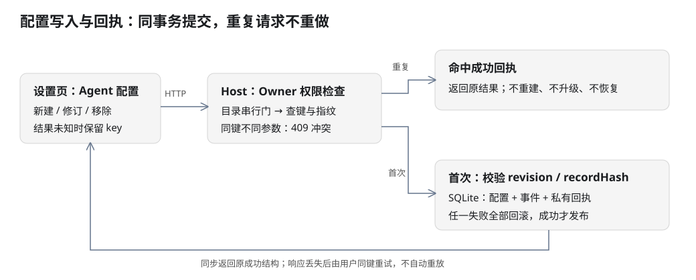

# Agent 配置操作与重试回执

Agent Profile（Agent 配置）的新建、保存修订和移除支持可选 `key`。同一配置写入意图使用同一个键：重复请求返回第一次成功的完整结果，既不新建重复配置，也不重复增加修订。移除后再次查询同一移除请求仍返回 `{ removed: true }`。

## 接口和一致性

入口仍为 `POST /v1/profiles`，成功响应结构保持不变。key在配置写操作命名空间内唯一，新建、修订和移除之间也不能复用同键表达不同参数。空键或超过128字节返回 `INVALID_INPUT`；相同键但请求字段不同返回409 `IDEMPOTENCY_CONFLICT`。未提供key或为null时保留旧行为。

Host在目录串行门内先查私有回执，再检查当前配置的 `revision` 或异常记录的 `recordHash`。首次请求继续执行原有修订冲突校验；重复成功请求直接返回原结果，因此不会把自己已完成的保存误判为旧修订。失败的请求不保存成功回执。配置投影、变更事件和回执在同一个SQLite事务中提交，存储失败不会发布未提交内容。

回执保存键摘要、参数指纹和原成功响应，Host重启后仍然可用；它不会进入配置目录、快照或事件公开正文。重试返回的是原操作结果，不能用它判断当前配置是否后来又被修改或移除。重复旧保存只返回历史结果，不会重新创建或覆盖已经移除的配置。当前不自动清理成功回执；移除配置不是擦除历史记录的操作，已有会话仍保留固定配置。

配置接口仍仅供本机Owner（所有者）调用；手机的operator或viewer角色都不能凭key访问它。新能力标识为 `profileCommandIdempotency`，旧Host保持原兼容路径，没有持久去重保证。

## 设置页行为

设置页在请求结果未知时保留当前操作的key，用户重试相同内容复用它，不自动重新执行。输入内容、目标配置或操作改变后使用新身份，成功后清除。离开设置页面会结束本机未确认表单的保留期，不保证刷新后恢复该草稿。

新建和保存修订失败继续保留输入；移除正常配置失败仍可再次点击移除。异常记录移除的响应丢失时，事件同步可能已经让该行消失，因此错误区保留「重试移除异常配置」入口，使用原操作对账。

## 直接验证

- `tests/profile-receipts.test.mjs`：并发新建、修订/移除重复回执、不同请求冲突、无key兼容、旧修订保护、重启返回历史结果且不恢复已删配置。
- 存储测试：注入回执写入失败，验证更新与删除都回滚，事件游标不前进；成功删除后的回执可跨数据库重开恢复。
- `tests/desktop.test.mjs`：真实Host已提交后主动丢弃HTTP响应，验证新建、修订与异常记录移除都能在设置页同键重试。
- HTTPS手机回归继续检查设备不能访问配置管理入口。
