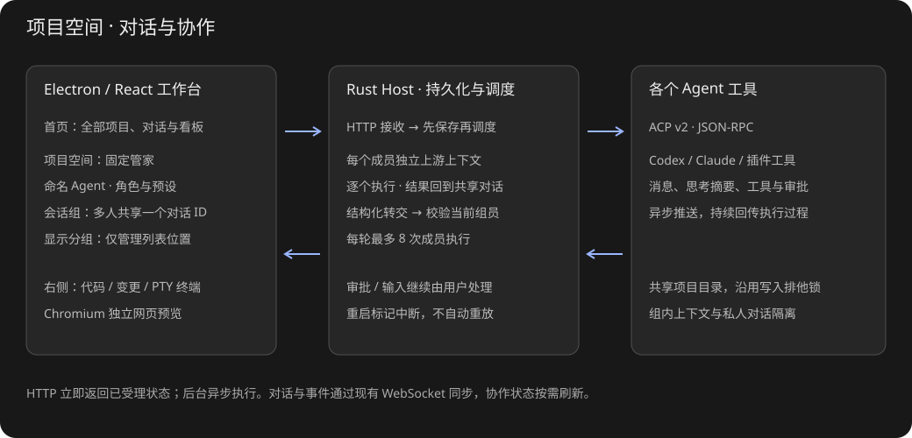

# 项目空间与Agent协作

首页汇总全部项目的独立对话与会话组，提供简单看板；进入某个项目后切换为专属空间，仅显示该项目的成员、对话及代码工具。工作目录仍沿用项目已有多目录模型。

## 层级

- 项目空间：对应现有项目，集中代码、Agent及协作对话。
- Agent：有稳定名称、角色说明、工具及模型配置的项目成员，拥有独立对话；可从预设创建。
- 管家：每个项目唯一且固定的Agent身份，负责接收任务、分发和汇总，不能删除、重命名或移动到其他项目。首版固定使用Codex，执行仍使用正常审批策略。
- 会话组：多个Agent参与的共享对话，有一个对外会话ID，每个成员在组内有独立上游上下文，避免污染其私人对话。
- 展示分组：仅整理Agent和会话组的列表位置，不代表执行团队、权限或文件隔离。
- Agent预设：复用名称、角色、工具与模型的创建模板；修改预设不改变已有Agent。

协作由Host负责投递。组内默认先由管家协调，也可通过@名字指定成员。成员可提出结构化转交，Host验证目标属于当前项目及会话组，并限制单次任务的转交次数。结果与执行状态可追踪；审批仍由用户处理。重启后未完成协作明确中断，不自动重复发任务。

独立Agent与组对话均出现在首页；组成员执行用的内部会话不重复出现在首页。原有会话保留，进入项目空间时可作为命名Agent接入。

## 桌面运行方式

Electron负责窗口、目录选择、通知、交互终端和Chromium网页视图；React复用当前正式页面，Rust Host继续负责ACP、持久化、审批与远程服务。浏览器网页运行于独立WebContentsView，不注入工作台权限；登录状态由独立持久浏览器分区保存。

## 首版行为与边界

管家对话是项目的默认协调入口，自动关联项目成员；内部执行上下文隐藏在首页列表之外。普通会话组创建时选择2到8位成员，有独立对话ID及独立成员上下文；显示分组可在编辑成员/会话组时选择。

组消息可直接输入，也可点击成员名字插入`@名字`。未指定成员时先交给管家；没有管家的自选会话组由首个成员负责汇总。工具执行时可直接处理审批、补充输入，或打开成员执行详情。只把明确的`vibeone-handoff` JSON块识别为任务转交，普通正文不触发执行。每轮最多执行8次，结果串行收集；同目录写入仍受已有排他锁约束。达到上限停止转交，重启中断不自动重发。

首次进入项目空间会幂等地准备固定管家，并把已有会话接入为命名成员。已有会话ID、历史和上游恢复信息保留。旧会话重名时追加短标识。Agent名称在项目内唯一，管家不能重命名或归档；管家工具首版固定Codex，未安装/未登录时不会假装执行成功。

空间数据保存在Host的SQLite目录记录中，不依赖窗口本地存储。`GET /v1/spaces`返回成员、组对话、展示分组和预设；`POST /v1/spaces`按`action`处理进入、创建、配置、发送和停止。当前空间管理仅开放本机管理端，手机既有会话与审批能力继续保留，完整空间管理尚未向配对设备开放。组消息发送有持久去重回执，相同键不同内容拒绝；单轮执行失败显示错误并保留记录，不自动换模型或授权。

首版不提供无限自治循环、自动并行写同一目录、自动通过审批，也不把展示分组解释为执行权限。成员角色作为用户配置的提示上下文传入工具，具体行为仍取决于所选Agent和模型。
