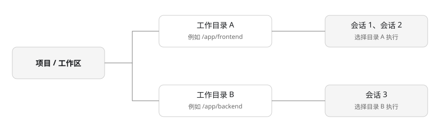

# 项目、工作目录与会话

## 关系

项目（界面中的工作区）是组织单位，一个项目可引入多个工作目录，并包含多个会话。工作目录是实际文件系统路径；每个会话固定一个执行目录和Agent配置，后续轮次默认续接原Agent上下文。

左侧统一展示“项目 → 会话”，移除最近分区和分组模式切换。项目旁加号在该项目中新建会话；全局新建会话默认使用当前项目。新会话可以选项目内已有目录，也可以引入其他已有目录或创建托管目录。设置中的“项目与目录”负责创建项目及引入多个目录。

同一工作目录归属一个项目，避免同一会话在多个项目下重复出现。把已有目录引入新项目时，原来该目录的会话自然归入该项目，历史及原路径不改变。项目中的其他目录不会静默扩大某个会话的文件访问范围：每个会话仍有一个实际执行目录。

## 持久化与兼容

项目清单保存在Host的SQLite目录表中，包含稳定id、名称、paths和revision。原有工作目录无需移动或复制：没有显式项目归属时，以原工作目录生成兼容项目；首次引入或编辑时保存显式项目。名称修改可用revision检查冲突，目录引入在目录表锁内合并；路径先按现有授权目录导入逻辑规范化。

`GET /v1/projects` 返回项目列表，手机端只收到授权工作目录相关的项目及路径；`POST /v1/projects` 仅电脑所有者可调用，用于创建/命名项目或引入目录，不增加设备权限。原协议中的workspace字段暂保留，仍表示会话的执行目录，以兼容历史、插件和现有文件授权。

## 默认续接

打开历史会话后可以直接编辑输入并发送。Host在新消息受理前自动选择原上下文；添加附件也采用同样规则。原始消息不重复回放，旧审批不重放，暂停队列仍需手动恢复。相同幂等键重试先识别已有执行，不因重试而选择其他上下文。

正常情况下不显示“在原上下文继续/在新上下文继续”常驻条。缺少可恢复身份或恢复失败时显示具体错误，不自动创建替代上下文；需要时可在会话菜单显式选择“新开Agent上下文”。归档及设备权限限制保留。

## 本次检查

按快速迭代要求，仅进行前端/Host构建，以及隔离目录下的一次项目API局部检查：一个项目引入两个目录，重复目录归属被拒绝。未跑整套桌面/手机/联网Agent回归；本版交由用户体验。
