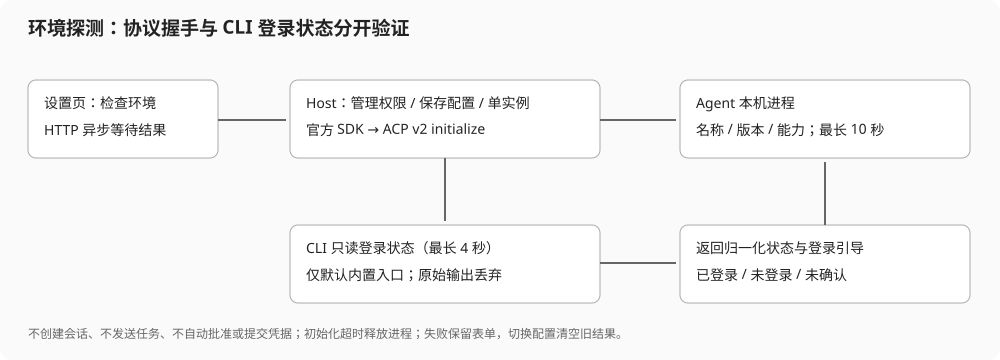

# Agent 环境探测

在设置 → Agent → 环境探测点击「检查环境」，检查内置默认入口或当前已保存的启动配置。修改启动程序、参数或 Agent 后，先保存修订再检查；结果随编辑/切换清空，不会被误当成新配置的检测结果。探测失败保留表单，允许重试。

## 检测链路

`POST /v1/providers/{id}/probe` 接受可选 `profileId`，使用 Host 中实际保存的程序与完整参数。只有主机管理端可以调用；配对设备即使能操作工作区，也不能借此启动管理进程。动态插件入口仍通过既有会话连接验证，不使用这个独立探测入口。

Host 每次只执行一个探测；已有检测未结束时返回 `PROBE_BUSY` / 409。主机不可用、配置不存在和配置/Agent不匹配使用现有结构化错误信封。

官方 ACP SDK 发送协议 v2 的 `initialize` 请求，读取桥接器上报的名称、版本及会话能力。使用 SDK 的版本协商结果明确识别 v1，不会降级继续；不发送 `session/new` 或任务，不创建工作台会话，也不提供人工权限批准。初始化最多 10 秒，超时由 SDK 释放传输与进程组。

响应只保留允许的版本信息和基础会话、图片、嵌入文件是否声明；其他初始化字段及原始错误不返回。未声明能力不等于对整个工具做出永久“不支持”判断，具体选项仍由会话实际上报。

## 登录状态与引导

内置默认 Codex、Claude 入口分别通过本机 `codex login status`、`claude auth status --json` 读取 CLI 登录状态。命令固定，不经过 shell；标准输出/错误各限制 8 KiB，4 秒超时。仅提取状态，立即丢弃原始输出，不写入配置、日志或 HTTP 响应。命令失败或格式无法识别显示「未确认」，不将网络/运行错误伪装成未登录。

自定义启动入口或参数可能使用不同的认证上下文，因此不套用内置 CLI 结果；演示入口标记无需登录。初始化明确返回认证要求时标记未认证。需要登录时显示固定命令 `codex login` 或 `claude auth login`，由用户在本机终端完成，不自动提交凭据。

「握手通过」和「CLI 显示已登录」分别描述协议与本机登录状态，不保证额度、网络、模型权限或后续会话创建成功。探测不读取用户会话消息，也不修改已有会话固定修订。原生 CLI 在 PATH 中不可发现时保留未确认状态；包内桥接器可正常握手不意味着 PATH 中必然存在同名独立 CLI。

## 验证与边界

- 真实进程夹具拒绝所有非初始化请求，验证未创建会话、未发送任务、版本不兼容及明确认证要求。
- 无响应夹具启动真实子进程，验证超时回收、重复探测冲突与结束后可重试；公开响应不含夹具私有输出。
- 本机实际 Codex ACP 2.5.0 和 Claude ACP 0.101.0 均完成 v2 初始化；本轮 CLI 状态分别为已登录和未登录。未为此登录 Claude 或调用模型任务。
- 登录解析覆盖明确未登录、CLI失败及无效JSON；桌面入口与生成契约纳入回归。跨平台进程行为和真实系统登录交互仍需对应设备验收。

旧 Host 不含 `providerProbe` 能力时，设置页显示升级说明。检测结果不持久缓存，重新打开或修改配置后需要再次检测。

协议说明：当前 SDK 的 v2 `session: {}` 已声明基础生命周期（包括 `session/resume`），没有独立的 v1 `loadSession` 标志。菜单显示「会话」声明，不把缺失的旧标志误报为能力缺失。此处只是能力检测，已有历史继续策略仍见会话文档。
