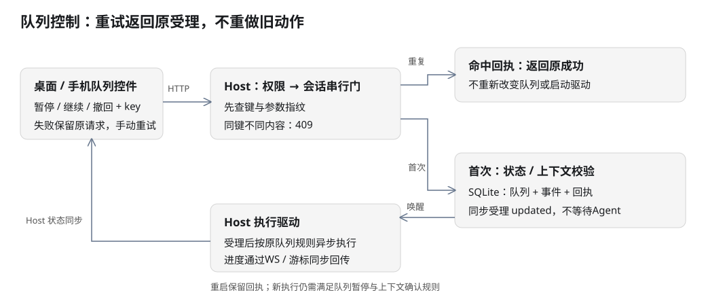

# 队列控制与重复请求对账

队列的暂停、继续和撤回使用可选幂等键 `key` 标识一次控制意图。重复请求返回原受理结果，不会把「已经撤回」误报成新的冲突，也不会让旧暂停/继续覆盖后来发生的状态变化。

## Host 规则

入口保持为 `POST /v1/sessions/{id}/queue`，成功仍返回 `{ updated: true }`。请求保留 `withdraw`、`pause`、`resume` 和 `freshContext`，增加可选key；同一会话内同key同参数返回历史成功，同key不同参数返回409 `IDEMPOTENCY_CONFLICT`。空key或超过128字节返回 `INVALID_INPUT`，未提供key或为null保留旧行为。

Host在会话串行门内先查回执，再检查首次请求的队列和上下文状态。已成功的旧请求不会重新启动执行驱动，不修改后来暂停的队列，不重建Agent上下文，不删除其他消息。第一次撤回已开始/已撤回的消息仍为 `QUEUE_CONFLICT`；重启后首次继续未明确同意新上下文时仍为 `CONTEXT_CONFLICT`。暂停与继续/撤回混用仍拒绝。历史成功回执不代表当前队列仍处于当时的状态。

队列投影、事件、历史投影和私有回执在同一个SQLite事务中提交，随后发布内存状态。写入失败不会留下部分撤回或假成功回执。受理成功后才唤醒原有串行执行驱动；HTTP返回不等待后续Agent执行完成，运行进度通过既有快照、WS和游标同步查看。

回执按会话与key摘要索引，保存参数指纹和受理事实，不进入公开快照或事件正文。Host重启后保留回执，恢复队列的原有暂停和上下文确认规则不变，不自动重放旧控制动作。设备工作区操作权限在入口每次检查，知道key不能绕过授权。

## 客户端行为

正式桌面和手机共用 `useQueueCommands`，新上下文继续入口也使用它。提交期间拦截连点，失败时保存原请求和key，显示「重试队列操作」；即使最后一条消息已经撤回，错误区仍存在。重试只在用户点击时发生。操作成功后结束本次意图，之后的暂停/继续可使用新key。

连接中断时使用中文提示，不把传输失败表述为动作一定未发生。队列清空后的请求确认仍显示状态；手机重试与关闭提示按钮的触摸高度至少44px，沿用亮暗主题和键盘焦点样式。

「关闭提示」只清除本机未确认操作提示，不撤销服务端已接受的动作；切换会话、离开页面或刷新页面后不保证恢复本机提示。另一项控制操作会开始新的意图。能力标识为 `queueCommandIdempotency`，旧Host继续使用原接口，不能提供新回执保证。

## 验证范围

- 真实Host验证并发重复撤回只有一次变更事件、旧暂停不覆盖后续继续、旧继续不覆盖后续暂停、同键不同内容冲突。
- 重启后重复历史控制不解除队列暂停或上下文保护；新请求必须明确确认新上下文，之后待执行消息仍能执行。
- SQLite注入回执写入失败，原投影、版本、事件游标和回执共同回滚。
- 桌面主动丢弃暂停/继续/撤回的真实成功响应，验证同key重试和队列清空后的提示；HTTPS手机验证撤回丢失响应、实际key及viewer/工作区权限。
