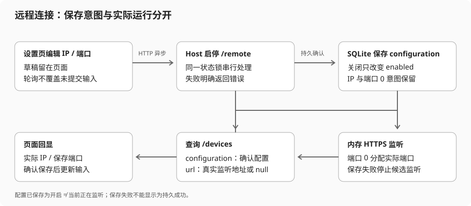

# 远程连接配置与运行状态

远程设置区分两类信息：`configuration` 是 SQLite 中最后确认保存的配置，`url` 是当前实际监听的 HTTPS 地址。只有 `url` 非空才表示入口正在运行。保存为开启而启动失败时，页面明确提示当前没有运行，用户核对地址后可重新开启。

## 保存规则

开启入口先校验 IP 和端口、创建监听及 TLS，然后持久保存配置。保存失败会停止本次监听并返回错误，不能把运行过的候选当作保存成功。端口 `0` 表示每次开启自动选择；保存的是这个意图，实际端口在 `url` 中。明确设置非零端口时，重启继续请求该端口。

关闭入口先停止监听和临时配对，再保存 `enabled: false`，保留已确认的 IP 与端口。关闭请求附带的任意 IP/端口不能覆盖已有配置。持久化失败继续使用已确认的旧记录，并报告错误；本次服务仍保持关闭。重新启动 Host 时读取同一配置，避免类型转换截断无效端口。

## 页面回显

首次进入及再次打开设置时，从主机读取配置。监听中的 IP 以真实 URL 为准；未监听时使用已保存 IP，再回退到建议 IP。端口优先使用已保存配置，保留 `0` 的含义。旧版 Host 没有 `configuration` 时，从实际 URL 和建议 IP 回退。

状态每三秒轮询。输入框被编辑后，轮询更新连接/设备状态，不覆盖未提交 IP 或端口。只有成功启停后的确认刷新才重新应用保存结果；复制、撤销设备等其他操作不丢弃配置编辑。请求按序号过滤过期响应，组件离开后不接纳结果。读取失败有独立提示，后续成功读取自动清除；操作失败信息单独保留。

`RemoteConfiguration`、`RemoteClaimSummary`、`RemoteStatusResponse` 由实际 Rust HTTP 响应定义生成 Schema 和 TypeScript。92已将设备目录公开项接到 `RemoteDeviceSummary` 与角色/状态枚举；其余动态接口仍另行收紧。设备状态、字段与授权规则见 [设备授权状态](device-status.md)。

## 验证范围

- 存储单元测试：关闭保留 IP/端口，重新打开 SQLite 后记录一致；不保留未知字段。
- 真实 Host HTTP：运行地址与保存配置分离；关闭请求不能篡改 IP/端口；无效开启不改写已保存配置。
- 桌面浏览器：未提交编辑经过轮询保持，开启后切换设置仍回显正确，关闭后重新进入仍保留配置。
- 原有设备授权、撤销、TLS 和失败路径继续回归；物理手机信任安装仍另行验收。

## 二维码恢复（90）

当前监听代次在生成HTTPS地址时生成一次SVG二维码，并在内存中保留。`/devices` 同时返回本代次的 `url` 和 `qr`；轮询复制现有结果，不重复编码。重新进入设置时，页面直接从Host状态恢复二维码；关闭监听后两者一起为空，重新开启时替换为新地址的二维码。二维码不包含配对码或设备凭据，也不持久保存到设备授权记录中。

旧Host没有状态二维码字段时，仅在本页收到的开启响应地址与当前状态地址一致时使用本地回退，避免把另一个入口的旧二维码显示出来。
