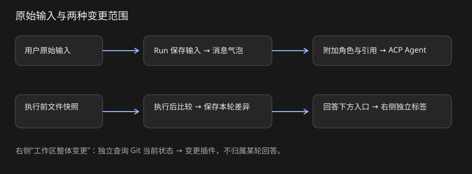

# 本轮变更与工作区整体变更

## 展示规则

用户消息气泡显示 Host 接受的原始输入。角色说明、引用文件正文属于发送给 Agent 的执行上下文，不作为用户输入显示；Agent 回传完整提示时也按 Run（本轮执行）中的原始输入展示。旧会话有对应 Run 的输入时同样修正展示，不通过删字符串猜测正文。

回答下方的“查看本轮变更”只在本轮执行开始和结束之间确实存在文件内容差异时出现。打开后在右侧独立标签展示保存的差异；后续修改、提交或切换会话不改变该轮快照。仅问候且没有文件变化时不显示卡片。

右侧“工作区整体变更”始终面向当前 Git 基线，与某轮执行无关；点击进入现有变更插件查看整个工作目录。整体变更可能包含用户和其他工具的修改。

## 采集与边界

Host 在队列开始执行时采集 Git 可见文件内容，执行结束、失败或取消后再次采集并比较。已有脏文件不变时不进入本轮结果；已有脏文件继续编辑时只比较新增的差异。新增、删除、已暂存和执行中提交均按文件内容变化计算，不修改用户 Git 索引或 HEAD。

本轮结果记录在 Run 的 `changes` 扩展字段，包含路径、增删行数及有界文本预览。采集只覆盖当前工作目录、Git 已跟踪及未忽略文件；符号链接不读取。快照最多 10,000 个文件、单文件 4 MiB、合计 64 MiB，采集限时 10 秒。超限、非 Git 或读取失败标记不可用，不冒充无变化，也不回退显示整体变更。文本预览每文件最多 256 KiB，每轮合计最多 1 MiB；二进制和超限内容只保存变更信息。

执行期间其他工具的修改也可能被采集，因此不将差异标为 Agent 独占成果。旧轮次缺少执行前快照，无法可靠回溯，不补造本轮变更。执行中忽略规则变化也会改变可采集文件范围。

## 流程

