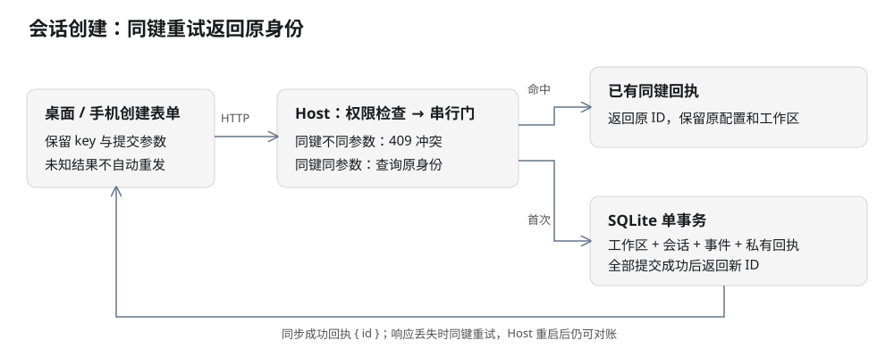

# 会话创建与重试对账

创建会话支持可选的幂等键 `key`（同一次用户意图的唯一身份）。桌面和手机共用创建表单：同一表单中，提交参数不变且结果尚未确认时保留同一个键；重复点击由同步忙碌标志拦截。网络失败不会自动重发，用户再次提交时沿用原键。成功后结束此意图；创建参数改变后再次提交使用新键。退出创建页面或刷新页面后重新创建属于新的意图，不承诺恢复未提交表单。

`POST /v1/sessions` 保留原来的 `{ id }` 成功回执。`key` 不传或为 `null` 时保留旧行为，每次请求创建新会话。空键或超过128字节返回 `INVALID_INPUT`；相同键、不同 `provider/workspace/profileId/model` 返回409 `IDEMPOTENCY_CONFLICT`。原始输入参与指纹，不把不同路径拼写自动合并为同一次操作。

## Host 处理

Host 在目录与配置变更共用的串行门内查找历史回执。同键同参数先返回既有会话，不重新选择 Agent Profile（Agent 配置），不重新创建默认项目；即使原配置后来修改或删除，原会话绑定的配置仍保持不变。工作区执行权限在接口入口每次检查，重试不会绕过设备授权。

首次受理时，SQLite 把工作区、会话、创建事件、历史投影和私有创建回执放入同一事务。事务失败不会留下半个会话；普通存储失败还会尝试删除本次新建的空默认目录。文件系统与数据库并非跨系统事务，进程在创建目录后突然退出仍可能留下空目录，但不会留下成功回执或自动启动 Agent。

回执只保存键的 SHA-256 摘要、请求参数指纹和会话 ID，不进入公开快照，也不保存参数正文。当前不自动清理已提交创建回执，从而保证 Host 重启后仍能以原键取回原身份。创建本身不执行 Agent，不适用后台插件操作的202回执。

能力标识为 `sessionCreationIdempotency`。新客户端只在 Host 声明该能力时携带键；旧 Host 仍可创建会话，但不具备重试去重保证。升级桌面后若后台 Host 仍是旧版，需要在任务结束后通过设置重启工作主机。

## 验证

- `tests/session-creation.test.mjs`：并发同键请求、唯一默认目录、不同参数冲突、旧请求兼容、Host 重启对账。
- `tests/request-contracts.test.mjs`：共享命令构造器及原 Profile 删除后的重复请求。
- 存储测试：注入回执写入失败，确认工作区、会话和事件全部回滚；成功后重新打开数据库可恢复回执。
- `tests/desktop.test.mjs`：服务端已提交但浏览器丢失创建响应，再次提交使用同键且只存在一个会话。
- `tests/remote.test.mjs`：HTTPS 操作设备可对账已授权工作区；只读设备或未授权工作区即使持有正确键，也不能创建或取回会话身份。请求使用授权目录中返回的规范路径，与正式手机表单一致。

## 初始模型

可选 `model: {id, value}` 参与幂等参数指纹；不携带模型时保持原指纹格式，兼容旧回执。模型在首条消息前校验并应用，详情见[新建会话弹窗](new-session-screen.md)。
