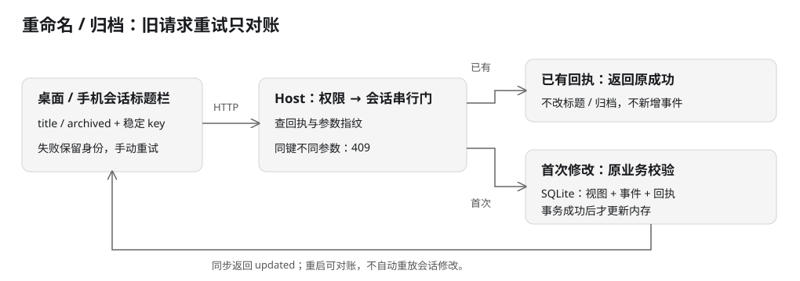

# 重命名、归档与请求对账

重命名、归档和取消归档使用同一会话元数据接口。页面为一次操作生成稳定的幂等键（`key`，用于识别重复请求）；成功响应丢失后，手动重试返回原成功回执，不再执行旧修改。例如先把标题改成A，再改成B，重试旧A请求不会将标题改回A。旧归档请求也不会覆盖后续取消归档状态。

## Host处理

`POST /v1/sessions/{id}/metadata` 接收 `UpdateSessionRequest` 的 `title/archived` 和可选 `key`，成功仍为 `SessionUpdateResponse` 的 `{updated:true}`。同一会话、同键、同参数返回已保存回执；同键不同参数返回409 `IDEMPOTENCY_CONFLICT`。不同会话的键独立。key须为1至128字节，省略或null沿用旧行为。

参数指纹取实际解码后的字段；省略的可选字段与显式null一致，标题仍按请求原文比较，不将不同空格写法合并为同一意图。首次操作才进行标题、归档忙碌、取消归档容量等业务校验；已成功的旧请求重试只对账，不会因为现在正在执行任务而重新归档或改名。

会话串行门内检查回执。取消归档沿用原目录容量锁及获取顺序；会话投影、事件和私有回执共用SQLite事务，成功后才更新内存。回执保存会话身份及参数指纹，不复制标题正文。提交失败不发布成功状态；Host重启后可用原请求确认结果，不自动重放修改。工作区权限在查回执之前执行，持有key不能绕过设备角色或范围。

## 页面行为

正式重命名、归档和取消归档共用会话级控制器，防止重复点击。失败提示显示原操作和错误，提供「重试会话修改」「关闭会话修改提示」，期间禁用新的会话修改，避免待确认身份被覆盖；没有自动重试。重试成功后关闭相应的标题编辑表单；失败保留原标题输入。

请求身份在当前会话界面内保留，刷新页面或切换会话后不保证恢复。关闭提示结束本机的未确认状态，不撤销Host可能已经保存的修改。界面状态由实际会话快照更新，因此成功响应丢失时可能先看到新标题或归档状态，提示仍需显式确认或关闭。

新能力标识为 `metadataCommandIdempotency`；旧Host不携带key，继续兼容原接口，不具备新回执保证。手机重试和关闭提示按钮触摸高度至少44px，沿用亮暗主题。

## 验证

- 隔离真实Host先复现旧重试覆盖新标题，回归覆盖新旧标题/归档顺序、并发重复不新增事件、参数冲突、跨会话键隔离、重启和旧无key行为。
- 真实SQLite注入回执写入失败，确认投影、事件游标、回执数量及内存标题均不发布部分成功。
- 桌面对三种操作分别主动丢弃真实成功响应，显式重试使用完全相同的key和正文。
- HTTPS手机通过正式重命名入口重试丢失响应，并验证实际触控高度、只读角色与越界会话权限。
