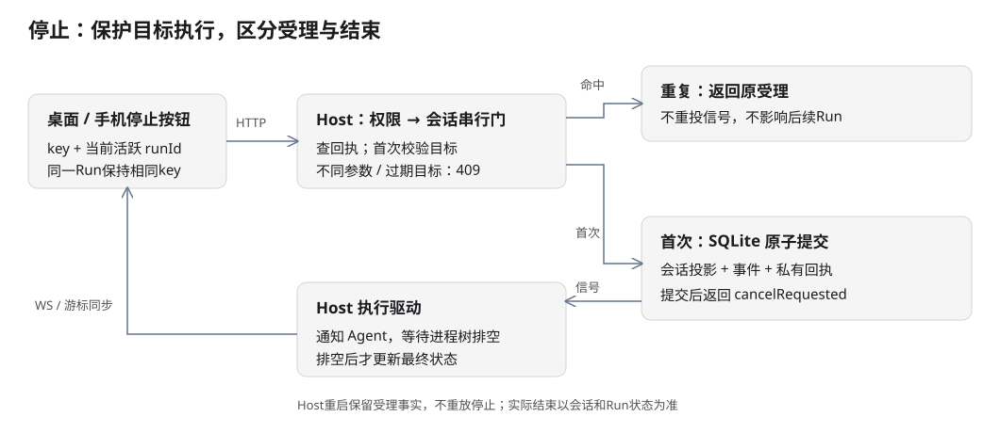

# 停止请求与目标执行保护

停止按钮绑定正在运行的 Run（单次执行），而不是简单取会话执行记录的最后一条。最后一条可能是排队或已撤回的消息，不能作为停止目标。

## 请求和受理

`POST /v1/sessions/{id}/cancel` 支持可选 `key` 和 `runId`。新客户端在同一Run整个生命周期使用相同停止key，重复点击或重试不重新生成身份。Host在会话串行门内先查私有回执，再检查目标；同键不同目标返回409 `IDEMPOTENCY_CONFLICT`。首次请求指定的Run不是当前活跃执行时返回409 `CONTEXT_CONFLICT`，不会取消其他Run或暂停它们的队列。

key和显式runId须为1至128字节。空请求体、`{}` 和未提供key继续兼容旧客户端。能力标识为 `stopCommandIdempotency`；新客户端连接旧Host时保留原接口调用，只有新Host提供持久去重和目标保护。

成功响应仍为 `{ cancelRequested: true }`，表示停止意图已受理，不表示Agent及其子进程已经结束。实际进度继续通过会话快照、Run状态和结束原因查看：停止期间显示「正在停止」，排空进程树后才显示终止状态。原有待执行队列暂停规则保持不变。

## 持久化与不重放

停止投影、对应事件和私有回执在同一SQLite事务提交，内存随后才发布；写入失败不会留下成功回执。空闲会话收到有key的停止也记录一次无操作受理，防止旧请求稍后作用于新Run。重复请求不新增事件、不再次投递停止信号，也不改变新Run的队列状态。

回执按会话和key的摘要索引，保存参数指纹、目标Run与受理事实，不进入公开快照或事件正文。Host重启后保留回执，但不重新投递旧停止动作；未完成执行按既有恢复规则标为中断。

首次受理后若Agent信号投递未确认，接口仍可能返回 `DELIVERY_UNCERTAIN`。此时受理事实已经持久化，使用原key重试只返回该事实，不补发信号；实际结果以会话状态为准。此机制也不承诺刷新页面后恢复本机未确认草稿。

设备的工作区操作权限仍在Host入口每次检查；知道key不能绕过只读角色或未授权工作区限制。

## 验证

- 真实Host先在空闲会话受理停止，重启后启动 `/wait`，再重试旧请求，新Run仍保持运行；过期目标拒绝，正确目标可以停止。
- 并发重复无操作停止只有一个事件；重复受理不会再改状态；无body旧请求仍可调用。
- SQLite注入回执写入故障，验证原会话版本、投影、事件游标和回执一致回滚。
- 客户端目标选择覆盖后续排队、撤回及已结束记录；桌面与HTTPS手机实际请求包含key和目标Run身份。
