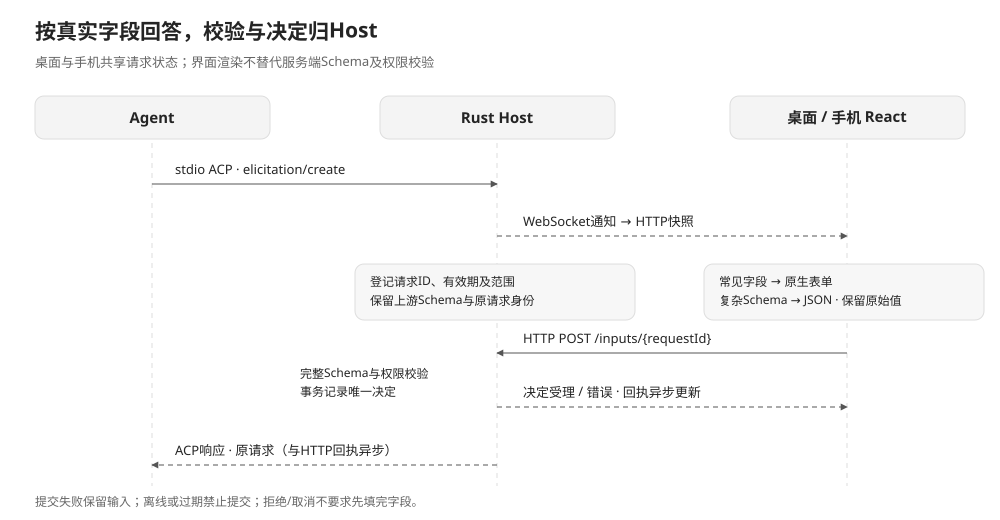
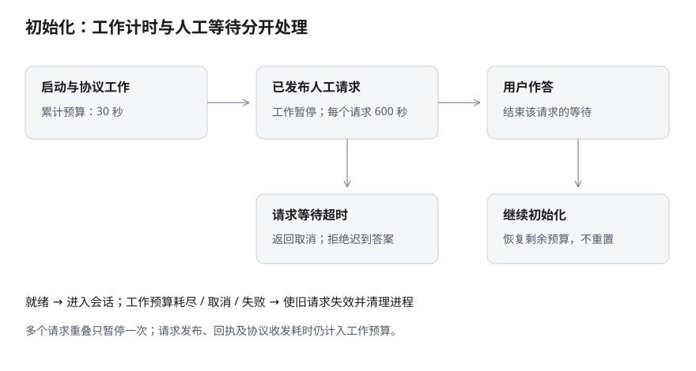

# 补充信息表单

Agent通过ACP `elicitation/create` 请求补充信息时，桌面和手机在当前会话中显示同一请求。表单名称、说明和候选值来自Agent提供的JSON Schema（JSON结构约束），不把补充输入当成权限审批，也不自行生成候选答案。

体验时可选择“本地演示”，发送 `/input-choices` 查看选择表单，发送 `/input-json` 查看复杂JSON输入。这些演示仅回显回答，不修改通知或工程设置。

## 呈现方式

- 字符串使用文本框；带secret元数据或password格式的字段使用密码输入框。
- 数字和整数使用数字输入框，保留数字类型；空白不转换为0。
- 布尔字段使用复选框；可选布尔提供“未填写/是/否”，未填写不会自动提交false。
- `enum`、带原始值的 `oneOf`/`const` 转换为选择控件。最多6项使用单选或复选，更多项使用原生下拉/多选。没有默认值的候选不会自动选中；传递原始值，不把标签当成值。
- 复杂嵌套、组合约束或超过32个字段的Schema保留JSON编辑。普通表单也可切换JSON；切回时如发现无法呈现的额外字段或值，会提示继续使用JSON，避免静默丢弃内容。

字段标题和说明保留上游文本；原始字段要求可展开查看。必填表示Schema要求该属性存在，不擅自增加非空约束；最小长度、数值范围等仍由Host完整校验。可选空白字段省略，显式false和0保持原值。

## 提交与状态

每次提交发送当前请求ID、action及类型正确的content到Host。Host验证设备权限、请求有效性和完整Schema，再持久记录决定并响应同一ACP请求。客户端字段检查不代替Host校验。

同步防重入锁防止同一帧连点造成重复请求；提交中禁用控件。主机受理后显示等待投递回执，实际结果继续使用已有人工处理回执。失败在当前请求旁显示，保留已填内容供修改；断线、设备无操作权限、会话停止中或请求过期时禁止提交。过期同时由Host及ACP请求超时路径处理。

表单草稿仅存于当前页面内存，不额外写入本机持久设置。拒绝回答与取消不要求先填完字段；未知请求类型不能提交“接受”。URL类型保留Agent提供的HTTP(S)页面入口，由用户完成后确认，不把点击链接视为认证成功。

## 验证范围

纯逻辑检查覆盖Codex oneOf、空字符串合法值、数字/整数、false/0、多选、复杂Schema回退、默认值及特殊字段名。浏览器使用真实Host和stdio演示进程核对表单、JSON、服务端失败保留和最终Agent回显；独立组件时序检查覆盖同帧连点、提交回执、断线、过期和密码字段。窄屏通过HTTPS移动浏览器验证，不代替物理手机输入法与辅助技术实测。

真实Codex的结构化请求、Host拒绝非法答案以及合法值到达Agent的证据见[ACP兼容记录](acp-compatibility.md)。生产时限仍为600秒，相关可控时间回归不改变实际等待时间。

## 会话创建期间的等待

会话创建前，Agent也可以通过带 `requestId` 的补充输入请求向用户提问。初始化使用两份独立的时间预算：Agent自身的启动与协议处理累计允许30秒；已成功发布、正在等待用户处理的请求各自允许600秒。等待用户的时间不消耗30秒预算，作答后继续使用剩余预算，不重新获得30秒。多个人工请求重叠时只暂停一次，不重复累加暂停时间。

预算从连接开始计算。请求尚未发布到Host、处理回执、响应发送及其他协议工作仍消耗初始化预算；已用尽预算后产生的问题不能延长启动。成功就绪的结果与超时同时可见时，优先接受就绪结果。无人工交互的卡死连接仍会超时。

600秒到期后请求以取消结果结束，迟到的回答会被拒绝。用户取消启动或初始化失败时，客户端使旧人工请求失效并中止SDK任务；进程生命周期仍由官方SDK管理。当前锁定的ACP v2 Schema中，补充输入支持请求作用域，而权限审批要求 `sessionId`，因此不伪造“无会话权限审批”来验证启动。

初始化回归使用真实Node stdio演示进程和可控Tokio时钟：等待45秒后成功作答、作答后Agent卡死、请求601秒失效及迟到答案拒绝、取消启动后父子进程退出。纯预算检查覆盖无人工请求30秒超时和重叠请求不重复延长。时间推进仅用于测试，生产时限没有缩短。

## 决定受理与投递状态

补充回答与审批共用“先保存唯一决定，再投递”的处理规则。无效回答保留原请求，公开错误仅提示修正字段或选项，不回显用户输入值或校验器的原始异常。请求过期、不同答案冲突及上游 Schema 无效有独立错误码。

投递失败会持久保存 `delivery: uncertain`；同内容重试仍提示未确认，不能以重复点击自动重放或误判为已成功投递。成功受理也不等于 Agent 已完成任务。实现、验证边界及 SVG 见[人工决定错误契约](http-errors.md)。
