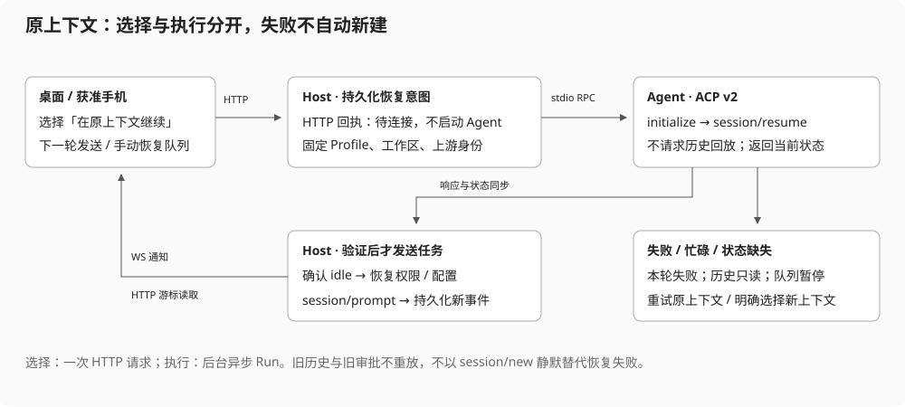

# 显式恢复 Agent 原上下文

Host（工作主机）重启后保留 Session（会话）的本地历史，正在执行的 Run（执行轮次）记为中断，旧审批失效，队列暂停。用户可以选择「在原上下文继续」或「在新上下文继续」。选择前不发送任务，也不自动启动 Agent。

## 用户操作与状态

- 历史会话保留上游身份且记录过 ACP v2 会话能力时，显示「在原上下文继续」。选择后恢复输入，标记为待连接；下一轮发送或用户手动恢复队列时才连接 Agent。
- 有排队消息时，选择原上下文仍保持队列暂停，必须再明确点击恢复队列。中断的旧 Run 不重发。
- 连接前使用会话固定的 Agent Profile（接入配置）、工作区和服务端保存的上游身份。恢复成功后显示已恢复；后续 Run 沿用该连接。
- 用户选择新上下文时清除原上下文恢复意图，保留本地历史，下一轮创建新的 Agent 会话；不会把旧对话自动拼接成新任务。已有的新上下文队列流程继续适用。
- 恢复失败时显示失败原因，暂停队列，并将会话恢复为历史只读。用户可以重试原上下文，或明确选择新上下文。失败任务可恢复为草稿，允许检查、修改后再发送；恢复草稿不会自动执行。

## 服务与协议

桌面或获准的手机操作设备发送 `POST /v1/sessions/{id}/context/resume`，HTTP 返回只表示已保存恢复意图，回执为 `resumeOnNextRun: true`。该操作不接收客户端指定的上游身份；查看者、其他工作区设备和未认证请求沿用 Host 的会话操作权限限制。

下一轮进入既有受理、工作区租约、插件代次固定和串行队列后，Host 通过 Agent Client SDK 使用 stdio JSON-RPC 建立 ACP v2 连接，完成 `initialize` 后调用 `session/resume`，不指定历史回放游标 `replayFrom`。必须在恢复响应前收到对应上游会话的当前 `state_update: idle`，才视为可继续。随后恢复上次配置（包括权限模式），全部成功后才调用 `session/prompt`。

建立连接期间的上游消息/工具更新不写入当前 Run，防止旧历史重复导入或旧空闲事件提前结束本轮。人工审批、结构化输入仍通过已有的回调处理，并绑定新连接的请求身份；不会重放旧审批决定。发送后的新事件经 Host 持久化，客户端通过现有游标同步和 WS 通知异步更新。

`session.context_selected`、`session.context_connecting`、`session.context_resumed` 记录待连接、正在恢复和已恢复的变化。`agentState.contextRestoreState` 分别为 `pending`、`restoring`、`restored` 或失败时的 `failed`。这些状态与 HTTP 回执、Run 成功是不同事实。

## 失败边界

上游身份过期、恢复方法不支持、认证失效、状态忙碌、缺少当前状态、权限配置无法恢复、启动超时和取消，均停止本次恢复，不静默调用 `session/new`。恢复失败前不发送新任务；错误消息保留可操作说明，不输出 Agent 启动参数或上游原始错误中的私密数据。

是否最终能恢复由当前 Agent、账户、本机持久数据及其协议实现决定。旧记录缺少上游身份或 v2 能力证明时，只提供新上下文选项。选择原上下文也不保证 Agent 原生保留完整推理内容，只恢复该工具实际保存的会话上下文。

## 验证

- `npm run host:test`：真实独立 Host 跨进程测试，同一上游身份和记忆、权限恢复先于 prompt、队列不自动继续、旧 Run 不重发、意外回放不导入，忙碌/缺少状态/过期失败均无 prompt 或新会话。
- `npm run context:desktop`：正式 React 页面验证亮暗模式、手机布局、选择后才解锁输入、恢复失败后明确切换新上下文并恢复草稿。
- `npm run remote:test`：HTTPS 手机角色与工作区范围；查看者及其他工作区设备不能选择恢复上下文。
- `npm run agent:resume`：显式运行真实 Codex 两轮无工具验证，重启独立 Host 后沿用同一上游身份，第二轮未携带随机标记但能回忆，且只读配置保持。实际结果写入系统临时目录 `vibeone-real-context-resume.json`，不记录消息、令牌或标记。

2026-11-07：以上真实 Codex 原上下文记忆检查已通过。其他 Agent 的认证和恢复行为仍需按其本机配置验收；物理手机软键盘、证书及系统通知不由浏览器模拟结果代替。
