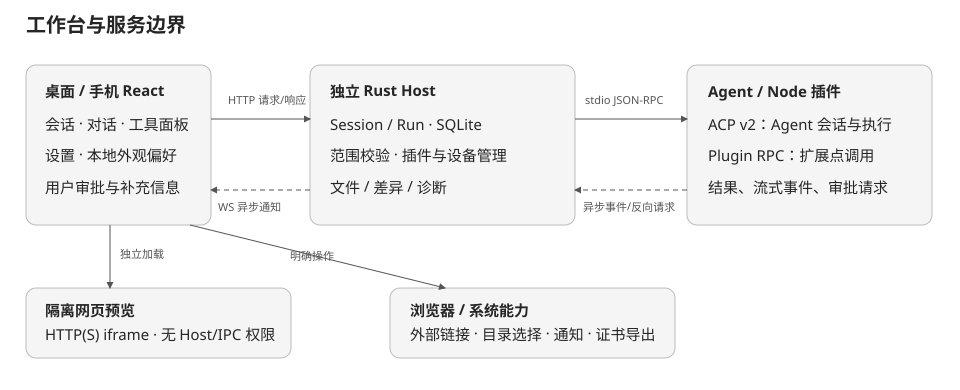

# 三栏工作台与设置中心实施方案

## 目标与边界

将已确认的交互原型重写为正式 React 界面，继续连接现有独立 Host 与 ACP 会话，不将原型演示逻辑合入生产代码。手机保留单列对话与审批，右侧工具在窄屏切换为独立面板。

## 交付顺序

| 阶段 | 工作 | 验证 |
| --- | --- | --- |
| 39 | 会话/对话/右侧工具三栏布局；消息分段；新 Logo | 对话、审批、队列和历史阅读不回归 |
| 40 | 文件、变更、只读执行输出、产物、会话配置与网页侧边预览 | 工作区范围、文件选择、流式与失败状态 |
| 41 | 八分类设置导航，接回 Profile、插件、工作区、设备和诊断 | 修改连接真实 Host，保留原有验证和权限 |
| 42 | 持久外观偏好、头像样式、距离衰减阅读索引 | 亮暗独立、减少动画、定位、浏览器存储不可用回退 |
| 43 | 真实浏览器、手机 HTTPS、打包与原生核对 | 不停止现有 Agent，记录人工待验 |

每阶段独立提交，交付时更新本文、验收清单和本地任务记录。

## 服务调用与界面边界

React 负责布局、主题与阅读状态。工作区、配置、插件和设备写操作仍通过 Host API；WebSocket 推送只触发已有快照恢复链路，不另造会话状态。文件与差异读取继续由 Host 校验路径与设备范围。

终端面板是 Agent 执行记录与 ACP 终端输出的只读投影，不新开交互 Shell。网页采用隔离 iframe，拒绝脚本方案与非 HTTP(S) 地址，不授予桌面 IPC、顶层导航或弹窗能力，不代理抓取网页。无法内嵌、加载失败或超时时保留在外部浏览器打开的入口。

外观与头像属于当前设备的界面偏好，保存在本地浏览器存储，不改变 Agent 权限和 Host 业务状态；设备配对、插件信任及工作区范围继续由 Host 持久校验。头像不作为执行状态指示，状态文字独立显示。

## 设置分类

常规、外观、通知、Agent、工作区、插件、远程连接、数据与诊断。会话专属配置留在右侧会话工具，不当作全局 Profile。入口可用和认证成功分别描述；没有实现的 Skill/MCP 市场或账号订阅功能不加入目录。

## 实施记录

39 已实现三栏容器、消息分段和新 SVG 品牌；工具打开后聊天仍保留。生产构建通过，继续接入工具预览。

40 已接入右侧文件/差异、产物、会话参数、执行记录和只读终端；Markdown 与工具链接进入网页预览，文件链接只在当前工作区内解析。HTTP(S) 地址校验、凭据拒绝、路径越界与编码穿越回归通过。面板支持指针与键盘调整宽度，网页支持刷新和外部打开；不将 iframe load 事件宣称为站点内容正常可用。

41 已接入八分类正式设置。Agent 配置使用真实 Profile API 校验和修订；工作区、通知、插件和设备流程复用原有业务调用。插件列表与详情分离，安装前的候选检查、工作区范围和信任确认保留。手机授权设备隐藏主机管理入口，后端权限校验继续生效。
