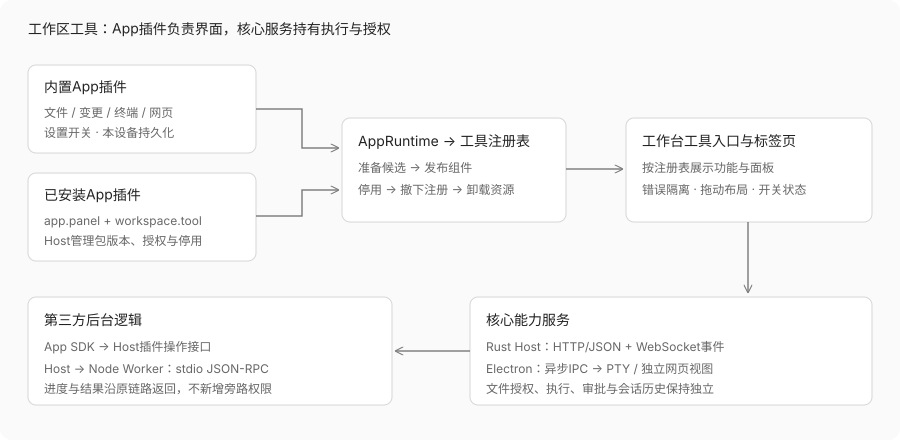

# 独立工作区插件

文件、变更、终端和网页已迁移到[插件仓库](https://github.com/qymlxin/VibeOnePlugin)的 `files`、`changes`、`terminal`、`browser` 四个独立目录。每个目录包含自己的源码、清单及可直接安装的 `dist/app.mjs`；不从桌面源码导入功能实现。桌面更新与插件更新分离。

## 安装、更新和启停

在「设置 → 插件 → 从仓库安装插件」输入仓库及插件目录，下载后显示版本、提交号、权限和可授权的工作目录。确认信任后安装。同一目录再次下载可更新；版本相同但源码变化也会创建新的代次。发布者应同步修改版本号、源码和构建产物。

所有插件统一走 `plugin.json → inspect → prepare → AppRuntime.prepare → commit → AppRuntime.publish`。远程下载只负责取得本地候选目录，之后与第三方本地包采用完全相同的校验、复制、授权和运行路径。安装版本保存在 Host 数据目录，重新打开桌面会重新加载，远程仓库离线不影响已安装版本。

停用通过 Host 的插件生命周期接口撤下注册，React 面板卸载，SDK Scope 关闭属于该插件的终端和网页资源。启用直接准备已经授权的安装副本，无须再次下载；更改配置或权限仍走检查授权。候选准备失败不会替换旧代次。Agent 的执行、审批和历史不会因界面插件停用而丢失。

## 扩展点和服务边界

| 内容 | 所属 |
| --- | --- |
| 标签页、入口、尺寸、错误兜底、React运行时 | 桌面核心 |
| 文件树、代码预览、差异视图、终端界面、网页地址导航 | 独立插件包 |
| 工作区授权、文件/Git读取、产物持久化、插件安装代次 | Rust Host |
| PTY、Chromium网页视图、仓库下载 | Electron主进程 |

面板声明 `app.panel`、`surface: workspace.tool`。第三方入口使用插件ID与贡献ID的命名空间；四个已发布工具ID有固定别名，以兼容正文文件链接、变更摘要和已有标签页。别名只绑定对应包ID，不允许任意贡献覆盖。

`AppPanelProps` 提供 `sessionId`、`workspaceId`、文件定位、可见性和标题/导航回调。SDK不注入内部React功能组件、完整workbench对象或Host token。

- `workbench.snapshot/subscribe`：仅返回授权工作目录中的会话和目录。
- `workbench.request`：允许会话目录、文件、Git差异、变更与产物端点；需要 `workspace.read`，保存产物需要 `artifact.write`。
- `desktop`：`desktop.terminal` 提供授权目录的交互终端；`desktop.browser` 提供网页资源。插件只能操作自己通过SDK创建的资源和事件通道；代次结束统一清理。
- Worker调用沿用原有的 `invokeWorker` 与 Host 权限接口。

这些是可信JS的受支持接口，并非恶意插件沙箱。安装时明确授权。现阶段远程下载入口在Electron桌面，使用Git克隆GitHub仓库；私有仓库可使用本机已有SSH认证，不在界面录入令牌。浏览器/手机仍能加载Host已安装的App面板，但不提供本机PTY/Chromium接口。

## 包与构建

React及SDK由宿主共享；各包将自己的UI、CSS和第三方依赖编译为单一ESM文件，CSS随插件Scope装卸。文件与变更包包含Pierre和代码高亮依赖，因此App资源上限为16MiB，整个安装包仍限制20MiB。无在线CDN或运行时npm安装。

插件仓库执行 `npm ci && npm run build`，仅更新一个包可执行 `node scripts/build.mjs files`。提交构建产物即可由客户端直接下载；不需要重建或重启桌面。新增底层SDK能力时仍需要升级宿主，本次迁移为这种边界升级一次。

## 当前范围

四个工作区工具已独立发布。输入区扩展、消息卡片、主题及协作视图尚未新增公开扩展点。公开市场、签名、跨插件依赖解析和不可信代码隔离不在本次范围。
